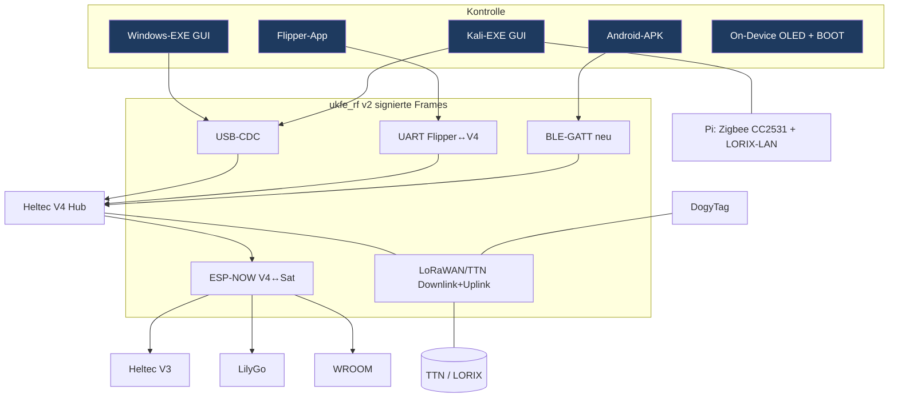

# G4MEOVER — Ökosystem-Masterplan v1 (2026-08-26)

> **Ziel:** Ein nahtloses, geräteübergreifendes Security-/RF-Ökosystem, das alles überragt, was
> in dieser Konstellation je gebaut wurde. Einheitliche Steuerung (Windows-EXE, Kali-EXE, Android-APK,
> Flipper-App, On-Device), volle LoRaWAN-Tiefe + LoRa-Sniffing, DogyTag-Integration, Kartenansicht,
> Live-Szenario-Visualisierung. Jedes Ergebnis wird am Ursprungsgerät **und** zentral angezeigt.
>
> **Dieses Dokument ist die Single Source of Truth + Fortschritts-Tracker.** Jede Session liest zuerst
> den Abschnitt „AUTO-FORTSETZUNG" und arbeitet die nächste offene `[ ]`-TODO ab, hakt sie ab (`[x]`)
> und notiert Ergebnis/Datum. Memory-Pointer: `project_ecosystem_masterplan`.

---

## 0. AUTO-FORTSETZUNG (nach Sitzungslimit zuerst lesen)
1. Diese Datei öffnen → Abschnitt **„FORTSCHRITT / NÄCHSTER SCHRITT"** unten.
2. Handoff `Desktop\_G4MEOVER-HANDOFF-2026-08-20.md` + Memory `MEMORY.md` querlesen (Live-Zustand).
3. Nächste offene TODO nehmen, umsetzen, **verifizieren**, `[x]` setzen + Ergebnis/Datum notieren.
4. Regeln: keine Malware bündeln; Commits nur im User-Namen (kein Co-Autor); B1–B9.sub nie pushen;
   DogyTag-Produktion nur additiv/read-only; Heltec-Native-USB nach esptool-Reset ggf. Replug.
5. Nach jedem abgeschlossenen Meilenstein: Memory + diesen Tracker aktualisieren.

---

## 1. Geräte-Inventar (Stand 2026-08-26, geerdet)
| Gerät | Chip | Wo | Port/ID | Rolle |
|---|---|---|---|---|
| Flipper Zero | STM32WB | PC | COM3 (0483:5740) | Handheld, CC1101/NFC/IR, GPIO-UART→V4, native Apps |
| Heltec **V4**-Hub | ESP32-S3 + SX1262 | **Pi** (SSH) | 303a:1001 (MAC B0:A6:04:C5:73:68) | Hub: UART↔Flipper, ESP-NOW→Sat, LoRaWAN, WiFi/BLE-Executor, OLED |
| Heltec **V3** | ESP32-S3 + SX1262 | PC | COM26 (10C4:EA60, MAC AC:A7:04:06:B1:90) | Satellit: LoRaWAN, WiFi/BLE, HID, RID, OLED |
| ESP32 **WROOM** | ESP32 | PC | COM8 (1A86:55D4) | ESP-NOW-Relay-Koordinator, Multi-Rolle |
| **LilyGo** T-Display | ESP32-S3 | PC | COM13 (303a:1001) | Satellit **mit Display** |
| **DogyTag** | XIAO ESP32-S3 + SX1262 | PC | COM16 (MAC 1C:DB:D4:A7:03:34) | LoRaWAN-Tracker + GPS |
| **CC2531** Zigbee | CC2531 | **Pi** | 0451:16a8 | Zigbee-Sniffer (whsniff/wireshark) |
| Raspberry Pi 4 | — | LAN, lokal notiert | Zugangsdaten lokal, nicht im Repo | Deck/Cockpit-Host, LORIX-LAN, Zigbee, Build/Flash-Host |
| LORIX One GW | SX1301 | LAN, lokal notiert | Zugangsdaten lokal, nicht im Repo | LoRaWAN-Gateway → TTN |
| *später* ESP32-CAM | ESP32 | — | — | Kamera/Streaming |
| *später* RA08 (ASR6601) | ASR6601 | — | — | 433-MHz-LoRa |
| *später* CubeCell HTCC-AB01 | ASR6501 | — | — | 433-MHz-LoRa (LowPower) |

## 2. Ziel-Architektur (Kontroll-Ebenen × Transport-Fabric × Geräte)

**Prinzip:** *Ein* Protokoll (ukfe_rf, signiert) über *fünf* Transporte. Jede Kontroll-Ebene spricht
dasselbe Command-Set. Antworten tragen die **Quell-Geräte-ID** und werden überall angezeigt, wo sie ankommen.

Maschinenlesbares Gegenstück zu diesem Graphen (Knoten/Kanten/Szenario-Presets, erweitert um die
Phase-2b-Direktverbindungen K1–K6, `implemented`/`planned`-Status je Kante): [`ecosystem/topology.json`](ecosystem/topology.json)
— Single Source of Truth für Phase 7 (Szenario-Visualizer), damit dort keine zweite, abweichende
Graph-Kopie entsteht.

## 3. Kern-Bausteine (was neu gebaut/erweitert wird)
- **A) Unified Control GUI** (Python/PySide6, *ein* Codebase → Win-EXE + Kali-EXE via PyInstaller).
- **B) ukfe_rf v2**: BLE-Transport, erweitertes Command-Set, Ergebnis-Routing mit Quell-ID.
- **C) Flipper-App v3**: alle Funktionen + Raw-Modus; Reverse-Kanal „Kali-Tool ausführen"; WiFi/BLE/SubGHz-Umschalt-Befehle (mit/ohne V4).
- **D) Heltec V3/V4 Firmware**: OLED-Multipage + BOOT-Tasten-Bedienung mit Ergebnis-Anzeige.
- **E) LoRaWAN-Ausbau + LoRa-Sniffing** (SX1262 promiscuous; LORIX-Bezug; Flipper/Pi).
- **F) DogyTag-Tab** (Config/Monitor, additiv/read-only) + **Kartenansicht** (alle GPS-Geräte).
- **G) Szenario-Visualizer** (Live-Datenfluss-Diagramm).
- **H) Android-APK** (BLE, Feature-Parität zur GUI).
- **I) WROOM Multi-Rolle**, **J) Zigbee-Integration** (CC2531→Pi→GUI), **K) 433-MHz-Geräte** (später).

---

## 4. ARBEITSPHASEN mit TODO (Reihenfolge = Abhängigkeiten)

### Phase 0 — Fundament & Tooling
- [x] P0.1 Pi-Flash-Workflow ✅ (2026-08-26): esptool v5.3.1 am Pi (`--break-system-packages`); V4=`/dev/ttyACM1` (per MAC, CC2531 auf ttyACM0 übersprungen). Tool `ecosystem/tools/pi_flash_v4.py` (Build am PC → SFTP → esptool write_flash am Pi) — E2E validiert, Hash verifiziert.
- [~] P0.2 Stabiles Geräte-/Port-/MAC-Mapping als JSON (`ecosystem/devices.json`) — Basis für alle Tools.
  - [x] P0.2a Schema festgelegt + [x] P0.2b `ecosystem/devices.json` mit den 12 aus Abschnitt 1
    bekannten Geräten vorbefüllt ✅ (2026-09-05, Cloud, nur nicht-sensible Felder — keine
    Zugangsdaten/LAN-IPs, siehe CONSTRAINTS.md Regel 3).
  - [ ] P0.2c **Lokal:** pro Gerät Port/MAC frisch verifizieren (`esptool.py --port <x> chip_id`,
    Windows-Gerätemanager bzw. `ls /dev/serial/by-id` am Pi), `verified_at` je Eintrag setzen,
    Abweichungen (v. a. `last_known_port`, kann sich nach Neustart/Replug ändern) korrigieren.
    - Konkrete Prüfschritte je aktivem Gerät aus `ecosystem/devices.json` (planned-Geräte
      esp32-cam/ra08/cubecell entfallen, noch nicht vorhanden):
      - `flipper` (pc, VID:PID `0483:5740`): Gerätemanager-COM-Port gegen `last_known_port`
        (`COM3`) abgleichen (kein `esptool` — STM32, kein ESP32).
      - `heltec-v4-hub` (pi, VID:PID `303a:1001`): `ls -l /dev/serial/by-id/` (persistenter
        Pfad, überlebt Replug/Neustart, besser als `ttyACMx`-Zählung) + `esptool.py --port
        <Pfad> read_mac`, Ergebnis gegen `B0:A6:04:C5:73:68` abgleichen.
      - `heltec-v3` (pc, VID:PID `10C4:EA60`): Gerätemanager-COM-Port + `esptool.py --port
        COMxx read_mac` gegen `AC:A7:04:06:B1:90`.
      - `esp32-wroom` (pc, VID:PID `1A86:55D4`): Gerätemanager-COM-Port + `esptool.py --port
        COMxx chip_id`; `devices.json` hat für dieses Gerät noch keine MAC — beim Verifizieren
        per `read_mac` ergänzen.
      - `lilygo-t-display` (pc, VID:PID `303a:1001` — identisch mit `heltec-v4-hub`, aber
        anderer Host/PC, daher keine reale Verwechslungsgefahr über USB): Gerätemanager-COM-Port
        + `esptool.py --port COMxx read_mac` (MAC bisher nicht hinterlegt — ergänzen).
      - `dogytag` (pc, `usb_id` bisher `null`): Gerätemanager-COM-Port, dabei VID:PID nachtragen,
        + `read_mac` gegen `1C:DB:D4:A7:03:34`.
      - `cc2531-zigbee` (pi, VID:PID `0451:16a8`): `lsusb` + Portpfad via `ls
        /dev/serial/by-id/`/`dmesg` — deckt sich mit dem P0.3a-Praxis-Test, kann in einem
        Rutsch mit erledigt werden.
      - `raspberry-pi-4`, `lorix-one-gw` (beide `lan`): kein Port zu verifizieren, nur
        Erreichbarkeit (SSH bzw. Web-UI/SSH) mit den lokal notierten Zugangsdaten prüfen.
      - Nach jedem Gerät `verified_at` (Datum) im jeweiligen `devices.json`-Eintrag setzen;
        `notes`/`usb_id`-Lücken (s. o.) gleich mitfüllen, aber **keine** Zugangsdaten/LAN-IPs
        eintragen (CONSTRAINTS.md Regel 3).
      - Mechanik für den Eintrag, statt Hand-Editieren der JSON (weniger Risiko für
        kaputtes JSON bei 9 Einträgen nacheinander): `jq` je Gerät gegen die Datei laufen
        lassen und zurückschreiben, z. B. für `heltec-v3` nach erfolgreichem `read_mac`:
        `jq '(.devices[] | select(.id=="heltec-v3")) |= (.verified_at="2026-MM-TT" |
        .last_known_port="COMxx")' ecosystem/devices.json > /tmp/devices.json.tmp &&
        mv /tmp/devices.json.tmp ecosystem/devices.json`. Gleiches Muster für `mac`/`usb_id`
        bei `esp32-wroom`/`lilygo-t-display`/`dogytag` (zusätzliches `.mac="AA:BB:.."` bzw.
        `.usb_id="VVVV:PPPP"` im `|=`-Ausdruck). Nach dem letzten Gerät einmal
        `python -c "import json;json.load(open('ecosystem/devices.json'))"` zur
        Syntax-Gegenprobe (wie beim initialen Anlegen), bevor committet wird.
  - [ ] P0.2d **Lokal:** `pi_flash_v4.py`/`flipper_ctl.py` auf `ecosystem/devices.json` als
    Port-Quelle umstellen statt hartkodierter Werte; Regressionstest: bestehender
    Flash-Workflow (P0.1) läuft unverändert.
    - Vorschlag für den Zugriffs-Contract (spart lokale Entwurfszeit, beide Tools nutzen
      dieselbe Helper-Funktion statt eigener Parsing-Logik): `get_device_port(device_id: str,
      devices_path="ecosystem/devices.json") -> str`. Auflösereihenfolge: 1) exakter Treffer im
      `devices`-Array über `id`, 2) daraus `usb_id` gegen aktuell angeschlossene Geräte matchen
      (`esptool.py` liest VID:PID ohnehin beim Verbindungsaufbau), 3) nur falls kein Live-Match
      möglich (Gerät nicht über USB erkennbar, z. B. V4 rein über SSH/ttyACM) Fallback auf
      `last_known_port`. Kein Live-Match und kein `last_known_port` → klarer Fehler mit
      Geräte-`id` in der Meldung, kein stiller Fallback auf einen geratenen Port.
      `verified_at`/`last_known_port` **nicht** von den Tools automatisch aktualisiert (bleibt
      manueller Schritt aus P0.2c) — vermeidet, dass ein einmaliger Fehl-Match sich in die JSON
      zurückschreibt.
      Konkretes Gerüst (nur Ablaufskizze, kein fertiger Code — Fehlerbehandlung/Imports je nach
      Zielsprache der beiden Tools ergänzen):
      ```
      def get_device_port(device_id, devices_path="ecosystem/devices.json"):
          devices = load_json(devices_path)["devices"]
          entry = find(devices, lambda d: d["id"] == device_id)   # Schritt 1: exakter id-Treffer
          if entry is None:
              raise LookupError(f"unknown device id: {device_id}")
          if entry["usb_id"]:
              live = match_connected_usb_devices(entry["usb_id"])  # Schritt 2: esptool/pyserial-Scan
              if live:
                  return live.port
          if entry["last_known_port"]:
              return entry["last_known_port"]                      # Schritt 3: Fallback
          raise LookupError(f"no live match and no last_known_port for {device_id}")
      ```
      `match_connected_usb_devices()` kapselt den ohnehin vorhandenen esptool-/pyserial-
      Enumerationscode aus `pi_flash_v4.py`/`flipper_ctl.py` — beim Übernehmen prüfen, welches
      der beiden Tools das bereits sauberer kapselt, und von dort in eine gemeinsame Helper-Datei
      (z. B. `ecosystem/tools/device_ports.py`) auslagern statt zu duplizieren.
  - Verifikation: `python -c "import json;json.load(open('ecosystem/devices.json'))"` ✅ (Cloud,
    Syntax geprüft) + Soll/Ist-Abgleich gegen Abschnitt-1-Tabelle (lokal, nach Replug, noch offen).
- [ ] P0.3 CC2531-Zigbee-Pipeline am Pi: Sniffer-FW-Status prüfen, `whsniff`/`tshark`-Capture → pcap.
  - [ ] P0.3a **Lokal (Pi-SSH):** `lsusb` gegen erwartete ID `0451:16a8` prüfen, aktuellen
    Firmware-Stand des CC2531 feststellen (Sniffer- vs. Z-Stack-Coordinator-Image).
    - Vor dem eigentlichen Test klären, ob `whsniff` am Pi überhaupt installiert ist
      (`which whsniff || dpkg -l | grep -i whsniff`) — fehlt es ganz, ist das ein eigener,
      vom Firmware-Stand unabhängiger Blocker (Paket/Build nachziehen), kein Grund, direkt auf
      P0.3b (Firmware-Flash) zu schließen.
    - Praxis-Test statt Firmware-Introspektion (erst wenn `whsniff` vorhanden ist):
      `timeout 10 whsniff -c 11 | tshark -i - -c 5` (kurz, unkritisch, `timeout` verhindert ein
      Hängenbleiben der Pipe) versuchen. Drei mögliche Ausgänge: (1) `tshark` zeigt innerhalb
      weniger Sekunden Zeilen mit Protokoll `IEEE 802.15.4` (nicht nur "Malformed Packet"/leer)
      → Sniffer-Image bereits drauf, P0.3b entfällt, direkt zu P0.3c; (2) der Befehl liefert bis
      zum `timeout` gar keine Zeilen oder nur "Malformed Packet" → vermutlich Coordinator-/
      Router-Image drauf → P0.3b; (3) `whsniff` selbst bricht sofort mit einem USB-/
      Berechtigungsfehler ab (z. B. `libusb` "Access denied") → eigener Blocker (udev-Regel/
      Gruppenrechte für den CC2531), ebenfalls unabhängig vom Firmware-Stand, vor P0.3b zu klären.
  - [ ] P0.3b **Lokal:** falls kein Sniffer-Image drauf: mit am Pi verfügbarem Tool (z. B.
    `cc-tool`/SmartRF Flash Programmer) whsniff-kompatibles Firmware-Image flashen.
    - Vorab prüfen, ob am Pi bereits ein CC-Debugger oder ein anderer unterstützter Flash-Weg für
      den CC2531 vorhanden ist (`cc-tool` braucht i. d. R. einen Debugger/Programmer, nicht nur
      die USB-Dongle-Verbindung selbst) — falls nicht vorhanden, ist das der eigentliche Blocker
      dieses Unterschritts, nicht das Firmware-Image selbst.
  - [ ] P0.3c **Lokal:** Testaufnahme `whsniff -c <Kanal> | tshark -i - -w capture.pcap` für
    30–60 s, Kanal aus eigener Zigbee-Umgebung wählen.
    - Kanal-Findung: falls eigener Koordinator/Router bekannt (z. B. Zigbee2MQTT/ZHA-Konfig,
      Router-Admin-UI), dessen konfigurierten Kanal direkt nehmen. Sonst Kurz-Scan vor der
      eigentlichen Aufnahme: die vier überlappungsarmen Kanäle 11/15/20/25 je 5 s antesten
      (`timeout 5 whsniff -c <n> | tshark -i - -c 20 -q -z io,phs`), den mit sichtbaren
      `zbee_nwk`/`ieee802154`-Frames für die 30–60-s-Aufnahme nehmen.
    - `timeout` statt Handabbruch verwenden, damit die Pipe sicher terminiert, z. B.
      `timeout 45 whsniff -c 15 | tshark -i - -w /home/kali/zigbee_test_c15.pcap` (Zieldatei
      **außerhalb** des Repo-Arbeitsverzeichnisses, damit sie nicht versehentlich mitgestaged wird).
  - [ ] P0.3d **Lokal:** pcap in Wireshark/tshark sichten — nur Meta-Ergebnis (Kanal, Paketzahl,
    erkannte Gerätetypen) dokumentieren, **keine** pcap mit echten Fremd-Zigbee-Nutzdaten pushen
    (analog CONSTRAINTS.md Regel 2/3).
    - Rein statistische Sichtung ohne Nutzdaten-Export: `tshark -r capture.pcap -q -z io,phs`
      (Protokoll-Hierarchie/Paketzahlen je Layer) und `tshark -r capture.pcap -Y ieee802154 -T
      fields -e wpan.src16 -e wpan.dst16 -e wpan.frame_type | sort -u` (eindeutige
      Kurzadressen/Frame-Typen als Metadaten — keine Nutzlast). Nur diese Kennzahlen (Kanal,
      Gesamtpaketzahl, Anzahl unterschiedlicher Kurzadressen, gesehene Frame-Typen) landen im
      Arbeits-Log; die `.pcap`-Datei selbst bleibt lokal, wird nicht committet.
  - Verifikation: pcap lokal vorhanden, Wireshark zeigt gültige 802.15.4/Zigbee-Frame-Header.
  - Kein Cloud-Anteil möglich außer dieser Verfeinerung — Pi-SSH und USB-Dongle sind aus der
    Cloud nicht erreichbar.
- [~] P0.4 ukfe_rf-v2-Spec entwerfen (Doku): BLE-Transport-Frame, Ergebnis-Envelope mit Quell-ID, neue Cmds.
  - [x] P0.4a–d Entwurf geliefert ✅ (2026-09-05, Cloud, rein dokumentarisch): siehe
    [`UKFE-RF-V2-SPEC.md`](UKFE-RF-V2-SPEC.md) — v2-Frame mit Source-ID, Ergebnis-Envelope mit
    Origin-ID, BLE-GATT-/MTU-Mapping, neue Commands (`0x60`–`0x70`) gegen `FLEET-COMMANDS.md`
    kollisionsgeprüft.
  - [ ] P0.4e **Lokal:** Entwurf mit Firmware-Owner-Hut gegenlesen — SRC_ID/ORIGIN_ID-Enum final
    festlegen, BLE-GATT-UUIDs final vergeben, Rückwärtskompatibilitäts-Strategie entscheiden
    (siehe Spec Abschnitt 7).
  - [ ] P0.4f **Lokal:** nach Freigabe erster Firmware-Patch (vermutlich `heltec-v4-hub` zuerst)
    gegen Spec umsetzen, kompilieren, flashen, Funktest.
  - Verifikation (Cloud-Teil): Diff gegen `FLEET-COMMANDS.md` zeigt nur Erweiterungen, keine
    Command-Code-Kollision ✅ geprüft.

### Phase 1 — Unified Control GUI (Win + Kali) [Kern]
- [x] P1.1 Projekt-Skelett ✅ (2026-08-26): `ecosystem/g4meover-control/g4meover_control.py` (Tkinter ttk.Notebook — läuft
  Pi+Windows ohne Extra-Deps; Worker-Thread für Serial/CLI). Tabs: Flipper (aktiv) + Heltec/LoRaWAN/DogyTag/Karte/Zigbee/Visualizer (Stubs).
  Desktop-Verknüpfungen: Windows `.lnk` (pythonw) + Kali `.desktop` (beide gesetzt). Deploy Pi `/home/kali/g4meover-control/`.
- [ ] P1.2 Transport-Abstraktion: serielle ukfe_rf-Verbindung (Auto-Port aus Cockpit übernehmen) + Frame-Dekoder.
  - [ ] P1.2a **Lokal:** Transport-Interface definieren (`open()`/`close()`/`send_frame(bytes)`/
    `receive_frame() -> bytes|None`/`is_connected`), erste Implementierung `SerialTransport`
    (pyserial) im bestehenden Kali-Cockpit-Prototyp (`g4meover_control.py`, Tkinter, P1.1).
    Portauflösung **nicht** neu erfinden: denselben `get_device_port()`-Contract aus P0.2d nutzen,
    sobald der dort vorgeschlagene Helper lokal existiert — sonst driften zwei Port-Logiken
    (Cockpit vs. Flash-Tools) auseinander.
  - [ ] P1.2b **Lokal, nicht aus der Cloud lieferbar:** Frame-Encode/-Decode (v1-Header aus
    Abschnitt „Alle Transporte tragen denselben signierten Frame" in `FLEET-COMMANDS.md`) als
    eigenständiges Modul, getrennt von der Transport-Schicht. Grund für „nur lokal": `CRC16`-Polynom
    und der **keyed-MAC**-Algorithmus (`MAC4`) sind nur in der echten Firmware verifizierbar
    (`heltec-v4-hub`, `lora-ukfe`, `heltec-ukfe-rx`, …) — diese Repos liegen außerhalb des
    GitHub-Zugriffs-Scopes dieser Cloud-Sitzung (nur `g4meover-ecosystem`). Ein hier geschriebener
    Codec wäre reine Vermutung statt gegen die reale Quelle verifizierter Bytes — genau das Risiko,
    das die firmware-mining-Routine mit ihren Host-Repros bewusst vermeidet (dort immer gegen
    echten Firmware-Quellcode geprüft). Lokal denselben Ansatz übertragen: Host-Repro (reines
    Python/C, ohne Hardware) gegen die tatsächliche Firmware-Implementierung schreiben, danach erst
    ins Cockpit integrieren.
  - [ ] P1.2c **Lokal:** Auto-Port-Übernahme aus dem bestehenden Kali-Cockpit-Prototyp (WAN-Tab,
    P1.1 bereits ✅) in die neue Transport-Abstraktion überführen statt neu zu entwerfen.
- [ ] P1.3 Tab **Geräte**: Live-Liste (aus devices.json + Probe), Status/Batt/RSSI je Gerät.
  - [ ] P1.3.0 **Lokal, zuerst:** klären, ob `ecosystem/g4meover-control/g4meover_control.py` (P1.1,
    hier als ✅ mit diesem Pfad vermerkt) tatsächlich nur lokal existiert (siehe neuer Blocker
    „Referenzierte Tool-Dateien fehlen im Repo" unten) — falls ja, aktuellen Stand ins Repo
    committen, **bevor** P1.3 draufgesetzt wird, sonst baut dieser Unterschritt auf einer von hier
    aus unsichtbaren Dateistruktur auf. Falls die Datei bewusst lokal-only bleiben soll: das explizit
    hier vermerken (Grund) statt es weiter stillschweigend als Repo-Artefakt zu führen.
  - [ ] P1.3a Datenquelle: `ecosystem/devices.json` laden (Schema aus P0.2a/b bereits vorhanden) +
    Live-Probe je Gerät über denselben `get_device_port()`-Contract aus P0.2d/P1.2a — kein zweiter,
    paralleler Probe-Pfad im GUI-Code.
  - [ ] P1.3b Anzeige: da P1.1 laut Log auf Tkinter/`ttk.Notebook` aufsetzt (kein Qt), passt
    `ttk.Treeview` als Tabelle (Spalten `id`/`host`/`status`/`last_known_port`/`verified_at`);
    Refresh über den in P1.1 bereits vorhandenen Worker-Thread, nicht im UI-Thread pollen.
  - [ ] P1.3c Batt/RSSI **zurückgestellt**: `0x01 Status` steht in `FLEET-COMMANDS.md` weiterhin auf
    📋 (geplant, kein Handler) — ohne Firmware-Response gibt es keine echten Werte zu zeigen. Bis
    P0.4f/Status-Response umgesetzt ist, nur `devices.json`-Felder + ein simples
    erreichbar/nicht-erreichbar aus der Live-Probe anzeigen, keine Platzhalter-Zahlen erfinden.
- [ ] P1.4 Tab **Flipper**: alle Flipper-Funktionen (CLI + App-Katalog) inkl. **Raw-Command**-Feld.
  - [ ] P1.4.0 **Lokal, zuerst:** dieselbe Existenz-/Commit-Frage wie P1.3.0, hier für
    `ecosystem/flipper-ctl/flipper_ctl.py` (P2.0, ebenfalls ✅ mit Pfad vermerkt, ebenfalls nicht im
    Repo auffindbar).
  - [ ] P1.4a Sobald verfügbar: `flipper_ctl.py`s CLI-Funktionen (SubGHz/NFC/RFID/IR/GPIO/
    Storage/Loader/Apps laut P2.0-Beschreibung) als Aufrufe aus dem GUI-Tab verdrahten (Subprocess
    oder Modul-Import — je nachdem, wie `flipper_ctl.py` tatsächlich strukturiert ist, erst nach
    P1.4.0 entscheidbar).
  - [ ] P1.4b Raw-Command-Textfeld: freier String direkt an die Flipper-CLI-Schicht durchreichen,
    Antwort unverändert im Log-Panel (P1.6) anzeigen — kein Parsing/Validierung nötig, ist bewusst
    der Fallback für alles, was der katalogisierte Teil noch nicht abdeckt.
  - [ ] P1.4c App-Katalog als Liste/Menü im Tab, gespeist aus derselben Quelle wie die CLI-Funktionen
    (kein zweiter, separat gepflegter Katalog).
- [ ] P1.5 Tab **Heltec/V4**: voller Command-Katalog + Raw-Frame-Sender; Ergebnis mit Quell-ID.
  - [ ] P1.5a Command-Katalog-Tabelle direkt aus der Befehls-Matrix in `FLEET-COMMANDS.md` ableiten
    (Code/Befehl/Args/Status-Spalte übernehmen) statt einer zweiten, separat gepflegten Liste im
    GUI-Code.
  - [ ] P1.5b Raw-Frame-Sender ist **blockiert auf P1.2b** (Frame-Encode/-Decode, als lokal markiert
    — CRC16/keyed-MAC nur gegen echte Firmware verifizierbar): ohne fertigen Codec kein sicherer
    Raw-Frame-Versand, nicht vorher als Freitext-Bytes ohne CRC/MAC durchreichen (würde von der
    Firmware ohnehin verworfen).
  - [ ] P1.5c Ergebnis-Anzeige mit Quell-ID setzt v2-`SRC_ID`/`ORIGIN_ID` (P0.4f) voraus; bis dahin
    Fallback: Ergebnis ohne Quell-ID anzeigen (wie v1 es implizit über den Transport-Pfad macht),
    Feld erst nachrüsten sobald P0.4f live ist — kein Platzhalter-Wert erfinden.
- [ ] P1.6 Ergebnis-/Log-Panel: jede Antwort zeigt **Herkunftsgerät**, Zeit, dekodierter Inhalt.
  - [ ] P1.6a Ein gemeinsames Log-Widget (nicht pro Tab dupliziert) im bestehenden `g4meover_control.py`
    (P1.1, Tkinter): `ttk.Treeview` mit Spalten `Zeit`/`Quelle`/`Inhalt`, Einträge kommen aus dem in
    P1.1 bereits vorhandenen Worker-Thread über eine Queue (`queue.Queue` + `after()`-Poll im
    UI-Thread) statt direktem Cross-Thread-Widget-Zugriff.
  - [ ] P1.6b **Herkunftsgerät** ohne v2-`SRC_ID` (das kommt erst mit P0.4f): bis dahin denselben
    Fallback wie P1.5c nutzen — die aktive Tab-/Transport-Verbindung (welcher Port/welches Gerät laut
    `devices.json`-`id` gerade verbunden ist) als Quelle eintragen, nicht auf ein Protokollfeld warten.
    Sobald P0.4f live ist, zusätzlich das echte `SRC_ID`/`ORIGIN_ID` aus dem Frame anzeigen (Feld
    ergänzen, Fallback bleibt für v1-Only-Geräte bestehen).
  - [ ] P1.6c **Dekodierter Inhalt** hat zwei Fälle, die unterschiedlich weit sind: Flipper-CLI-Antworten
    (P1.4, reiner Text über die Flipper-CLI-Schicht) können unverändert als Rohtext geloggt werden —
    kein Decoder nötig, das ist schon heute möglich, sobald P1.1/P1.4 committet sind. `ukfe_rf`-Binär-
    frames (Heltec/V4, P1.5) brauchen dagegen den Codec aus P1.2b — bis der lokal gegen die echte
    Firmware verifiziert ist, hier nur die Rohbytes (Hex) loggen statt eine ungeprüfte Dekodierung zu
    zeigen.
- [ ] P1.7 Packaging: PyInstaller → `G4MEOVER-Control.exe` (Win) + Kali-Binary/AppImage; Icons/Branding.
  - [ ] P1.7a **Bewusst zurückgestellt, bis P1.3/P1.4 (Geräte-/Flipper-Tab) tatsächlich funktionieren**
    (nicht nur Stubs wie laut P1.1-Log) — Packaging eines noch bewegten Ziels erzeugt nur wiederholte
    Rebuild-Arbeit ohne Mehrwert; kein Cloud-Anteil, da PyInstaller-Builds nur lokal gegen die echten
    Win-/Kali-Umgebungen sinnvoll sind.
  - [ ] P1.7b PyInstaller-Grundgerüst: `pyinstaller --onefile --windowed g4meover_control.py` sollte für
    reines Tkinter + `pyserial` ohne Sonder-Deps auskommen; bekannter Stolperstein vorab einplanen —
    `pyserial`s Backend-Module (`serial.tools.list_ports_windows`/`_linux`) werden von PyInstaller nicht
    immer automatisch erkannt, ggf. `--hidden-import` je Zielplattform nötig (Windows-Build separat vom
    Kali-Build testen, nicht nur eine Plattform).
  - [ ] P1.7c **Blocker, neu hier vermerkt:** kein Icon-/Branding-Asset existiert bisher im Repo (nur
    die beiden Ökosystem-Karten-Screenshots unter `docs/img/`, kein Logo/`.ico`/`.png`-Icon) —
    `--icon`-Flag von PyInstaller braucht eins. Muss vor P1.7c erst erstellt/beigesteuert werden
    (eigenständiger kleiner Schritt, keine Abhängigkeit von Hardware oder Firmware).

### Phase 2 — Flipper ↔ Ökosystem-Tiefe
- [~] P2.0 **Pi/PC steuert Flipper DIREKT** ✅ Engine (2026-08-26): `ecosystem/flipper-ctl/flipper_ctl.py`
  (VID:PID-Auto-Erkennung, volle CLI SubGHz/NFC/RFID/IR/GPIO/Storage/Loader/Apps) — läuft Pi+Windows,
  am Pi deployt `/home/kali/g4meover-flipper-ctl/`. TODO: GUI-Tab + BLE-Transport (P2.4).
- [ ] P2.1 Flipper-App: Reverse-Kanal „Kali-Tool ausführen" (Flipper→USB/GUI→Pi→Tool→Ergebnis zurück auf Flipper-Display).
  - [ ] P2.1a **Lokal, zuerst:** prüfen ob `g4meover-companion` (laut README „flipperbridge &
    Deck-Tools", eigenes Repo außerhalb des GitHub-Zugriffs-Scopes dieser Cloud-Sitzung — nur
    `g4meover-ecosystem`) bereits einen Reverse-Kanal-Mechanismus enthält, bevor hier neu entworfen
    wird — dasselbe Blocker-Muster wie bei P1.3.0/P1.4.0 (referenzierte Tool-Dateien erst prüfen,
    dann aufbauen).
  - [ ] P2.1b **Lokal:** Transport-Entscheidung — zwei Optionen, keine davon hier vorentscheidbar ohne
    echten Blick in `G4MEOVER-FW` (ebenfalls außerhalb Scope): (a) die bereits von `flipper_ctl.py`
    genutzte CLI-/RPC-Verbindung um einen eigenen, App-seitig ausgelösten Request erweitern (kein
    neuer Transport, nur neue Richtung auf demselben Kanal), oder (b) ein eigener UART-Pin
    (`furi_hal_serial`, LPUART) getrennt von der USB-CLI. (a) ist der risikoärmere Standardpfad
    (kein zusätzliches Kabel/Pin nötig, nutzt den ohnehin vorhandenen Kanal aus P2.0) — als Vorschlag
    hier vermerkt, endgültige Wahl aber lokal gegen die echte RPC-Implementierung von `G4MEOVER-FW`
    zu prüfen.
  - [ ] P2.1c Protokoll-Skizze (unabhängig von P2.1b, gilt für beide Optionen): Flipper-App sendet
    `{tool, args}` → Pi-seitiger Listener (Erweiterung des P2.0-Engines, sobald `flipper_ctl.py`
    committet ist, siehe Blocker unten) führt das Tool aus → Ergebnis als kurzer Text (Displaybreite
    Flipper-OLED, ca. 30 Zeichen/Zeile) zurück über denselben Kanal, längere Ausgaben auf mehrere
    Frames aufteilen statt abschneiden.
  - Verifikation: nur lokal (`fbt`-Build der Flipper-App, Gegenprobe an echter Hardware); über die
    Blocker-Prüfung (P2.1a) und die Transport-Empfehlung (P2.1b) hinaus kein Cloud-Anteil möglich.
- [ ] P2.2 Flipper-App: WiFi/BLE/SubGHz-Umschalt-Befehle — via V4 **und** V4-los (Flipper-nativ, wo möglich).
  - [ ] P2.2a Ist-Stand gegen `FLEET-COMMANDS.md` geprüft: es gibt noch **keinen** expliziten
    Moduswechsel-Befehl, nur je Angriff eigene Commands (`0x20`–`0x2A` WiFi, `0x30`–`0x33` BLE,
    `0x10`–`0x16` LoRa/SubGHz), die den Funkmodus implizit mit auswählen. Offene Entscheidung für die
    lokale Sitzung: ob P2.2 einen zusätzlichen expliziten „Modus X aktivieren"-Befehl braucht (z. B.
    für eine Status-Anzeige am OLED, siehe P3.1) oder ob das implizite Umschalten je Attack-Command
    bereits ausreicht — **nicht** hier vorentscheiden, da es dieselbe Funk-Koexistenz-Frage wie P8.2
    (BLE/WiFi gleichzeitig auf dem V4) berührt.
  - [ ] P2.2b Falls ein expliziter Befehl gebraucht wird: Code-Bereich `0x60`+ aus
    `UKFE-RF-V2-SPEC.md` nutzen (dort bereits für v2-Erweiterungen reserviert), nicht in die laufende
    v1-Matrix (`0x01`–`0x51`) einschieben — vermeidet die in P0.4 bereits geprüfte
    Command-Code-Kollision.
  - [ ] P2.2c „Flipper-nativ, wo möglich" konkretisiert: für Funktionen, die der Flipper ohne V4 selbst
    kann (SubGHz über eigenes CC1101, siehe `FLEET-COMMANDS.md`-Transporttabelle „868-FSK"), den
    nativen Pfad als Default nehmen und den V4-Pfad nur für WiFi/BLE (Flipper hat kein eigenes
    WiFi/BLE-Radio) — kein Doppelpfad für Funktionen pflegen, die der Flipper allein abdeckt.
- [ ] P2.3 Ergebnis-Anzeige am Flipper vereinheitlichen (Quell-ID, scrollbar).
  - [ ] P2.3a Dasselbe Fallback-Muster wie P1.5c/P1.6b in der Unified-GUI übernehmen statt separat zu
    entwerfen: Quell-ID erst echt, sobald `SRC_ID`/`ORIGIN_ID` (P0.4f) live ist; bis dahin nur die
    aktive Verbindung (welches Gerät gerade laut `devices.json` verbunden ist) anzeigen.
  - [ ] P2.3b Scrollbar-Anzeige ist reine Flipper-App-UI-Arbeit (`ViewPort`/Canvas, scrollendes
    Textfeld) — baut auf P2.1c auf (dieselbe Displaybreiten-Aufteilung für lange Ergebnisse), kein
    eigenständiges Layout zweimal entwerfen.
  - Verifikation: nur lokal (Flipper-Display-Ausgabe visuell prüfbar).
- [ ] P2.4 **BLE-Transport zum Flipper**: Pi (BlueZ Central) + Windows steuern den Flipper auch über dessen
  Serial-over-BLE/RPC (radio_mode=Stack ist aktiv) — kabellose Flipper-Steuerung.
  - [ ] P2.4a **Wichtige Abgrenzung, damit keine doppelte Protokoll-Arbeit entsteht:** P2.4 meint
    Flippers eigenes, bereits vorhandenes BLE-RPC (Serial-over-BLE, dieselbe Schnittstelle wie
    qFlipper/die offizielle Mobile-App — Protobuf-Requests über GATT, aktiviert per Settings →
    Bluetooth → `radio_mode=BLE`) — **nicht** das in `UKFE-RF-V2-SPEC.md` Abschnitt 5 entworfene
    neue `ukfe_rf`-v2-BLE-Mapping (eigene Service-UUID `f47ac9c1-…-e600`) für V3/V4/LilyGo/WROOM.
    Zwei getrennte BLE-Protokoll-Familien im selben Ökosystem: `ukfe_rf`-v2-BLE muss erst gebaut
    werden (Firmware-Patch, P8.1), Flippers RPC-über-BLE existiert bereits in der Basis-Firmware
    und muss hier nur als Client (Pi/Windows) angesprochen werden.
  - [ ] P2.4b **Lokal, nicht aus der Cloud lieferbar:** die exakten GATT-Service-/Characteristic-
    UUIDs und das Protobuf-Nachrichtenformat für Flippers RPC-über-BLE stehen nur in der echten
    Firmware-/Client-Quelle (`applications/services/bt`, die Protobuf-Definitionen bzw. die
    offiziellen `flipperzero-protobuf`-Python-Bindings) — dieses Repo hat dazu keinen Zugriff
    (analog P1.2b/P2.1b: nur `g4meover-ecosystem` im Scope dieser Cloud-Sitzung). Hier keine
    UUID/Nachrichtenform raten, sondern lokal gegen die reale Quelle verifizieren, bevor ein
    Client geschrieben wird.
  - [ ] P2.4c Pi-seitiger BLE-Central-Client: `bleak` (async, plattformübergreifend Linux/Windows)
    statt `bluepy` (Linux-only, unmaintained) — direkt wiederverwendbar für K2 (Pi als BLE-Central
    allgemein), dieselbe Scan-/Verbindungs-Logik nicht zweimal bauen.
  - [ ] P2.4d Windows-seitiger Client: `bleak` deckt auch Windows ab (WinRT-Backend) — ein
    gemeinsames Python-Modul für P2.4c/d statt zweier getrennter Implementierungen je Plattform.
  - Verifikation: nur lokal (echte BLE-Verbindung Pi/Windows↔Flipper, RPC-Antwort sichtbar).

### Phase 2b — KONNEKTIVITÄTS-MATRIX (neu, 2026-08-26): alles spricht mit allem
Ziel: jede Kontroll-Ebene erreicht jedes relevante Gerät **direkt**, nicht nur über den V4.
- [ ] K1 **Pi ↔ Flipper**: USB ✅(Engine) + BLE (P2.4).
  - Deckt sich vollständig mit P2.4 (Flippers eigenes RPC-über-BLE) — kein eigener Unterschritt
    nötig, hier nur als Matrix-Zeile geführt.
- [ ] K2 **Pi ↔ BLE allgemein**: Pi als BLE-Central (bluepy/bleak) — scannt/verbindet BLE-Geräte (V4, Flipper, DogyTag).
  - [ ] K2a **Zwei getrennte Protokoll-Ziele hinter dieser einen Zeile**, nicht mit einer
    Implementierung abzudecken: Flipper spricht sein eigenes RPC-über-BLE (siehe P2.4a); V4/V3/
    LilyGo sprechen (sobald P8.1 gebaut ist) das neue `ukfe_rf`-v2-BLE (`UKFE-RF-V2-SPEC.md`
    Abschnitt 5). DogyTag hat laut Geräte-Inventar (Abschnitt 1) **kein** BLE-Transport (nur
    LoRaWAN/GPS) — als Ziel hier vermerkt, aber ohne bestätigten BLE-Chip/-Firmware-Support aktuell
    nicht umsetzbar; vor Weiterarbeit gegen das DogyTag-Datenblatt/-Firmware klären statt anzunehmen.
  - [ ] K2b Gemeinsamer `bleak`-basierter Scan-/Verbindungs-Layer (aus P2.4c/d übernehmen), der beide
    Protokoll-Ziele (Flipper-RPC, `ukfe_rf`-v2-BLE) über dasselbe Discovery/Connect-Modul bedient und
    nur die Nachrichtenschicht (Codec) je nach erkanntem Geräte-Typ (`devices.json`-`id`) umschaltet.
- [ ] K3 **Flipper ↔ BLE**: Flipper-BLE (RPC/Serial-over-BLE) als Ziel für Pi-Central **und** Android.
  - Identisch zu P2.4a/K1 (Flippers eigenes RPC-über-BLE) plus Android als zweiter Client (siehe K4)
    — kein drittes Protokoll, nur ein zweiter Client für dasselbe RPC.
- [ ] K4 **APK ↔ Flipper direkt** (BLE, wie offizielle Flipper-App) — Steuerung + Ergebnis am Handy.
  - Nutzt dasselbe Flipper-RPC-über-BLE wie P2.4/K1/K3, nur mit Android/Flutter als Client statt
    Python/`bleak` — dieselbe Abgrenzung wie P2.4a gilt, kein neues Protokoll für die APK entwerfen.
- [ ] K5 **APK ↔ Pi direkt**: BLE-GATT **und** WiFi/TCP (Pi-Dienst) — APK erreicht den Pi kabellos.
  - [ ] K5a Drittes, eigenständiges Protokoll-Ziel (weder Flipper-RPC noch `ukfe_rf`-v2-BLE): der Pi
    selbst müsste hierfür als BLE-**Peripheral** auftreten (nicht Central wie in K2), z. B. über
    BlueZ' GATT-Server-Rolle — technisch anderer Code-Pfad als K2/P2.4 (Central), nicht
    wiederverwendbar, erst zu entwerfen sobald diese Phase ansteht.
  - [ ] K5b WiFi/TCP-Alternative ist der einfachere erste Schritt (Pi als normaler TCP/HTTP-Server im
    LAN, keine BLE-Peripheral-Rolle nötig) — Vorschlag für die Umsetzungsreihenfolge: zuerst WiFi/TCP,
    BLE-GATT-Peripheral erst danach falls kabellos ohne LAN gebraucht wird.
- [ ] K6 **APK ↔ V4** (BLE, P8.1). ⇒ Ergebnis: Win/Kali/APK/Flipper/On-Device × USB/UART/ESP-NOW/BLE/WiFi/LoRaWAN vollvermascht.
  - Vollständig blockiert auf P8.1 (`ukfe_rf`-v2-BLE-Firmware-Patch auf V4) — kein eigenständiger
    Unterschritt vor P8.1 sinnvoll.

### Phase 3 — Heltec V3/V4: OLED-Multipage + BOOT-Bedienung
- [ ] P3.1 OLED-Seiten-Framework (Blättern): Status · LoRaWAN · ESP-NOW-Peers · Letztes-Cmd/Resultat · GPS · Szenario.
  - [ ] P3.1a **Lokal, nicht aus der Cloud lieferbar:** welche OLED-Zeichenroutinen/-Library
    (`u8g2` o. ä.) `heltec-v4-hub`/`heltec-ukfe-rx` aktuell nutzen, ist nur in deren Firmware-Quelle
    sichtbar (außerhalb des GitHub-Zugriffs-Scopes dieser Cloud-Sitzung, analog P1.2b/P2.1b/P2.4b)
    — hier keine Zeichenroutine entwerfen, ohne sie gegen die echte Basis zu prüfen.
  - [ ] P3.1b Architektur-Vorschlag (protokoll-/hardwareunabhängig, lokal nur noch zu übertragen):
    `enum Page {Status, LoRaWAN, EspNowPeers, LastResult, Gps, Szenario}` plus ein Dispatch-Array
    `render_fn[Page]`, `current_page` als einzige globale Zustandsvariable — BOOT-Taste (P3.2)
    inkrementiert nur `current_page` und ruft `render_fn[current_page]()`; trennt Seitenverwaltung
    von der jeweiligen Datenquelle je Seite.
  - [ ] P3.1c Datenverfügbarkeit ist pro Seite unterschiedlich weit: Status/LoRaWAN/ESP-NOW-Peers
    haben lokal bereits laufende Firmware-Zustände als Datenquelle, **GPS** hängt bereits an echter
    Hardware am V4-Hub; **Letztes-Cmd/Resultat** braucht das Ergebnis-Envelope aus P0.4
    (`ORIGIN_ID`/`RESULT_CODE`, `UKFE-RF-V2-SPEC.md` Abschnitt 4) für eine saubere Quell-Anzeige —
    bis P0.4f live ist, dort nur die rohe letzte Antwort ohne Herkunfts-Feld zeigen (dasselbe
    Fallback-Muster wie P1.5c/P1.6b/P2.3a); **Szenario** hängt an Phase 7 (Visualizer) und bleibt
    bis dahin ein Platzhaltertext „noch nicht verfügbar" statt erfundener Daten.
  - Verifikation: nur lokal (Display-Ausgabe an echter Hardware).
- [ ] P3.2 BOOT-Taste: kurz=Seite blättern, lang=Aktion des aktuellen Kontexts ausführen, doppelt=Menü.
  - [ ] P3.2a **Lokal, nicht aus der Cloud lieferbar:** welche Button-Read-/Debounce-Mechanik
    (`furi_hal_gpio`/Input-Service oder eigene Polling-Schleife) `heltec-v4-hub`/`heltec-ukfe-rx`
    für die BOOT-Taste bereits nutzen, ist nur in deren Firmware-Quelle sichtbar (außerhalb des
    GitHub-Zugriffs-Scopes dieser Cloud-Sitzung, dieselbe Begründung wie P3.1a) — hier keine
    Debounce-/Timing-Routine entwerfen, ohne sie gegen die echte Basis zu prüfen.
  - [ ] P3.2b Architektur-Vorschlag (protokoll-/hardwareunabhängig, lokal nur noch zu übertragen):
    drei Ereignisklassen aus einer einzigen Press/Release-Zeitmessung ableiten statt drei separater
    Handler — kurz (<~400 ms), lang (Halten >~800 ms), doppelt (zwei kurze Presses innerhalb
    <~400 ms Pause); konkrete Schwellwerte lokal gegen Tastergefühl/Prellverhalten der echten Taste
    kalibrieren, hier nur als Ausgangswerte markiert. Mapping auf den P3.1b-Dispatch: kurz →
    `current_page = (current_page + 1) % PageCount`; doppelt → eigener Overlay-Zustand „Menü" (kein
    neuer `Page`-Enum-Wert, da sich das Menü über jede Seite legt statt sie zu ersetzen); lang →
    kontextabhängige Aktion der aktuell sichtbaren Seite (siehe P3.2c).
  - [ ] P3.2c „Aktion des aktuellen Kontexts" (lang) ist pro Seite unterschiedlich weit: für
    **LastResult** ergibt „letzten Befehl erneut senden" den meisten Sinn (Datenquelle bereits
    vorhanden); für **Status** ein manueller Status-Refresh/Broadcast; für
    **LoRaWAN/ESP-NOW-Peers/GPS** ist noch keine sinnvolle On-Device-Aktion (nur Anzeige, kein
    Trigger) definiert — als offene lokale Entscheidung markiert statt hier für jede Seite eine
    Aktion zu erfinden; **Szenario** bleibt analog P3.1c ohne Aktion, solange Phase 7 nicht steht.
  - Verifikation: nur lokal (Taster-Druckdauer/-Doppelklick an echter Hardware, Debounce-Verhalten).
- [ ] P3.3 Ergebnis-Anzeige direkt am Gerät (Resultat der on-device-getriggerten Aktion).
  - [ ] P3.3a Nutzt dieselbe **LastResult**-OLED-Seite aus P3.1a/c — kein zweiter, separat
    gepflegter Anzeige-Pfad für on-device- vs. remote-getriggerte Ergebnisse; einziger Unterschied
    ist die Quelle des Triggers (P3.2c Lang-Press vs. eingehender Frame über
    868-FSK/ESP-NOW/UART/BLE).
  - [ ] P3.3b Herkunfts-Kennzeichnung „selbst ausgelöst" vs. „extern ausgelöst" setzt dasselbe
    `ORIGIN_ID`/`SRC_ID`-Envelope aus P0.4f voraus (Gerät vergleicht `ORIGIN_ID`/`SRC_ID` mit der
    eigenen `devices.json`-`id`); bis P0.4f live ist, dasselbe Fallback-Muster wie
    P1.5c/P1.6b/P2.3a nutzen (Ergebnis ohne Herkunfts-Unterscheidung zeigen, kein erfundenes Feld).
  - Verifikation: nur lokal (Display-Ausgabe nach echtem BOOT-Tasten-Trigger vs. echtem
    Remote-Befehl).
- [ ] P3.4 V4 nach jeder FW-Änderung **per SSH am Pi flashen** (P0.1-Workflow).
  - Reiner Prozessschritt, kein eigener Entwurf nötig: nutzt den bereits validierten
    P0.1-Workflow (`ecosystem/tools/pi_flash_v4.py`, sobald der Blocker „referenzierte
    Tool-Dateien fehlen im Repo" geklärt ist) unverändert für jeden Patch aus P3.1/P3.2/P0.4f.

### Phase 4 — LoRaWAN massiv + LoRa-Sniffing
- [ ] P4.1 LoRaWAN-Tab (Win/Kali): Join/Uplink/Downlink-Queue/Session-Status/Live-Events (TTN-API), Duty-Cycle-Anzeige.
  - [ ] P4.1a Tab-Grundgerüst — **hängt am selben Blocker wie P1.3.0/P1.4.0** (`g4meover_control.py`
    im Repo nicht auffindbar): erst dort klären/committen, dann hier als weiteren `ttk.Notebook`-Tab
    im bestehenden Worker-Thread-Muster (P1.1) anlegen statt eines zweiten GUI-Grundgerüsts.
  - [ ] P4.1b TTN-Zugriff für Join/Uplink/Downlink-Queue/Live-Events: TTN v3 bietet dafür einen MQTT-
    Broker pro Application (`eu1.cloud.thethings.network:8883`, Topics `v3/<app-id>/devices/<dev-id>/
    {up,down/push,down/queued,join}`) sowie eine HTTP-Application-API für einmalige Abfragen
    (Downlink-Queue-Status, Device-Registry) — Live-Events **über MQTT-Subscribe** beziehen (kein
    Polling), HTTP-API nur für Downlink-Einreihen/-Queue-Abfrage nutzen. Zugangsdaten (API-Key,
    Application-ID) analog CONSTRAINTS.md Regel 3 nur lokal, nicht im Repo.
  - [ ] P4.1c Duty-Cycle-Anzeige ist die einzige rein rechnerische Teilaufgabe hier (kein TTN-Zugriff
    nötig): EU868-Airtime pro Uplink aus SF/BW/Payload-Länge per LoRaWAN-Airtime-Formel (Semtech
    AN1200.13) berechnen, laufende Summe über das 1-h-Fenster gegen das jeweils gültige Sub-Band-Limit
    (meist 1 % bei G4MEOVER-typischer EU868-Nutzung, abhängig vom tatsächlich verwendeten Kanal/
    Sub-Band) führen — reine Client-Logik, als eigenständiges, hardwareunabhängiges Modul umsetzbar,
    sobald P4.1a existiert; kann parallel zu P4.1b entstehen statt in Reihe.
  - Verifikation P4.1b/c (Cloud-Teil): Airtime-Formel gegen ein bekanntes SF9/125 kHz-Beispiel aus
    AN1200.13 gegenrechnen (reine Mathematik, kein Live-TTN-Zugriff nötig). P4.1a/echte TTN-Verbindung:
    nur lokal (echte Application-Credentials, echtes Gateway).
- [ ] P4.2 Downlink-Kommandokanal ausbauen (Fleet-Broadcast schon da; Klassen/Ports/Confirmed-Uplink).
  - [ ] P4.2a „Fleet-Broadcast schon da" bezieht sich auf den Log-Eintrag vom 2026-08-26 („WAN-Downlink-
    Kanal + RespAck ✅", „WAN→Flotte ✅") — dieser Stand ist wie die anderen als ✅ geführten Tools
    (P1.1/P2.0/P0.1) im Repo nicht auffindbar (kein Downlink-/Broadcast-Code unter `ecosystem/`,
    `git log --all` liefert nichts). Vor jeder Erweiterung erst wie beim „referenzierte Tool-Dateien
    fehlen"-Blocker klären, ob dieser Code lokal existiert und nachzuliefern ist, statt hier auf einer
    unsichtbaren Basis weiterzubauen.
  - [ ] P4.2b Geräte-Klassen: nur `heltec-v4-hub` ist laut Geräte-Inventar (Abschnitt 1) dauerhaft
    stromversorgt (Pi-Peripherie) und käme für Class C (permanenter Downlink-Empfang, kein
    Empfangsfenster-Timing) infrage; alle batteriebetriebenen Knoten (V3, LilyGo, DogyTag) bleiben
    Class A (Downlink nur im RX1/RX2-Fenster nach eigenem Uplink) — Klasse ist eine
    Netzwerkserver-/Device-Registry-Einstellung in TTN, keine reine Firmware-Frage; vor der Umsetzung
    mit dem tatsächlichen TTN-Device-Profil jedes Geräts abgleichen, nicht neu annehmen.
  - [ ] P4.2c FPort-Zuordnung: aktuell (v1) trägt der Downlink vermutlich den kompletten `ukfe_rf`-Frame
    unverändert als FRMPayload auf einem festen Port — für „Klassen/Ports" hier explizit klären
    (lokal, gegen die echte Netzwerkserver-/Firmware-Konfiguration), ob unterschiedliche Befehlsklassen
    (Fleet-Broadcast vs. gezielter Einzel-Downlink vs. künftige v2-Envelope-Antworten, siehe P0.4)
    eigene FPorts bekommen sollen oder ob ein fester Port + das `CMD`-Byte im Payload selbst zur
    Unterscheidung ausreicht — **nicht** hier vorentscheiden, ohne den bestehenden (aber unsichtbaren,
    siehe P4.2a) Downlink-Code zu kennen.
  - [ ] P4.2d Confirmed-Uplink: das bereits erwähnte „RespAck" (2026-08-26) liefert vermutlich schon
    eine Form von Antwort-Bestätigung: prüfen (lokal, gegen den echten Code aus P4.2a), ob das bereits
    LoRaWAN-Confirmed-Uplinks (MAC-Layer-ACK) nutzt oder nur eine eigene Anwendungsschicht-Bestätigung
    ist — falls Letzteres, für kritische Downlink-Kommandos (z. B. Broadcast-Abort) auf echtes
    Confirmed-Uplink umstellen, um Netzwerkserver-seitige Zustellbestätigung statt nur
    Anwendungs-ACK zu bekommen.
  - Verifikation: nur lokal (echte TTN-Device-Profile, echter Downlink-Test je Klasse/Port).
- [ ] P4.3 LoRa-Sniffer-Modus (SX1262 promiscuous RX) auf V3/V4 → Roh-Frames an GUI; Flipper-Trigger.
  - [ ] P4.3a **Lokal, nicht aus der Cloud lieferbar:** der SX1262 hat keinen echten Hardware-
    „Promiscuous"-Modus wie z. B. ein CC1101 im Raw-RX — ein Sniffer-Modus bedeutet hier
    Dauer-RX mit deaktivierter Adress-/CRC-Filterung auf PHY-Ebene (LoRa-Modem liefert auch Frames mit
    ungültiger CRC oder fremder DevAddr, statt sie zu verwerfen). Ob/wie das bereits genutzte
    Funktreiber-Setup (`heltec-v4-hub`/`lora-ukfe`, siehe P0.4-Begründung: außerhalb des
    GitHub-Zugriffs-Scopes dieser Cloud-Sitzung) diese Filter exponiert (z. B. `SX126x`-Register für
    `CrcMode`/Adressfilter über die genutzte LoRa-Bibliothek), ist nur gegen die echte Firmware-Quelle
    zu klären — hier keine Registerbelegung raten.
  - [ ] P4.3b Sobald P4.3a geklärt ist: Roh-Frame-Weiterleitung an die GUI kann denselben v2-Envelope-
    Transportpfad nutzen, der ohnehin für Ergebnis-Routing entsteht (P0.4/P1.2b) — kein dritter,
    separat gepflegter Übertragungsweg nur für Sniff-Daten.
  - [ ] P4.3c Flipper-Trigger nutzt den in `FLEET-COMMANDS.md` bereits reservierten, aber noch
    unbelegten Code-Bereich `0x10`–`0x16` (LoRa/SubGHz, Status 📋 „geplant, kein Handler") — Sniffer-
    Start/-Stop als zwei der dort vorgesehenen Befehle einordnen statt neue Codes zu vergeben; welche
    der sechs Codes im Detail (Scan/Tx/Jammer/RollForge laut Notiz-Spalte) für Sniff-Start/-Stop
    passen, lokal gegen die echte `FLEET-COMMANDS.md`-Historie/Firmware klären.
  - Verifikation: nur lokal (echte SX1262-Hardware, sichtbare Fremd-LoRa-Pakete im RX-Log).
- [ ] P4.4 LORIX-Bezug: Gateway-Status/Traffic aus LORIX/TTN, optional Raw-Packet-Forwarder-Log am Pi.
  - [ ] P4.4a Gateway-Status/Traffic-Quelle: TTN selbst liefert pro Gateway bereits Live-/Health-Daten
    über dieselbe MQTT-Verbindung wie P4.1b (Topic `v3/<app-id>/…` ist Application-, nicht
    Gateway-scope — für Gateway-Metriken stattdessen die TTN-Gateway-API/Console bzw. das
    LORIX-eigene Web-UI nötig). Zwei unabhängige Quellen, nicht eine: (1) TTN-Sicht (Uplinks
    beim Gateway angekommen, RSSI/SNR je Uplink — bereits Teil der P4.1b-Uplink-Metadaten, kein
    zusätzlicher Kanal nötig), (2) LORIX-eigene Sicht (Gateway-Auslastung, Paketforwarder-Status,
    unabhängig davon ob TTN gerade erreichbar ist) — nur lokal gegen die echte LORIX-Firmware-
    Version zu klären, ob sie eine JSON-/SNMP-Statusabfrage anbietet oder nur die Web-UI.
  - [ ] P4.4b Optionales Raw-Packet-Forwarder-Log: nur falls P4.4a (2) keine strukturierte Abfrage
    hergibt, ersatzweise `journalctl`/Log-Datei des Packet-Forwarder-Diensts per Pi-SSH tailen
    (`tail -f`/`journalctl -u <dienst> -f`) und roh im GUI-Log-Panel (P1.6) anzeigen — bewusst als
    Fallback zuletzt, nicht als erster Ansatz, da unstrukturiert.
  - Verifikation: nur lokal (echtes LORIX-Web-UI/CLI, echte TTN-Console).
- [ ] P4.5 LoRa-Sniffing: Standort-Entscheidung Flipper (nur mit SX126x-Modul) vs. Pi (SX1262-HAT
  o. LORIX-UDP) — **kein eigenständiges Feature, sondern dieselbe P4.3-Sniff-Funktion an einem
  anderen Standort.** P4.3 setzt bereits „auf V3/V4" voraus (beide ESP32-S3+SX1262, siehe
  Geräte-Inventar); P4.5 fragt zusätzlich, ob derselbe Dauer-RX-Ansatz aus P4.3a auch über ein
  am Flipper angeschlossenes SX126x-Modul (falls vorhanden — nicht im aktuellen Geräte-Inventar
  gelistet, erst lokal prüfen ob eines existiert) oder über die LORIX-eigene UDP-Paketforwarder-
  Schnittstelle (Semtech-UDP-Protokoll, würde am Pi ankommen, kein SX1262-HAT nötig) sinnvoller
  ist als eine dritte Hardware-Variante. Erst nach P4.3a (Register-/Filter-Klärung) entscheidbar,
  keine eigene Vorarbeit nötig — als reine Standort-Entscheidung im PREP-Abschnitt vermerkt statt
  hier eigene Unterschritte zu erfinden.

### Phase 5 — DogyTag-Integration
- [ ] P5.1 DogyTag-Tab: Live-Position/Batt/State via TTN-Uplinks (App dogytag-v1) — read-only.
  - [ ] P5.1a Ingestion-Pfad: denselben MQTT-Subscribe-Ansatz wie P4.1b wiederverwenden (eigene
    TTN-v3-Application `dogytag-v1` statt der Ökosystem-App, sonst identisches Topic-Schema
    `v3/dogytag-v1/devices/<dev-id>/up`) — kein zweiter Ingestion-Mechanismus nur für DogyTag.
  - [ ] P5.1b Uplink-Payload-Decoder (Position/Batt/State aus den rohen FRMPayload-Bytes): **lokal,
    nicht aus der Cloud lieferbar** — Payload-Format ist entweder in der DogyTag-Firmware selbst
    oder in der TTN-Payload-Formatter-Konfiguration der App `dogytag-v1` festgelegt, beides
    außerhalb des Cloud-Zugriffs-Scopes (analog P1.2b/P2.1b/P4.3a); ohne den echten Uplink-Payload
    zu raten wäre unverifizierte Annahme, kein prüfbares Artefakt.
  - [ ] P5.1c Tab-Grundgerüst hängt am selben Blocker wie P1.3.0/P4.1a (`g4meover_control.py`
    im Repo nicht auffindbar) — erst dort klären/committen, dann hier als weiteren Tab anlegen,
    kein zweites GUI-Grundgerüst.
  - Verifikation: P5.1a (Cloud-Teil) — MQTT-Topic-Schema ist bereits durch P4.1b belegt, keine
    weitere Prüfung nötig; P5.1b/c nur lokal (echte App-Credentials, echter Uplink).
- [ ] P5.2 Konfig-Downlinks (Intervall/Modus) — additiv, Produktion nicht umkonfigurieren.
  - [ ] P5.2a Baut auf P4.2 (Downlink-Kommandokanal) auf, sobald dessen P4.2a-Blocker (Fleet-
    Broadcast-Code im Repo nicht auffindbar) geklärt ist — kein eigener Downlink-Pfad nur für
    DogyTag.
  - [ ] P5.2b **CONSTRAINTS-Grenze konkretisiert:** „Produktion nicht umkonfigurieren" heißt hier
    praktisch — kein Downlink-Test gegen das echte, im Feld laufende DogyTag-Gerät, solange kein
    zweites (Test-)Gerät oder ein Simulator-/Staging-Device auf derselben TTN-Application zur
    Verfügung steht. Vor der ersten echten Downlink-Sendung lokal klären, ob ein solches
    Test-Gerät existiert; falls nicht, Konfig-Downlinks nur gegen simulierte/aufgezeichnete
    Uplinks entwerfen, nicht live gegen das Produktivgerät verifizieren.
  - Verifikation: nur lokal, und nur gegen ein Test-/Staging-Gerät (siehe P5.2b) — niemals gegen
    das produktive DogyTag-Feldgerät.
- [ ] P5.3 MQTT-Bezug (mosquitto 192.168.0.80) additiv auf `dogytag/#`.
  - [ ] P5.3a Rein additiv heißt hier: **nur `SUBSCRIBE` auf `dogytag/#`, kein `PUBLISH`** —
    reiner Lesezugriff auf denselben Broker, auf dem ggf. bereits andere Dienste laufen, um deren
    Zustand nicht zu beeinflussen. `192.168.0.80` ist eine LAN-Adresse und aus der Cloud nicht
    erreichbar (analog Pi-SSH/LORIX) — nur lokal zu implementieren/testen.
  - Verifikation: nur lokal (`mosquitto_sub -h 192.168.0.80 -t 'dogytag/#' -v` als erster
    Praxis-Test, bevor ein GUI-Client entsteht).

### Phase 6 — Kartenansicht
- [ ] P6.1 Karten-Tab (Leaflet in QWebEngine, offline-Tiles optional): alle GPS-Geräte live (Dogy, Wardrive-GPS, …).
  - [ ] P6.1a **Offene Toolkit-Spannung, hier aufgedeckt statt stillschweigend übernommen:** P1.1 hat
    den tatsächlich gebauten Kali-Cockpit-Prototyp bereits auf Tkinter/`ttk.Notebook` festgelegt
    (`g4meover_control.py`, siehe Abschnitt 4 P1.1-Log), nicht auf PySide6/Qt — die
    „GUI-Framework: PySide6 vs. Web"-Entscheidung in Abschnitt 6 galt bislang als weiterhin offen,
    ist für den Cockpit-Unterbau aber faktisch schon zugunsten Tkinter gefallen. P6.1 setzt jedoch
    „Leaflet in QWebEngine" voraus (Qt WebEngine, Teil von PySide6) — Tkinter hat kein eingebautes
    Web-Rendering-Widget, dieser Widerspruch war bisher nicht vermerkt. Optionen für die lokale
    Entscheidung (hier bewusst nicht vorentschieden): (a) `tkintermapview` (reines
    Tkinter-Widget, OSM-Tiles, ohne Qt-Abhängigkeit, aber geringerer Funktionsumfang als
    Leaflet/QWebEngine), (b) `pywebview` als eingebettetes Fenster (reines Python, kein volles Qt),
    (c) Karten-Tab als eigenständiges PySide6-Fenster neben dem bestehenden Tkinter-Hauptfenster
    (zwei GUI-Toolkits parallel im selben Prozess), (d) den bisher aufgeschobenen Wechsel des
    gesamten Cockpits auf PySide6 jetzt vorziehen. Vor jeder weiteren P6.1-Umsetzung erst
    entscheiden, sonst entsteht doppelte GUI-Arbeit (ein Tab in fremdem Toolkit).
  - [ ] P6.1b Datenquellen laut Geräte-Inventar (Abschnitt 1): **DogyTag** (LoRaWAN+GPS) über
    denselben MQTT-Subscribe-Pfad wie P5.1a (TTN-Application `dogytag-v1`) — der
    Payload-Decoder-Blocker aus P5.1b (lokal, nicht aus der Cloud lieferbar) gilt hier identisch,
    kein zweiter Decoder nötig. **V4-Hub-GNSS** (eingebaut + sekundäres GPS laut
    `V4-MASTERPLAN.md`) hat in `FLEET-COMMANDS.md` bereits einen reservierten Code-Bereich
    (`0x40`–`0x41 GPS`, Status 📋 „geplant", noch kein Handler) — Kartenanbindung ans V4-Hub-GPS ist
    damit auf die Umsetzung dieses Commands blockiert, nicht neu zu entwerfen. „Wardrive-GPS" (aus
    der ursprünglichen P6.1-Zeile) ist kein eigenständiges Gerät, sondern GPS-Tagging des
    Wardrive-Angriffs (`0x26`, an V3 ohne eigenes GPS gebunden laut `FLEET-COMMANDS.md`) — auf dem
    V4-Hub-GPS-Pfad mitgeführt, kein dritter Datenkanal.
  - Verifikation: nur lokal (echte GPS-Fixes von DogyTag/V4-Hub, Karten-Rendering visuell prüfbar);
    P6.1a ist eine reine Architekturentscheidung, ohne Hardware treffbar.
- [ ] P6.2 Marker mit Geräte-ID, Track-Historie, Klick→Detail/Command.
  - [ ] P6.2a Blockiert auf P6.1a (Toolkit-Entscheidung) — Marker-/Klick-Interaktion ist pro
    Kandidat unterschiedlich zu implementieren (`tkintermapview`-Callback vs.
    Leaflet-JS↔Python-Brücke via QWebChannel vs. natives PySide6-Fenster), kein
    toolkit-unabhängiger Entwurf möglich.
  - [ ] P6.2b Track-Historie braucht eine noch offene Persistenz-Entscheidung: reiner
    In-Memory-Puffer pro Cockpit-Sitzung (einfach, geht bei Neustart verloren) vs. lokale
    SQLite-/CSV-Ablage (überlebt Neustart, zusätzlicher Schreibpfad) — hier nicht vorentschieden,
    da sie von der erwarteten Sitzungsdauer/Nutzung abhängt, die nur lokal einzuschätzen ist.
  - Verifikation: nur lokal, nach P6.1.

### Phase 7 — Szenario-Visualizer
- [ ] P7.1 Live-Datenfluss-Diagramm: Geräte=Knoten, Cmd/Data/Resp=animierte Kanten, pro Szenario einfärbbar.
  - [x] P7.1a Knoten/Kanten-Topologie aus dem bisher nur in Abschnitt 2 als Mermaid-Prosa geführten
    Graphen extrahiert und um die Phase-2b-Direktverbindungen (K1–K6) erweitert ✅ (2026-09-26,
    Cloud, rein dokumentarisch): [`ecosystem/topology.json`](ecosystem/topology.json) — 13 Knoten
    (3 Kontroll-Ebenen, 9 Geräte aus `devices.json`, TTN extern), 19 Kanten mit
    `implemented`/`planned`-Status und Verweis auf die jeweils bauende TODO-Kennung, 4 Szenario-
    Presets für P7.2. Bewusst **keine** zweite, im Visualizer-Code neu gepflegte Graph-Kopie — die
    künftige lokale Implementierung liest diese Datei statt den Graphen erneut zu entwerfen.
  - [ ] P7.1b **Lokal, gebunden an dieselbe offene Entscheidung wie P6.1a:** Rendering braucht ein
    Web-fähiges Widget (D3-Kanten-Animation, siehe Abschnitt 6 „Vorschlag: Web/D3 in QWebEngine"),
    der Cockpit-Prototyp (P1.1) läuft aber auf Tkinter — **nicht** separat von P6.1a entscheiden,
    sondern beide Fragen zusammen: fällt die Wahl auf `pywebview`/QWebEngine/PySide6-Wechsel, teilen
    sich Karte (P6) und Visualizer (P7) denselben Web-Container statt zwei eigene Fenster/Engines zu
    laden.
  - [ ] P7.1c Datenquelle für die animierten Kanten: **kein** zweiter Event-Pfad neben dem in P1.6a
    bereits vorgesehenen Log-Queue-Mechanismus (`queue.Queue` aus dem Worker-Thread, `after()`-Poll
    im UI-Thread) — der Visualizer abonniert dieselbe Queue und mappt jeden Eintrag (Zeit/Quelle/
    Inhalt) über `topology.json`-Kanten statt eigene Serial-Reads zu machen. Färbung nach realer
    Quelle/Ziel braucht `SRC_ID`/`ORIGIN_ID` aus P0.4f; bis dahin dasselbe Fallback-Muster wie
    P1.5c/P1.6b/P2.3a: nur die aktive Verbindung farblich hervorheben, kein erfundenes Routing.
  - Verifikation (Cloud-Teil): `python -c "import json;json.load(open('ecosystem/topology.json'))"`
    ✅ + Konsistenzprüfung Knoten-IDs gegen `devices.json` und Presets gegen `edges` ✅ (Cloud,
    2026-09-26). Rendering/Animation nur lokal prüfbar (P7.1b/c).
- [ ] P7.2 Szenario-Presets (z. B. „Flipper→V4→ESP-NOW→V3→TTN"), Highlight des aktiven Pfads bei jedem Command.
  - [x] P7.2a Presets als Daten statt Code angelegt ✅ (2026-09-26, Cloud): `presets[]` in
    `ecosystem/topology.json` (das Beispiel aus dieser TODO-Zeile plus drei weitere, an bereits
    dokumentierten Abläufen orientiert: `kali-direct-flipper` = P2.0-USB-CLI ohne V4,
    `apk-ble-to-fleet` = P8.1/K6, `dogytag-lorawan-uplink` = Phase 5). Jeder Preset-Pfad ist gegen
    `edges[]` konsistenzgeprüft (jedes aufeinanderfolgende Knotenpaar entspricht einer echten Kante).
  - [ ] P7.2b Highlight-Mechanismus baut auf P7.1c auf (derselbe Log-Queue-Abgleich gegen
    `topology.json`-Kanten) — kein eigenständiges zweites Matching für Presets entwerfen: ein
    aktiver Preset filtert einfach, welche der ohnehin ankommenden Kanten-Events farblich betont
    werden, alle anderen bleiben sichtbar aber gedimmt.
  - Verifikation (Cloud-Teil): wie P7.1, Presets-Konsistenzprüfung ✅. Highlight-Verhalten nur lokal
    an echter GUI prüfbar.

### Phase 8 — Android-APK (BLE)
- [ ] P8.1 Firmware: BLE-GATT-Transport für ukfe_rf am V4 (NimBLE) — Frames über Characteristic.
  - [ ] P8.1a Baut direkt auf P0.4e/f auf: nutzt dieselben, dort bereits vorgeschlagenen
    GATT-Service-/Characteristic-UUIDs (`UKFE-RF-V2-SPEC.md` Abschnitt 5) — hier keine zweiten
    UUIDs entwerfen. Empfohlene Reihenfolge (verknüpft mit der P0.4f-Patch-Empfehlung): erst der
    kleine `SRC_ID`/Versionsbyte-Patch, danach als eigener zweiter Patch dieser BLE-Transport —
    nicht beides in einem Schritt, damit ein Fehlschlag klar zuordenbar bleibt.
  - [ ] P8.1b **Lokal, nicht aus der Cloud lieferbar:** NimBLE-Stack-Konfiguration, ATT-MTU-
    Aushandlung und die Frage, ob `ukfe_rf`-Frames (Größe laut `FLEET-COMMANDS.md`-Header) in ein
    einzelnes ATT-Write passen oder Fragmentierung (Sequenznummer + Reassemblierung über mehrere
    Writes) brauchen, sind nur gegen die echte `heltec-v4-hub`-Firmware zu klären — dieselbe
    Begründung wie P1.2b/P2.1b/P2.4b/P3.1a/P3.2a (Firmware-Repos außerhalb des GitHub-Zugriffs-
    Scopes dieser Cloud-Sitzung). Erster Versuch lokal: NimBLE unterstützt ATT-MTU bis 247 Byte
    aushandeln — reicht das für die größten `ukfe_rf`-Frames, entfällt Fragmentierung; nur falls
    nicht, das Reassemblierungsschema entwerfen.
  - [ ] P8.1c **Abgrenzung nicht vergessen** (dieselbe Unterscheidung wie P2.4a/K1-K6): dies ist ein
    komplett neuer, eigener GATT-Service für `ukfe_rf`-v2 — **nicht** Flippers bereits vorhandenes
    RPC-über-BLE. K6 (APK↔V4) bleibt vollständig auf diesen Unterschritt blockiert, wie in Phase 2b
    bereits vermerkt.
  - Verifikation: nur lokal (NimBLE-Verbindung an echter V4-Hardware, Frame-Roundtrip über die
    Characteristic sichtbar/mitschneidbar, z. B. per nRF Connect).
- [ ] P8.2 BLE/WiFi-Koexistenz-Strategie (ESP32 kann nicht immer gleichzeitig) → Umschalt-Befehl.
  - [ ] P8.2a Technischer Ausgangspunkt (kein Rätselraten nötig): der ESP32-S3 hat nur **einen**
    2,4-GHz-Funk — BLE und WiFi teilen ihn sich per Zeitmultiplex über ESP-IDFs eingebaute
    Software-Koexistenz (`CONFIG_SW_COEXIST_ENABLE`, greift automatisch sobald beide Stacks aktiv
    sind). Ein harter Umschalt-Befehl ist damit **nicht zwingend** nötig, nur ein Durchsatz-/
    Latenz-Kompromiss bei echtem Gleichzeitigbetrieb (z. B. WiFi-Deauth-Flood parallel zu einem
    aktiven BLE-GATT-Link aus P8.1).
  - [ ] P8.2b Ob trotzdem ein expliziter Umschalt-Befehl gebraucht wird, ist **nur mit echten
    Messwerten** an der Hardware zu entscheiden (Deauth-Paketrate/BLE-Latenz mit vs. ohne aktivem
    Koexistenzbetrieb) — hier bewusst nicht vorentschieden. Dieselbe offene Frage ist bereits unter
    P2.2a verlinkt; beide zusammen entscheiden, nicht zwei getrennte Umschalt-Konzepte entwerfen.
    Falls ein Befehl gebraucht wird: denselben reservierten Codebereich `0x60`+ nutzen wie in P2.2b
    vorgeschlagen.
  - [ ] P8.2c **Lokal, nicht aus der Cloud lieferbar:** die eigentliche Messung braucht reale
    Hardware (V4 mit gleichzeitig aktivem `ukfe_rf`-v2-BLE-Link und laufendem WiFi-Angriff) — keine
    Simulation möglich, blockiert zusätzlich auf P8.1 (BLE-Transport muss existieren, bevor
    gleichzeitiger Betrieb überhaupt messbar ist).
  - Verifikation: nur lokal (Messreihe an echter Hardware, siehe P8.2c).
- [ ] P8.3 APK (Flutter o. Kotlin): Feature-Parität zur GUI über BLE; Ergebnis-Anzeige mit Quell-ID.
  - [ ] P8.3a Wie in K4/K6 bereits festgehalten, braucht die APK **zwei getrennte** BLE-Protokoll-
    Clients, kein drittes Protokoll zu entwerfen: Flippers eigenes RPC-über-BLE (identisch zu
    P2.4a/K1/K3/K4) für den Flipper, und `ukfe_rf`-v2-BLE (P8.1, blockiert bis dahin) für V4/V3/
    LilyGo/WROOM — beide auf Android als das portieren, was auf Pi/Windows bereits mit `bleak`
    gebaut wird (P2.4c/d), nicht zwei neue Implementierungen erfinden.
  - [ ] P8.3b Framework-Entscheidung (Flutter vs. Kotlin-nativ, Abschnitt 6, weiterhin offen) prägt
    nur die BLE-Bibliothek, nicht das Protokoll: Flutter (`flutter_blue_plus` o. ä.) deckt beide
    GATT-Verbindungen aus einem Codepfad ab (analog `bleak` auf Desktop-Seite); Kotlin-nativ nutzt
    Androids `BluetoothGatt`-API direkt. Sinnvoll erst entscheidbar, sobald P8.1b (Frame-/
    Fragmentierungsformat) lokal geklärt ist, sonst wird gegen ein unbekanntes Protokoll geplant.
  - [ ] P8.3c Quell-ID-Anzeige: dasselbe bereits etablierte Fallback-Muster wie P1.5c/P1.6b/P2.3a/
    P3.1c/P3.3a/P7.1c (echtes `SRC_ID`/`ORIGIN_ID` erst mit P0.4f, bis dahin nur die aktive
    Verbindung/das verbundene Gerät laut `devices.json`-`id` anzeigen) — keine dritte Variante
    entwerfen.
  - Verifikation: nur lokal (echte APK auf Android-Gerät gegen echte BLE-Hardware getestet).

### Phase 9 — WROOM Multi-Rolle
- [ ] P9.1 WROOM-Rollen je Szenario: ESP-NOW-Relay · WiFi-Attack · BLE · Standalone — umschaltbar per Command.
  - [ ] P9.1a **Ist-Stand-Abgleich zuerst, echter Doku-Fund dabei:** `FLEET-COMMANDS.md` führt
    `g4meover-wifi-relay` (WROOM-Relay) in der Geräte-Fähigkeiten-Tabelle bisher nur mit
    ESP-NOW ✅ (Koordinator), WiFi-Angriff/BLE stehen dort auf „–"; die Befehls-Matrix selbst hat
    für WROOM gar keine eigene Spalte (nur Heltec V3/LilyGo). `ecosystem/devices.json` führt für
    `esp32-wroom` dagegen bereits `transport: [espnow, wifi, ble]` und `role: "ESP-NOW-Relay-
    Koordinator, Multi-Rolle"`. Kein Widerspruch, nur unterschiedlicher Stand: die Hardware kann es,
    das Umschalt-Command (P9.1b) existiert nur noch nicht — `FLEET-COMMANDS.md` bekommt eine
    WROOM-Spalte + die neuen Rollen-Codes erst, wenn P9.1b tatsächlich gebaut ist, nicht vorher
    (sonst 📋-Einträge ohne Gegenstück).
  - [ ] P9.1b Rollen-Umschalt-Befehl: denselben `0x60`–`0x7F`-v2-Block aus `UKFE-RF-V2-SPEC.md`
    Abschnitt 6 weiterverwenden (dort bereits `0x60`/`0x61`/`0x70` belegt) statt einen neuen Bereich
    zu öffnen — Vorschlag `0x62 RoleSet` mit 1-Byte-Rollen-Enum
    (`0=Standalone,1=ESP-NOW-Relay,2=WiFi-Attack,3=BLE`), analog zum bereits für P2.2b vorgeschlagenen
    Muster. Enum-Werte sind hier nur ein Vorschlag, keine Festlegung — vor dem ersten Firmware-Patch
    lokal gegen `g4meover-wifi-relay` bestätigen, wie schon bei P0.4e/f für SRC_ID/ORIGIN_ID.
  - [ ] P9.1c Koexistenz-Frage vor der Umsetzung klären, nicht neu erfinden: der WROOM ist (wie beim
    ESP32-S3 in P8.2 bereits festgehalten) ein Single-Radio-Chip — ESP-NOW-Koordinator-Rolle und
    WiFi-Attack-Rolle können nicht gleichzeitig aktiv sein, ein Rollenwechsel muss die vorherige
    Rolle sauber beenden (`WifiStop`/ESP-NOW-Deinit) bevor die nächste startet. Ob die WiFi-Attack-
    Rolle die bestehenden `0x20`–`0x2A`-Befehle (bereits 🔨 für Heltec/LilyGo) wiederverwendet oder
    einen eigenen Codepfad braucht, nur lokal gegen den echten `g4meover-wifi-relay`-Quellcode zu
    entscheiden (außerhalb des Cloud-Zugriffs-Scopes, dieselbe Begründung wie P1.2b/P2.1b/P2.4b).
- [ ] P9.2 In GUI/Flipper als eigenes Ziel mit Rollen-Auswahl.
  - [ ] P9.2a Blockiert auf denselben Tool-Existenz-Blocker wie P1.3.0/P1.4.0
    (`g4meover_control.py`/`flipper_ctl.py` im Repo nicht auffindbar, siehe Risiken/Blocker) — erst
    klären, dann WROOM als weiteres Ziel/Tab mit Rollen-Dropdown ergänzen, keine dritte
    Tab-Architektur entwerfen.
  - [ ] P9.2b Ergebnis-/Rollen-Status-Anzeige nutzt dasselbe Quell-ID-Fallback-Muster wie
    P1.5c/P1.6b/P2.3a/P3.3a (aktive Verbindung statt Protokollfeld, bis P0.4f live ist).

### Phase 10 — Zigbee-Integration
- [ ] P10.1 CC2531 am Pi: Sniffer-Betrieb (whsniff→wireshark/tshark) → pcap; Live-Feed an GUI-Tab.
  - [ ] P10.1a Baut direkt auf P0.3 auf (dort bereits vollständig verfeinert: `whsniff`-Praxistest,
    Kanal-Scan, `timeout`-Aufnahmebefehl, Metadaten-Sichtung per `tshark`) — P10.1 fügt nur zwei
    neue Dinge hinzu, die P0.3 noch nicht abdeckt: (1) Dauerbetrieb statt 30–60-s-Testaufnahme,
    (2) Live-Feed statt Offline-pcap-Sichtung. Kein zweiter Sniffer-Pfad, derselbe
    `whsniff`|`tshark`-Befehl, nur anders parametrisiert — P0.3a-d zuerst erledigen, bevor hier
    weitergebaut wird.
  - [ ] P10.1b Dauerbetrieb: `whsniff -c <Kanal> | tshark -i - -l -T fields -e wpan.frame_type
    -e wpan.src16 -e wpan.dst16 -e frame.time_relative` (`-l` = line-buffered, sonst puffert
    `tshark` die Ausgabe und der Live-Feed hinkt nach) als langlebiger Hintergrundprozess bzw.
    systemd-Service am Pi statt eines manuellen Einzelbefehls wie in P0.3c. Gegen CONSTRAINTS
    Regel 2/3 (keine fremden Nutzdaten dauerhaft speichern/pushen): nur Metadaten/Zähler
    persistent halten (Kanal, Paketzahl, gesehene Kurzadressen/Frame-Typen — dieselben Felder wie
    schon in P0.3d), Rohpakete/`.pcap` nur in einem begrenzten lokalen Ringpuffer, nicht endlos
    wachsend und nicht im Repo.
  - [ ] P10.1c Live-Feed an GUI: kein neuer Transportmechanismus — der Pi-seitige
    `tshark`-Metadaten-Stream (stdout, eine Zeile pro Paket) wird über denselben Queue-Mechanismus
    wie P1.6a (`queue.Queue` + `after()`-Poll im UI-Thread) ins Zigbee-Tab eingespeist, sobald das
    Cockpit (P1.1) lokal verfügbar ist — kein eigenständiger zweiter Log-/Event-Pfad neben P1.6a/
    P7.1c/P7.2b.
  - Blocker: der GUI-Teil (P10.1c) hängt am selben Tool-Existenz-Blocker wie P1.3.0/P9.2a
    (`g4meover_control.py` im Repo nicht auffindbar, siehe Risiken/Blocker unten); der reine
    Pi-seitige Sniff-Teil (P10.1a/b) ist davon unabhängig und lokal sofort umsetzbar, sobald
    P0.3a-d (`whsniff`-Grundtest/Kanalwahl) erledigt ist.
  - Verifikation: nur lokal (CC2531 physisch am Pi, Dauerlauf zeigt stabile Paketrate ohne
    Prozessabbruch über mehrere Minuten).
- [ ] P10.2 Zigbee-Tab: Kanäle, Geräte, Pakete; optional Z-Stack-Koordinator-Modus (Trennung Sniff/Coord).
  - [ ] P10.2a UI: `ttk.Treeview` analog P1.3b/P1.6a (konsistentes Widget-Muster im ganzen Cockpit
    statt je Tab eine eigene Lösung), Spalten Kanal/Quelle(16-bit)/Ziel(16-bit)/Frame-Typ/Zeit,
    gespeist aus dem P10.1c-Feed.
  - [ ] P10.2b „Geräte" als abgeleitete Ansicht, nicht neu erhoben: eindeutige `wpan.src16`-
    Kurzadressen aus dem laufenden Feed aggregieren (dieselbe Feldliste, die P0.3d bereits für die
    einmalige Metadaten-Sichtung nutzt), keine zweite Erhebungsmethode nur für den Tab.
  - [ ] P10.2c Z-Stack-Koordinator-Modus ist strukturell getrennt vom Sniffer-Modus: eigenes
    Firmware-Image auf dem CC2531 (Coordinator- statt Sniffer-Image aus P0.3a/b) — beide Rollen
    können nicht gleichzeitig auf demselben Dongle laufen, ein Moduswechsel braucht einen erneuten
    Flash-Vorgang. Nur relevant, falls das Projekt einen eigenen Zigbee-Koordinator betreiben will
    (z. B. für eigene Testgeräte) statt nur zu sniffen — als optionale, eigenständige Entscheidung
    markiert, kein Default, keine Umsetzung ohne diese Entscheidung.
  - Verifikation: nur lokal (CC2531 physisch am Pi, echter Zigbee-Traffic in Empfangsreichweite).

### Phase 11 — 433-MHz-Erweiterung (wenn HW da)
- [ ] P11.0 **Blocker vor allem anderen:** alle drei Geräte (RA08, CubeCell HTCC-AB01, ESP32-CAM)
  stehen im Geräte-Inventar (Abschnitt 1) weiterhin als *„später"*. Gegen `ecosystem/devices.json`
  geprüft (12 Einträge gesamt, nicht nur die 9 aktiven wie in früheren Sitzungen angenommen): alle
  drei haben bereits einen Platzhalter-Eintrag (`id: esp32-cam`/`ra08`/`cubecell-htcc-ab01`,
  `status: "planned"`, `host`/`usb_id`/`mac`/`verified_at` durchgehend `null`, `transport: []`) —
  das Schema ist also schon vorbereitet, nur noch mit echten Werten zu befüllen, sobald das Gerät
  vorliegt (dieselbe `jq`-Update-Mechanik wie P0.2c, kein neuer Eintrag anzulegen). Beschaffungsstatus/
  -termin selbst ist von hier aus nicht feststellbar, nur lokal zu klären. Erst wenn mindestens eines
  der drei Geräte real vorliegt, lohnt sich weitere Verfeinerung von P11.1/P11.2 über das hier
  Vorliegende hinaus; bis dahin bewusst nicht weiter in die Tiefe planen, um nicht gegen unbekannte
  Hardware-Revisionen zu entwerfen.
- [ ] P11.1 RA08 (ASR6601) + CubeCell HTCC-AB01 als 433-LoRa-Knoten integrieren (eigene FW + ESP-NOW/UART-Brücke).
  - [ ] P11.1a Sobald eines der beiden Geräte vorliegt: den bereits bestehenden `devices.json`-
    Platzhalter (P11.0) mit `status: "active"`, realem `host`/`usb_id`/`mac`/`verified_at` befüllen
    (`jq`-Einzeiler wie P0.2c) — keinen neuen Eintrag anlegen, keine zweite Schema-Variante.
  - [ ] P11.1b Beide Chips (ASR6601/ASR6501) sind **nicht** ESP32 — eigener Vendor-SDK/Toolchain
    (Ashining/Seeed-SDK bzw. Arduino-Core für diese Boards, nicht `arduino-esp32`) statt des bisher
    für V3/V4/LilyGo/WROOM genutzten ESP-IDF/Arduino-ESP32-Stacks. Welche Firmware-Basis Momentum/
    `G4MEOVER-FW`-Pendant dafür vorsieht (eigenständige Mini-FW vs. Portierung von `lora-ukfe`) ist
    nur lokal zu entscheiden — hier keine Toolchain vorab festlegen, ohne das reale Board in der Hand
    zu haben.
  - [ ] P11.1c Brücke zur Flotte: da diese Chips kein ESP-NOW haben (anderer Funk-Stack als die
    ESP32-Satelliten), kommt nur eine UART-Brücke zu einem vorhandenen ESP32-Satelliten (V3/LilyGo/
    WROOM) in Frage, der die `ukfe_rf`-Frames weiterreicht — kein eigenständiges drittes Transport-
    Protokoll entwerfen. Sobald P0.4f (`SRC_ID`) live ist, bekommt der RA08/CubeCell-Knoten eine
    eigene Quell-ID aus demselben Enum statt eine neue Nummerierung zu erfinden.
  - Verifikation: nur lokal (reales Board, Vendor-Toolchain-Build, UART-Brücken-Test gegen echten
    Satelliten).
- [ ] P11.2 ESP32-CAM als Streaming-Knoten (Bild an GUI).
  - [ ] P11.2a Sobald das Board vorliegt: denselben bestehenden `devices.json`-Platzhalter (P11.0)
    befüllen wie P11.1a (ist regulärer ESP32, passt in dasselbe Schema/Toolchain wie
    V3/V4/LilyGo/WROOM — kein Sonderfall wie bei P11.1b).
  - [ ] P11.2b Streaming-Ansatz als offene, nur lokal zu treffende Wahl (nicht hier vorentscheiden):
    (a) eigener MJPEG-HTTP-Stream auf dem ESP32-CAM selbst (wie das verbreitete
    `esp32-cam-webserver`-Muster, GUI bindet nur ein ``/VideoCapture an die Kamera-IP) — einfach,
    aber eigener WiFi-AP/-Client-Pfad außerhalb von `ukfe_rf`; (b) Einzelbilder/Chunks über ESP-NOW an
    den Hub, von dort ins GUI-Log-Panel — passt ins bestehende Fabric, aber ESP-NOW-Framegröße (max.
    250 Byte) macht Chunking/Reassembly nötig, bisher nirgends im Protokoll vorgesehen. Tendenz (a)
    für einen ersten, einfachen Stand, (b) falls ein einheitlicher Transportweg wichtiger ist als
    Einfachheit — endgültige Wahl nur lokal gegen das reale Modul.
  - [ ] P11.2c GUI-Einbindung folgt dem P1.6a-Tab-Muster (eigener Tab oder Unterbereich, kein
    zweiter Fenster-Typ), Bild-Anzeige als neues Widget (Tkinter `PhotoImage`/Pillow bei MJPEG, oder
    reines Byte-Log bei Chunk-Variante) — erst nach P11.2b entscheidbar.
  - Verifikation: nur lokal (reales Modul, Bildausgabe sichtbar in der GUI).

### Phase 12 — Politur, Packaging, Doku
- [ ] P12.1 Einheitliches Branding/Icons über alle Tools.
  - [ ] P12.1a Blockiert auf demselben, seit 2026-09-14 offenen Blocker wie P1.7c (siehe
    Risiken/Blocker unten): es existiert noch **kein** Icon-/Branding-Asset im Repo (`docs/img/`
    enthält nur die zwei Ökosystem-Karten-Screenshots) — ein Motiv/Farbschema ist eine bewusste
    Design-/Markenentscheidung, hier aus der Cloud nicht eigenmächtig zu treffen. Sobald eines
    vorliegt (`.ico` für Windows, `.png`/`.svg` für Kali-Desktop-Eintrag und APK), unter
    `ecosystem/branding/` ablegen statt verstreut je Tool.
  - [ ] P12.1b Sobald P12.1a vorliegt: auf alle Ziele anwenden, die bereits einen eigenen
    Fenster-/App-Kontext haben — PyInstaller `--icon` (P1.7b/c), Kali-`.desktop`-Eintrag (bereits aus
    P1.1 vorhanden, nur Icon-Pfad ergänzen), Android-APK-Launcher-Icon (erst sinnvoll nach Phase 8).
    Kein eigener zweiter Asset-Satz je Plattform pflegen — eine Quelle (SVG/hochauflösendes PNG),
    daraus die plattformspezifischen Formate exportieren.
- [ ] P12.2 Installer: Win-EXE, Kali-.deb/AppImage, APK-Release; Auto-Update optional.
  - [ ] P12.2a Baut auf P1.7 (PyInstaller-Grundgerüst) auf, das selbst explizit erst nach
    funktionierendem P1.3/P1.4 angegangen wird (P1.7a: „kein Packaging eines beweglichen Ziels") —
    P12.2 ist damit zusätzlich auf diese Bedingung gestapelt, kein eigener, früherer Zeitpunkt.
  - [ ] P12.2b Kali-Paketierung als zweiter Schritt nach dem rohen PyInstaller-Onefile-Build aus
    P1.7b: `.deb` via `dpkg-deb`/`fpm` oder einfacher zuerst ein AppImage (weniger
    Abhängigkeits-Pflege als ein echtes `.deb` mit Postinst-Skripten) — AppImage als Vorschlag für
    den ersten Wurf, `.deb` erst falls Kali-Paketmanager-Integration wirklich gebraucht wird.
  - [ ] P12.2c APK-Release-Build setzt eine fertige, getestete Phase 8 (Android-APK/BLE) voraus —
    kein Release-Signing/Store-Vorbereitung für eine noch unfertige App.
  - [ ] P12.2d Auto-Update **optional** markiert heißt hier konkret: zurückgestellt bis P12.2a-c
    einmal manuell funktionieren — kein Update-Mechanismus für ein Artefakt, das noch nicht
    reproduzierbar baut.
- [ ] P12.3 Benutzer-Doku + Szenario-Handbuch.
  - [ ] P12.3a Einziger Teil von Phase 12, der schon jetzt ohne Hardware/fertige GUI sinnvoll ist:
    Gliederung festlegen (Geräte-Setup, Cockpit-Bedienung je Tab, Szenario-Presets aus
    `ecosystem/topology.json` als Handbuch-Kapitel-Vorlage) — Inhalt selbst aber erst befüllbar,
    sobald die jeweiligen Tabs (Phase 1) real funktionieren, sonst dokumentiert das Handbuch
    Platzhalter statt echtem Verhalten.
  - [ ] P12.3b Szenario-Handbuch nutzt dieselben vier Presets aus `ecosystem/topology.json` (Feld
    `presets`, P7.2) als Kapitelstruktur statt einer zweiten, separat gepflegten Szenario-Liste.

---

## 5. FORTSCHRITT / NÄCHSTER SCHRITT
**Aktueller Fokus:** Phase 1 → **Heltec/ukfe_rf-Tab** in die Unified GUI überführen (Cockpit einbetten).
**RESUME (nach PC-Neustart / Timeout):** `python ecosystem/tools/g4meover_resume.py` → Briefing + Gerätezustand +
`SESSION-STATE.json`. Desktop-Verknüpfung „G4MEOVER Resume" (Win+Kali). Auto-Fortsetzung: Cloud-Routine (cloud-scoped,
nur Code/Repo/Plan, kein lokaler HW-Zugriff — Pi/COM nicht aus der Cloud erreichbar; HW-Schritte bleiben der lokalen Session).
**Log:**
- 2026-08-26: Masterplan v1 erstellt. Inventar geerdet (V4+CC2531 am Pi; V3/LilyGo/WROOM/Flipper/Dogy am PC).
  Basis vorhanden aus dieser Session: SF9-LoRaWAN-Join (V3+V4) ✅, WAN-Downlink-Kanal + RespAck ✅, WAN→Flotte ✅,
  Kali-Cockpit (Tkinter, ukfe_rf, Auto-Port, WAN-Tab) ✅, Flipper-Katalog voll ausgebaut ✅.
  → Diese werden in die Unified GUI (Phase 1) überführt/erweitert.
- 2026-09-05 (Cloud-Heartbeat): P0.2/P0.3/P0.4 in Abschnitt 4 in konkrete Unterschritte zerlegt.
  P0.2 (Teil): `ecosystem/devices.json` (Schema + 12 Geräte aus Abschnitt 1, nur nicht-sensible
  Felder) neu angelegt und Syntax geprüft. P0.4 (Teil): vollständiger Protokoll-Entwurf
  `UKFE-RF-V2-SPEC.md` geliefert (Frame v2, Ergebnis-Envelope, BLE-Mapping, neue Commands,
  gegen `FLEET-COMMANDS.md` kollisionsgeprüft). P0.3 bleibt reine Lokal-Arbeit (Pi-SSH/USB
  aus der Cloud nicht erreichbar), nur die TODO-Verfeinerung erledigt. Neuer Abschnitt „PREP
  für nächste lokale Session" unten ergänzt. Kein Hardware-Zugriff versucht, nichts geflasht.
- 2026-09-07 (Cloud-Heartbeat): die drei nächsten offenen TODOs (P0.2d, P0.3a/b, P0.4e/f) einen
  Schritt konkreter gemacht, damit die lokale Session direkt entscheiden/umsetzen kann statt
  erst zu entwerfen: P0.2d bekam einen fertigen Zugriffs-Contract-Vorschlag
  (`get_device_port()`-Auflösereihenfolge usb_id-Live-Match → `last_known_port`-Fallback →
  Fehler, kein stiller Fallback) für `pi_flash_v4.py`/`flipper_ctl.py`. P0.3a/b bekam einen
  Praxis-Test (`whsniff`-Kurzversuch statt Firmware-Introspektion) und den Hinweis, dass ein
  fehlender CC-Debugger/Programmer der eigentliche Blocker für P0.3b sein könnte, nicht das
  Firmware-Image selbst. P0.4e/f (`UKFE-RF-V2-SPEC.md`): BLE-Service-/Characteristic-UUIDs als
  konkreter Vorschlag ergänzt (Abschnitt 5), inkl. Hinweis, sie vor dem ersten Firmware-Patch zu
  fixieren, sowie eine empfohlene Patch-Reihenfolge (erst nur `SRC_ID`/Versionsbyte auf
  `heltec-v4-hub`, BLE-Transport separat erst zu P8.1) — beides jetzt Bestätigen-statt-Entwerfen
  für die lokale Session. Kein Hardware-Zugriff versucht, nichts geflasht. Wiederkehrender Fund
  aus den letzten ~30 Firmware-Mining-Reports gegengelesen (siehe PREP unten): Pi-SSH-/
  LORIX-Zugangsdaten weiterhin im Klartext in der Repo-Historie, seit 2026-08-27 unrotiert.
- 2026-09-08 (Cloud-Heartbeat): P0.2c (bisher nur generisch "pro Gerät prüfen") um eine
  konkrete Prüfschritt-Liste je der 9 aktiven Geräte aus `ecosystem/devices.json` ergänzt
  (genauer Befehl/VID:PID/MAC-Soll-Wert pro Eintrag, inkl. Hinweis auf die noch fehlenden
  `usb_id`/MAC-Werte bei `esp32-wroom`/`lilygo-t-display`/`dogytag`). Beim Gegenlesen des
  Zugangsdaten-Fund-Zitats den bisher überall zitierten Commit **korrigiert**: `df0cf3b` (Aug 26,
  README+Screenshots) enthält keine Zugangsdaten — der tatsächliche Fund ist der ursprüngliche
  Masterplan-Commit `7e39b5b` (fügt `192.168.0.18`/`kali@…/kali` sowie `192.168.0.130`/
  `admin/Core2Quad` im Klartext ein) und dessen Redaktions-Commit `57560bd`, dessen Diff die
  entfernten Werte weiterhin als `-`-Zeile im Objekt trägt — beide direkt per `git show`
  gegengeprüft. Damit bestätigt sich der wiederholte Fund als real, nur die Commit-Angabe in den
  letzten ~30 Reports war falsch (vermutlich einmal falsch zitiert und seither unverändert
  weitergereicht). Repo-Sichtbarkeit geprüft: `G4MEOVER18/g4meover-ecosystem` ist **privat**
  (senkt die Dringlichkeit gegenüber "öffentlich exponiert", macht Rotation/Historie-Bereinigung
  aber nicht überflüssig). Kein Hardware-Zugriff versucht, nichts geflasht, kein Firmware-/
  GUI-Code geschrieben.
- 2026-09-09 (Cloud-Heartbeat): P0.3c/d konkretisiert — Kanal-Findung per Kurz-Scan (11/15/20/25,
  je 5 s) falls kein Koordinator-Kanal bekannt, fertiger `timeout`-Befehl für die 30–60-s-Aufnahme
  (P0.3c), sowie zwei `tshark`-Kommandos für P0.3d, die nur Metadaten (Protokoll-Hierarchie,
  eindeutige Kurzadressen/Frame-Typen) liefern statt Nutzdaten — die pcap bleibt lokal, nur die
  Kennzahlen gehören ins Arbeits-Log. Repo-Sichtbarkeit erneut per GitHub-API geprüft: weiterhin
  `private`. Kein Hardware-Zugriff versucht, nichts geflasht, kein Firmware-/GUI-Code geschrieben.
- 2026-09-10 (Cloud-Heartbeat): die drei vordersten offenen TODOs je einen Schritt konkreter
  gemacht. P0.2c: Update-Mechanik für `devices.json` ergänzt (`jq`-Einzeiler pro Gerät statt
  Hand-Editieren, Syntax-Gegenprobe nach dem letzten Gerät). P0.2d: den bisher nur in Prosa
  beschriebenen `get_device_port()`-Contract als Ablaufskizze (Pseudocode) ausformuliert, inkl.
  Hinweis, den ohnehin vorhandenen esptool-/pyserial-Scan aus `pi_flash_v4.py`/`flipper_ctl.py`
  in eine gemeinsame Helper-Datei auszulagern statt zu duplizieren. P0.3a: den Praxis-Test um
  eine dritte, bisher übergangene Fehlerquelle ergänzt (`whsniff` fehlt ganz vs. USB-/
  Berechtigungsfehler vs. tatsächlich falsches Firmware-Image) — jede der drei braucht einen
  anderen nächsten Schritt, nur der letzte Fall führt zu P0.3b. Repo-Sichtbarkeit erneut per
  GitHub-API geprüft: weiterhin `private`. Zugangsdaten-Rotation (siehe Risiken) weiterhin
  unbestätigt, jetzt seit zwei Wochen unverändert offen. Kein Hardware-Zugriff versucht, nichts
  geflasht, kein Firmware-/GUI-Code geschrieben.
- 2026-09-11 (Cloud-Heartbeat): die drei vordersten offenen TODOs (P0.2c/d, P0.3a-d, P0.4e/f) sind
  nach fünf aufeinanderfolgenden Verfeinerungs-Runden jetzt so detailliert (Befehl, Soll-Werte,
  Fehlerbaum, Schreib-Mechanik, Vorschläge für jede offene Entscheidung), dass eine weitere
  Cloud-Verfeinerung nur noch Text wiederholen würde statt echten Mehrwert zu liefern — bewusst
  keine weitere Textmenge ergänzt, um genau das zu vermeiden. Stattdessen den seit fünf Sitzungen
  wiederholten, aber nie umgesetzten Punkt bearbeitet: die Zugangsdaten-Rotation (Pi-SSH,
  LORIX-Admin) — bisher nur als "muss rotiert werden" notiert, jetzt als fertiges Drei-Schritt-
  Runbook unter Risiken (Rotation zuerst, danach erst `git filter-repo --replace-text` statt
  Pfad-Entfernung, `--force-with-lease` statt `--force`, Hinweis auf nötiges Neuklonen aller
  Checkouts) — lokal nur noch auszuführen, nicht mehr zu entwerfen. Fund bleibt unverändert seit
  2026-08-27 offen, jetzt 15 statt 14 Tage; per Push-Notification an den User eskaliert, da fünf
  Cloud-Sitzungen ihn bereits erfolglos im Log vermerkt haben. Repo-Sichtbarkeit erneut per
  GitHub-API geprüft: weiterhin `private`. Kein Hardware-Zugriff versucht, nichts geflasht, kein
  Firmware-/GUI-Code geschrieben.
- 2026-09-12 (Cloud-Heartbeat): P0.2c/d, P0.3a-d und P0.4e/f sind nach sechs aufeinanderfolgenden
  Verfeinerungsrunden bewusst unverändert gelassen (weitere Textmenge dort wäre Wiederholung, siehe
  Log 2026-09-11) — stattdessen den nächsten, noch unverfeinerten Tier aufgegriffen: **Phase 1
  (aktueller Fokus laut FORTSCHRITT)**, P1.2 „Transport-Abstraktion" in drei Unterschritte zerlegt
  (P1.2a Transport-Interface + Wiederverwendung von P0.2d's `get_device_port()`; P1.2b
  Frame-Encode/-Decode — explizit als „lokal, nicht aus der Cloud lieferbar" markiert, da CRC16/
  keyed-MAC nur gegen die echte Firmware verifizierbar sind, deren Repos (`heltec-v4-hub`,
  `lora-ukfe`, …) außerhalb des GitHub-Zugriffs-Scopes dieser Cloud-Sitzung liegen — ein hier
  geschriebener Codec wäre unverifizierte Vermutung, kein prüfbares Artefakt; P1.2c Auto-Port aus
  dem bestehenden Cockpit-Prototyp übernehmen statt neu entwerfen). Doku-Konsistenzlücke geschlossen:
  `FLEET-COMMANDS.md` verwies bisher nicht auf `UKFE-RF-V2-SPEC.md` (nur umgekehrt) — Vorausschau-
  Hinweis ergänzt, v1-Matrix selbst unverändert (weiterhin live). Repo-Sichtbarkeit erneut per
  GitHub-API geprüft: weiterhin `private`. Zugangsdaten-Rotation weiterhin unverändert offen (siehe
  Risiken, jetzt seit 2026-08-27), keine erneute Eskalation ohne neuen Sachstand. Kein
  Hardware-Zugriff versucht, nichts geflasht, kein Firmware-/GUI-Code geschrieben (auch keine
  „nur Python, keine Hardware nötig"-Ausnahme für P1.2b — siehe Begründung oben: der Grund ist hier
  fehlender Quell-Zugriff, nicht nur fehlende Hardware).
- 2026-09-13 (Cloud-Heartbeat): Phase-1-TODO-Kette nach P1.2 (09-12 bereits zerlegt) fortgesetzt:
  P1.3 (Tab Geräte), P1.4 (Tab Flipper), P1.5 (Tab Heltec/V4) in Abschnitt 4 in Unterschritte
  zerlegt. Dabei einen realen Doku-Konsistenzfund gemacht: die als ✅ mit Repo-Pfad geführten Tools
  `ecosystem/tools/pi_flash_v4.py` (P0.1), `ecosystem/g4meover-control/g4meover_control.py` (P1.1),
  `ecosystem/flipper-ctl/flipper_ctl.py` (P2.0) sowie `ecosystem/tools/g4meover_resume.py` (Abschnitt
  FORTSCHRITT/RESUME) sind weder im aktuellen Checkout noch in der vollen Git-Historie dieses Repos
  auffindbar (`git log --all --diff-filter=A` auf alle vier Dateinamen: keine Treffer) — nur
  `ecosystem/devices.json` ist tatsächlich committet. Als neuer Blocker in Risiken/Blocker und PREP
  „Nur lokal möglich" aufgenommen, P1.3/P1.4/P1.5 verweisen jetzt explizit auf diese Klärung als
  ersten Schritt statt blind auf eine von hier aus unsichtbare Dateistruktur aufzusetzen. Repo-
  Sichtbarkeit erneut per GitHub-API geprüft: weiterhin `private`. Zugangsdaten-Rotation weiterhin
  unverändert offen (seit 2026-08-27, jetzt 17 Tage) — keine erneute Push-Notification ohne neuen
  Sachstand (zuletzt am 2026-09-11 eskaliert). Kein Hardware-Zugriff versucht, nichts geflasht, kein
  Firmware-/GUI-Code geschrieben (die fehlenden Tool-Dateien wurden hier bewusst nicht neu erstellt,
  da ihr tatsächlicher lokaler Stand unbekannt ist — ein hier neu geschriebener Ersatz würde einen
  eventuell bereits funktionierenden lokalen Stand überschreiben/verwirren, siehe CONSTRAINTS Regel 6).
- 2026-09-14 (Cloud-Heartbeat): P0.2c/d, P0.3a-d, P0.4e/f weiterhin bewusst unverändert (siehe Log
  2026-09-11/12, weitere Textmenge wäre Wiederholung); Phase-1-TODO-Kette letzten Schritt fortgesetzt:
  P1.6 (Log-Panel) und P1.7 (Packaging) in Abschnitt 4 in Unterschritte zerlegt — beide bauen auf dem
  am 2026-09-13 dokumentierten Fallback-Muster von P1.5c auf (Herkunftsgerät ohne v2-`SRC_ID` über die
  aktive Transport-Verbindung statt Protokollfeld) statt eine dritte, separate Lösung zu entwerfen.
  Dabei einen konkreten neuen Blocker gefunden: P1.7c (Icons/Branding) braucht ein Icon-Asset für
  PyInstallers `--icon`-Flag, das im Repo bisher komplett fehlt (`docs/img/` enthält nur die zwei
  Ökosystem-Karten-Screenshots, kein Logo/`.ico`) — als eigenständiger, hardwareunabhängiger
  Kleinschritt vermerkt, nicht blockiert auf Phase 1 selbst. P1.7 zusätzlich explizit auf „erst wenn
  P1.3/P1.4 wirklich funktionieren, nicht nur Stubs" zurückgestellt, um kein bewegliches Ziel zu
  verpacken. Den seit 2026-09-13 offenen Blocker „referenzierte Tool-Dateien fehlen im Repo"
  (`pi_flash_v4.py`/`g4meover_control.py`/`flipper_ctl.py`/`g4meover_resume.py`) erneut gegen
  `git log --all --diff-filter=A` geprüft: unverändert kein Treffer, Blocker bleibt bestehen. Repo-
  Sichtbarkeit erneut per GitHub-API geprüft (`visibility`-Feld direkt, nicht nur `private`-Flag):
  weiterhin `private`. Zugangsdaten-Rotation weiterhin unverändert offen (seit 2026-08-27, jetzt 18
  Tage) — keine erneute Push-Notification ohne neuen Sachstand (zuletzt am 2026-09-11 eskaliert; reine
  Tageszählung ohne neue Information ist kein neuer Sachstand). Kein Hardware-Zugriff versucht, nichts
  geflasht, kein Firmware-/GUI-Code geschrieben.
- 2026-09-15 (Cloud-Heartbeat): P0.2c/d, P0.3a-d, P0.4e/f sowie die komplette Phase-1-Kette (P1.2-P1.7)
  bewusst unverändert gelassen (weitere Textmenge dort wäre Wiederholung, siehe Log 2026-09-11ff.) —
  stattdessen den nächsten unverfeinerten Tier aufgegriffen: Phase 2, P2.1-P2.3 in Abschnitt 4 in
  Unterschritte zerlegt. P2.1 (Reverse-Kanal) bekam eine Transport-Empfehlung (CLI-/RPC-Kanal aus P2.0
  erweitern statt neuer UART-Pin) mit explizitem Hinweis, dass die endgültige Wahl nur lokal gegen den
  echten `G4MEOVER-FW`-Quellcode zu treffen ist (Repo außerhalb des Cloud-Zugriffs-Scopes, analog der
  P1.2b-Begründung) — hier bewusst nicht vorentschieden. P2.2 bekam einen echten Doku-Abgleich gegen
  `FLEET-COMMANDS.md`: es gibt noch keinen expliziten Moduswechsel-Befehl, nur implizite Umschaltung
  je Attack-Command; ob ein expliziter Befehl nötig wird, als offene lokale Entscheidung markiert
  (verknüpft mit der P8.2-Koexistenzfrage, nicht hier separat beantwortet). P2.3 verweist jetzt auf
  dasselbe Quell-ID-Fallback-Muster wie P1.5c/P1.6b statt einer dritten Variante.
  Vor der Textarbeit einen echten Repo-Zustand geprüft und korrigiert: der lokale `main`-Branch dieses
  Checkouts zeigte auf einen 29 Commits alten Stand (`68cf176`), während `origin/main` bereits weiter
  war (`1d06c82`, reine Firmware-Mining-Reports/Repros, keine Divergenz) — lokal per Fast-Forward
  nachgezogen; `git push` bestätigte „Everything up-to-date", also kein tatsächlicher Datenverlust,
  nur ein veralteter lokaler Branch-Zeiger in diesem Checkout. Keine `.sub`/DogyTag-Berührung in diesem
  Bereich geprüft. Repo-Sichtbarkeit erneut per GitHub-API geprüft: weiterhin `private`. Blocker
  „referenzierte Tool-Dateien fehlen im Repo" (`pi_flash_v4.py`/`g4meover_control.py`/
  `flipper_ctl.py`/`g4meover_resume.py`) erneut gegen `git log --all --diff-filter=A` geprüft:
  unverändert kein Treffer. Zugangsdaten-Rotation weiterhin unverändert offen (seit 2026-08-27, jetzt
  19 Tage) — keine erneute Push-Notification ohne neuen Sachstand (zuletzt am 2026-09-11 eskaliert).
  Kein Hardware-Zugriff versucht, nichts geflasht, kein Firmware-/GUI-Code geschrieben.
- 2026-09-16 (Cloud-Heartbeat): P0.2c/d, P0.3a-d, P0.4e/f sowie die komplette Phase-1- und
  Phase-2-Kette (P1.2-P1.7, P2.1-P2.3) bewusst unverändert gelassen (weitere Textmenge dort wäre
  Wiederholung, siehe Log 2026-09-11ff.) — stattdessen den nächsten unverfeinerten Tier
  aufgegriffen: P2.4 (BLE-Transport zum Flipper) und Phase 2b (K1-K6) in Abschnitt 4 in
  Unterschritte zerlegt, dabei Phase 3/P3.1 als drittes Stück ebenfalls begonnen. Echter
  Architektur-Fund dabei (nicht nur Textmenge): P2.4 und die BLE-Zeilen in Phase 2b vermischten
  bisher zwei komplett getrennte BLE-Protokoll-Familien unter derselben Überschrift — Flippers
  eigenes, bereits vorhandenes RPC-über-BLE (Serial-over-BLE, wie qFlipper/die offizielle
  Mobile-App es nutzen) einerseits, und das in `UKFE-RF-V2-SPEC.md` Abschnitt 5 neu entworfene
  `ukfe_rf`-v2-BLE-Mapping für V3/V4/LilyGo/WROOM andererseits. Jetzt in P2.4a explizit
  auseinandergezogen und in K1-K6 pro Zeile vermerkt, welches der beiden Protokolle jeweils gilt
  (K1/K3/K4 = Flipper-RPC, K2 = beide je nach Ziel-Gerät, K5 = drittes, eigenständiges Ziel
  [Pi als BLE-Peripheral statt Central], K6 = reines `ukfe_rf`-v2-BLE via P8.1) — ohne diese
  Trennung hätte eine spätere lokale Sitzung riskiert, einen Client für das falsche Protokoll zu
  bauen oder beide unnötig doppelt zu implementieren. P2.4b (exakte GATT-UUIDs/Protobuf-Format für
  Flippers RPC) als „lokal, nicht aus der Cloud lieferbar" markiert — dieselbe Begründung wie
  P1.2b/P2.1b (Firmware-Quelle außerhalb des GitHub-Zugriffs-Scopes dieser Cloud-Sitzung), `bleak`
  statt `bluepy` als Client-Bibliothek vorgeschlagen (deckt Linux **und** Windows aus einem
  Codepfad ab, spart P2.4c/d als getrennte Implementierungen). P3.1 (OLED-Seiten-Framework) bekam
  einen protokollunabhängigen Architektur-Vorschlag (Page-Enum + Dispatch-Array, siehe P3.1b) plus
  eine Einordnung, welche der sechs Seiten schon heute Daten hätte und welche noch an P0.4f/Phase 7
  hängen (P3.1c) — die eigentliche Zeichenroutine bleibt lokal (P3.1a), analog P1.2b. Repo-
  Sichtbarkeit erneut per GitHub-API geprüft (`visibility`-Feld): weiterhin `private`. Blocker
  „referenzierte Tool-Dateien fehlen im Repo" (`pi_flash_v4.py`/`g4meover_control.py`/
  `flipper_ctl.py`/`g4meover_resume.py`) erneut gegen `git log --all --diff-filter=A` geprüft:
  unverändert kein Treffer. Zugangsdaten-Rotation weiterhin unverändert offen (seit 2026-08-27,
  jetzt 20 Tage) — keine erneute Push-Notification ohne neuen Sachstand (zuletzt am 2026-09-11
  eskaliert; reine Tageszählung ist kein neuer Sachstand). Kein Hardware-Zugriff versucht, nichts
  geflasht, kein Firmware-/GUI-Code geschrieben.
- 2026-09-17 (Cloud-Heartbeat): P0.2c/d, P0.3a-d, P0.4e/f sowie die komplette Phase-1- und
  Phase-2-Kette (P1.2-P1.7, P2.1-P2.4, K1-K6) bewusst unverändert gelassen (weitere Textmenge dort
  wäre Wiederholung, siehe Log 2026-09-11ff.) — stattdessen Phase 3 fertig zerlegt: P3.2
  (BOOT-Taste kurz/lang/doppelt) bekam eine Zeitschwellen-basierte Ereignis-Ableitung (ein
  Press/Release-Timer statt drei getrennter Handler, Schwellwerte kurz <~400 ms/lang >~800 ms/
  doppelt <~400 ms Pause) mit Mapping auf den P3.1b-Dispatch, sowie eine Einordnung, welche
  OLED-Seiten überhaupt eine sinnvolle Lang-Press-Aktion haben (LastResult/Status ja,
  LoRaWAN/ESP-NOW-Peers/GPS noch offene lokale Entscheidung, Szenario analog P3.1c erst mit
  Phase 7) — hier bewusst nicht für jede Seite eine Aktion erfunden. P3.3 (Ergebnis-Anzeige am
  Gerät) verweist jetzt explizit auf dieselbe LastResult-Seite aus P3.1 (kein zweiter
  Anzeige-Pfad) und auf das etablierte Quell-ID-Fallback-Muster (P1.5c/P1.6b/P2.3a) bis P0.4f live
  ist. P3.4 als reiner Prozessschritt markiert (nutzt den P0.1-Workflow unverändert, kein eigener
  Entwurf nötig) — damit ist Phase 3 vollständig in Unterschritte zerlegt. Vor der Textarbeit einen
  echten Repo-Zustand korrigiert: der lokale `main`-Branch dieses Checkouts zeigte wieder auf einen
  veralteten Stand (`abbebb8`, 7 Commits hinter `origin/main`/`47012fb` — dieselbe Art
  Ref-Zeiger-Drift wie am 2026-09-15 dokumentiert), per Fast-Forward nachgezogen, kein
  Datenverlust. Blocker „referenzierte Tool-Dateien fehlen im Repo"
  (`pi_flash_v4.py`/`g4meover_control.py`/`flipper_ctl.py`/`g4meover_resume.py`) erneut gegen
  `git log --all --diff-filter=A` geprüft: unverändert kein Treffer. Repo-Sichtbarkeit erneut per
  GitHub-API geprüft (`visibility`-Feld): weiterhin `private`. Zugangsdaten-Rotation weiterhin
  unverändert offen (seit 2026-08-27, jetzt 21 Tage) — keine erneute Push-Notification ohne neuen
  Sachstand (zuletzt am 2026-09-11 eskaliert; reine Tageszählung ist kein neuer Sachstand). Kein
  Hardware-Zugriff versucht, nichts geflasht, kein Firmware-/GUI-Code geschrieben.
- 2026-09-19 (Cloud-Heartbeat): P0.2c/d, P0.3a-d, P0.4e/f sowie die komplette Phase-1- bis
  Phase-3-Kette (P1.2-P1.7, P2.1-P2.4, K1-K6, P3.1-P3.4) bewusst unverändert gelassen (weitere
  Textmenge dort wäre Wiederholung, siehe Log 2026-09-11ff.) — stattdessen den nächsten
  unverfeinerten Tier aufgegriffen: Phase 4 (LoRaWAN massiv + Sniffing), P4.1-P4.3 in Abschnitt 4
  in Unterschritte zerlegt. P4.1 (LoRaWAN-Tab) bekam einen konkreten TTN-v3-Zugriffsweg (MQTT-
  Subscribe für Live-Events statt Polling, HTTP-API nur für Downlink-Queue) sowie eine rein
  rechnerische, hardwareunabhängige Duty-Cycle-Teilaufgabe (EU868-Airtime nach Semtech AN1200.13,
  läuft unabhängig vom TTN-Zugriff). P4.2 (Downlink-Ausbau) bekam einen echten Blocker-Fund: der
  im Log vom 2026-08-26 als "✅ Fleet-Broadcast/RespAck" geführte Stand ist — wie schon die
  Tool-Dateien aus dem 2026-09-13-Blocker — im Repo nirgends auffindbar; P4.2b-d (Geräte-Klassen,
  FPort-Zuordnung, Confirmed-Uplink) verweisen jetzt explizit darauf, das gegen den echten
  (aber von hier unsichtbaren) Code zu klären statt auf einer angenommenen Basis weiterzubauen.
  P4.3 (LoRa-Sniffer) als "lokal, nicht aus der Cloud lieferbar" markiert: der SX1262 hat keinen
  echten Promiscuous-Modus, Sniffing bedeutet Dauer-RX mit deaktivierter CRC-/Adressfilterung —
  nur gegen die echte Firmware-Quelle (außerhalb des Cloud-Scopes) zu klären, welche Register/
  Bibliotheksfunktion das exponiert; Flipper-Trigger ordnet sich in den bereits reservierten,
  unbelegten `0x10`-`0x16`-Codebereich aus `FLEET-COMMANDS.md` ein statt neue Codes zu vergeben.
  Vor der Textarbeit den Blocker "referenzierte Tool-Dateien fehlen im Repo"
  (`pi_flash_v4.py`/`g4meover_control.py`/`flipper_ctl.py`/`g4meover_resume.py`) erneut gegen
  `git log --all --diff-filter=A` geprüft: unverändert kein Treffer — jetzt zusätzlich derselbe
  Fund für den P4.2a-Downlink-/Broadcast-Stand bestätigt (siehe oben). Lokaler `main`-Branch-
  Zeiger dieses Checkouts war wieder veraltet (16 Commits hinter `origin/main`, dieselbe Art
  Drift wie 2026-09-15/17) — per Fast-Forward nachgezogen, kein Datenverlust. Zugangsdaten-
  Rotation (Pi-SSH, LORIX-Admin) weiterhin unverändert offen (seit 2026-08-27, jetzt 23 Tage) —
  keine erneute Push-Notification ohne neuen Sachstand (zuletzt am 2026-09-11 eskaliert; reine
  Tageszählung ist kein neuer Sachstand). Kein Hardware-Zugriff versucht, nichts geflasht, kein
  Firmware-/GUI-Code geschrieben.
- 2026-09-21 (Cloud-Heartbeat): P0.2c/d, P0.3a-d, P0.4e/f sowie die komplette Phase-1- bis
  Phase-3-Kette weiterhin bewusst unverändert (siehe Log 2026-09-11ff.) — nächsten unverfeinerten
  Tier aufgegriffen: P4.4/P4.5 (Rest von Phase 4) und Phase 5 (DogyTag, P5.1-P5.3) in Abschnitt 4
  in Unterschritte zerlegt. P4.4 (LORIX-Bezug) in zwei unabhängige Quellen aufgeteilt (TTN-Sicht
  bereits über P4.1b abgedeckt, kein zusätzlicher Kanal nötig; LORIX-eigene Gateway-/
  Paketforwarder-Sicht separat, nur lokal gegen die echte LORIX-Firmware zu klären). P4.5 als das
  erkannt, was es ist — keine eigene Funktion, sondern dieselbe P4.3-Sniff-Funktion an einem
  anderen Hardware-Standort (Flipper-SX126x-Modul vs. LORIX-UDP-Paketforwarder) — deshalb bewusst
  ohne eigene Unterschritte belassen, nur als Standort-Entscheidung nach P4.3a vermerkt, um keine
  doppelte Planung für dieselbe Sache zu erzeugen. Phase 5: P5.1a verweist auf denselben
  MQTT-Subscribe-Mechanismus wie P4.1b (nur andere TTN-Application-ID `dogytag-v1`) statt eines
  zweiten Ingestion-Wegs; P5.1b (Uplink-Payload-Decoder) als „lokal, nicht aus der Cloud
  lieferbar" markiert (Payload-Format liegt in der DogyTag-Firmware bzw. TTN-Payload-Formatter-
  Konfiguration, beides außerhalb des Zugriffs-Scopes, analog P1.2b/P4.3a). P5.2b konkretisiert
  die bestehende CONSTRAINTS-Grenze „Produktion nicht umkonfigurieren" auf eine prüfbare Regel:
  kein Downlink-Test gegen das echte Feldgerät ohne Test-/Staging-Gerät. P5.3a macht „additiv"
  bei `dogytag/#` explizit: nur `SUBSCRIBE`, nie `PUBLISH` auf den gemeinsam genutzten
  Mosquitto-Broker. Vor der Textarbeit geprüft: seit dem letzten Masterplan-Log-Eintrag
  (2026-09-19) sind 25 weitere Commits auf `main` gelandet, ausschließlich Firmware-Mining-/
  App-Verbesserungs-Beiträge einer separaten, häufiger laufenden lokalen/Cloud-Routine (siehe
  `reports/2026-09-20-*.md`, `2026-09-21-0026.md`) — keine davon berührt Abschnitt 4/PREP dieser
  Datei, daher keine Überschneidung mit der heutigen Verfeinerung. Dabei auch geprüft, ob dieselbe
  Art lokaler `main`-Branch-Zeiger-Drift wie 2026-09-15/17/19 vorliegt: dieses Mal war der
  Checkout-Kopf stattdessen (ungewöhnlich) direkt auf demselben Commit wie `origin/main`
  detached statt auf einem veralteten `main`-Zweig zu stehen — nach `git fetch` bestätigt: kein
  Rückstand, keine Fast-Forward-Aktion nötig, reine Beobachtung ohne Handlungsbedarf. Blocker
  „referenzierte Tool-Dateien fehlen im Repo" (`pi_flash_v4.py`/`g4meover_control.py`/
  `flipper_ctl.py`/`g4meover_resume.py`) sowie der P4.2a-Fund (Fleet-Broadcast/RespAck-Stand nicht
  auffindbar) erneut gegen `git log --all --diff-filter=A` geprüft: unverändert kein Treffer.
  Repo-Sichtbarkeit erneut per GitHub-API geprüft (`visibility`-Feld): weiterhin `private`.
  Zugangsdaten-Rotation (Pi-SSH, LORIX-Admin) weiterhin unverändert offen (seit 2026-08-27, jetzt
  25 Tage) — keine erneute Push-Notification ohne neuen Sachstand (zuletzt am 2026-09-11
  eskaliert; reine Tageszählung ist kein neuer Sachstand). Kein Hardware-Zugriff versucht, nichts
  geflasht, kein Firmware-/GUI-Code geschrieben.
- 2026-09-22 (Cloud-Heartbeat): P0.2c/d, P0.3a-d, P0.4e/f sowie die komplette Phase-1- bis
  Phase-5-Kette weiterhin bewusst unverändert (siehe Log 2026-09-11ff.) — nächsten unverfeinerten
  Tier aufgegriffen: Phase 6 (Kartenansicht, P6.1/P6.2) in Abschnitt 4 in Unterschritte zerlegt.
  Dabei einen echten Architektur-Widerspruch aufgedeckt (nicht nur Textmenge): P6.1 setzte bisher
  „Leaflet in QWebEngine" voraus (Qt WebEngine, Teil von PySide6), während der tatsächlich gebaute
  Kali-Cockpit-Prototyp aus P1.1 auf Tkinter/`ttk.Notebook` läuft — Tkinter hat kein eingebautes
  Web-Rendering-Widget, dieser Widerspruch war bislang nirgends vermerkt, obwohl die
  „PySide6 vs. Web"-Frage in Abschnitt 6 offiziell noch als offen geführt wird. Jetzt in P6.1a
  als vier lokal zu entscheidende Optionen aufgezeigt (`tkintermapview`, `pywebview`-Fenster,
  paralleles PySide6-Fenster, oder Wechsel des gesamten Cockpits auf PySide6), bewusst nicht
  vorentschieden. P6.1b ordnet die Datenquellen: DogyTag über denselben MQTT-Pfad wie P5.1a/b
  (inkl. deren „lokal, nicht aus der Cloud lieferbar"-Payload-Decoder-Blocker), V4-Hub-GNSS über
  den in `FLEET-COMMANDS.md` bereits reservierten, aber noch unbelegten `0x40`–`0x41`-Code
  (Status 📋), „Wardrive-GPS" als kein drittes Gerät, sondern GPS-Tagging des bestehenden
  Wardrive-Angriffs (`0x26`, an V3 gebunden) erkannt — kein separater Datenkanal dafür entworfen.
  P6.2 verweist auf P6.1a als Blocker für die Marker-Interaktion und markiert die
  Track-Historie-Persistenz (In-Memory vs. SQLite/CSV) als offene, nur lokal zu treffende Wahl.
  Vor der Textarbeit den Repo-Zustand geprüft: lokaler `main`-Branch-Zeiger war wieder veraltet
  (30 Commits hinter `origin/main`, dieselbe Art Drift wie 2026-09-15/17/19), per Fast-Forward
  nachgezogen, kein Datenverlust (`git push` unnötig, nur lokaler Checkout betroffen). Den
  jüngsten Report (`reports/2026-09-22-0024.md`, RollLab-OTG-Ownership-Fix) sowie die weiteren seit
  2026-09-21 gelandeten Commits gesichtet: ausschließlich dieselbe separate, häufiger laufende
  Firmware-Mining-/App-Verbesserungs-Routine, keine Überschneidung mit Abschnitt 4/PREP dieser
  Datei. Blocker „referenzierte Tool-Dateien fehlen im Repo"
  (`pi_flash_v4.py`/`g4meover_control.py`/`flipper_ctl.py`/`g4meover_resume.py`) sowie der
  P4.2a-Fund erneut gegen `git log --all --diff-filter=A` geprüft: unverändert kein Treffer.
  Repo-Sichtbarkeit erneut per GitHub-API geprüft (`visibility`-Feld): weiterhin `private`.
  Zugangsdaten-Rotation (Pi-SSH, LORIX-Admin) weiterhin unverändert offen (seit 2026-08-27, jetzt
  26 Tage) — keine erneute Push-Notification ohne neuen Sachstand (zuletzt am 2026-09-11
  eskaliert; reine Tageszählung ist kein neuer Sachstand). Kein Hardware-Zugriff versucht, nichts
  geflasht, kein Firmware-/GUI-Code geschrieben.
- 2026-09-26 (Cloud-Heartbeat): P0.2c/d, P0.3a-d, P0.4e/f sowie die komplette Phase-1- bis
  Phase-6-Kette weiterhin bewusst unverändert (siehe Log 2026-09-11ff.) — nächsten unverfeinerten
  Tier aufgegriffen: Phase 7 (Szenario-Visualizer, P7.1/P7.2) in Abschnitt 4 zerlegt. Diesmal über
  reine Prosa-Verfeinerung hinaus ein echtes, prüfbares Artefakt geliefert statt nur weiterer
  Textmenge: [`ecosystem/topology.json`](ecosystem/topology.json) — die bisher nur als Mermaid-Prosa
  in Abschnitt 2 geführte Fabric-Topologie plus die Phase-2b-Direktverbindungen (K1-K6) als
  maschinenlesbarer Graph (13 Knoten, 19 Kanten mit `implemented`/`planned`-Status und TODO-Referenz,
  4 Szenario-Presets für P7.2, inkl. dem in P7.2 als Beispiel genannten „Flipper→V4→ESP-NOW→V3→TTN").
  Device-Knoten referenzieren `devices.json`-IDs statt einer zweiten ID-Liste; Konsistenz geprüft
  (`json.load` + Skript: alle `device_nodes`-IDs existieren in `devices.json`, jeder Preset-Pfad
  entspricht echten `edges`). P7.1b hält fest, dass das Rendering an dieselbe, bereits in P6.1a
  aufgeworfene GUI-Framework-Frage gebunden ist (Tkinter-Cockpit vs. Web/D3) — bewusst nicht separat
  entschieden, um nicht zwei Web-Container für Karte und Visualizer zu riskieren. P7.1c/P7.2b binden
  die Event-Quelle an den bereits in P1.6a vorgesehenen Log-Queue-Mechanismus statt einen zweiten
  Event-Pfad zu entwerfen. Bei der Vorbereitung einen echten, sicherheitsrelevanten Fund gemacht und
  sofort behoben: die lokale Git-Identität dieses Checkouts stand auf `Claude <noreply@anthropic.com>`
  statt der in CONSTRAINTS.md Regel 1 vorgeschriebenen `Yanis / G4MEOVER18 <g4me.over.18@gmail.com>`
  (vermutlich Default der ausführenden Cloud-Umgebung, nicht aus einem vorherigen Commit übernommen —
  alle bisherigen Commits seit 2026-09-11 tragen bereits die korrekte Identität, siehe Log
  2026-09-14) — vor dem Commit dieser Sitzung korrigiert, damit kein Commit mit falschem Autor
  entsteht. Repo-Zustand geprüft: `HEAD` stand exakt auf `origin/main` (kein Drift wie
  2026-09-15/17/19/21/22), keine Fast-Forward-Aktion nötig. Blocker „referenzierte Tool-Dateien
  fehlen im Repo" (`pi_flash_v4.py`/`g4meover_control.py`/`flipper_ctl.py`/`g4meover_resume.py`)
  sowie der P4.2a-Fund erneut gegen `git log --all --diff-filter=A` geprüft: unverändert kein
  Treffer. Repo-Sichtbarkeit per GitHub-API geprüft (`visibility`-Feld): weiterhin `private`.
  Zugangsdaten-Rotation (Pi-SSH, LORIX-Admin) weiterhin unverändert offen (seit 2026-08-27, jetzt 30
  Tage) — keine erneute Push-Notification ohne neuen Sachstand (zuletzt am 2026-09-11 eskaliert;
  reine Tageszählung ist kein neuer Sachstand). Kein Hardware-Zugriff versucht, nichts geflasht, kein
  Firmware-/GUI-Code geschrieben (`topology.json` ist reine Graph-/Preset-Daten, kein Code).
- 2026-09-27 (Cloud-Heartbeat): P0.2c/d, P0.3a-d, P0.4e/f sowie die komplette Phase-1- bis
  Phase-7-Kette weiterhin bewusst unverändert (siehe Log 2026-09-11ff.) — nächsten unverfeinerten
  Tier aufgegriffen: Phase 8 (Android-APK/BLE, P8.1-P8.3) in Abschnitt 4 in Unterschritte zerlegt.
  P8.1 (BLE-GATT-Transport am V4) verweist auf die in P0.4e bereits vorgeschlagenen GATT-UUIDs
  (kein zweiter Entwurf) und schlägt eine Zwei-Schritt-Patch-Reihenfolge vor (erst der P0.4f-
  SRC_ID-Patch, danach BLE getrennt); Fragmentierungsfrage (ATT-MTU bis 247 Byte vs. `ukfe_rf`-
  Framegröße) als „lokal, nicht aus der Cloud lieferbar" markiert, dieselbe Begründung wie
  P1.2b/P2.4b (Firmware-Repos außerhalb des Cloud-Zugriffs-Scopes). P8.2 (BLE/WiFi-Koexistenz)
  bekam einen echten technischen Ausgangspunkt statt reiner Prosa: ESP32-S3 hat nur einen
  2,4-GHz-Funk, ESP-IDFs Software-Koexistenz (`CONFIG_SW_COEXIST_ENABLE`) teilt ihn automatisch
  per Zeitmultiplex — ein harter Umschalt-Befehl ist damit nicht zwingend nötig, nur ein Durchsatz-/
  Latenz-Kompromiss; ob einer trotzdem gebraucht wird, nur mit echten Messwerten an der Hardware zu
  entscheiden (verlinkt mit der bereits offenen P2.2a-Frage, kein zweites Umschalt-Konzept). P8.3
  (APK) hält fest, dass zwei getrennte BLE-Clients nötig sind (Flipper-RPC wie K4, `ukfe_rf`-v2-BLE
  wie K6) statt eines dritten Protokolls, und dass die Flutter/Kotlin-Wahl erst nach P8.1b (Frame-/
  Fragmentierungsformat) sinnvoll entscheidbar ist. Vor der Textarbeit den Repo-Zustand geprüft:
  `origin/main` war beim ersten Fetch dieser Sitzung noch auf einem 9 Commits alten Stand
  (`791f682`) und zeigte erst nach `git fetch origin main` auf den tatsächlichen Kopf (`6e28c84`,
  identisch mit dem bereits ausgecheckten `HEAD` dieses Checkouts) — anders als die bisherige
  Drift-Art (lokaler `main`-Zeiger hinter `origin/main`, siehe 2026-09-15/17/19/21/22) war hier
  `HEAD` bereits korrekt, nur die zwischengespeicherte `origin/main`-Ref war veraltet; keine
  Fast-Forward-Aktion nötig, nur der Fetch selbst. Der lokale `main`-Branch-Zeiger dieses Checkouts
  zeigt weiterhin auf den älteren Commit `791f682` (Verschieben des Branch-Zeigers wurde vom
  Auto-Mode als irreversible lokale Aktion geblockt) — beeinflusst diese Sitzung nicht (Arbeit
  erfolgt direkt auf dem bereits korrekten `HEAD`, Push erfolgt explizit als `HEAD:main`), aber für
  eine künftige Sitzung vermerkt: `git branch -f main origin/main` (oder ein regulärer
  `git checkout main`) lokal nachziehen, falls dieser Checkout weiterverwendet wird. Blocker
  „referenzierte Tool-Dateien fehlen im Repo" (`pi_flash_v4.py`/`g4meover_control.py`/
  `flipper_ctl.py`/`g4meover_resume.py`) sowie der P4.2a-Fund erneut gegen
  `git log --all --diff-filter=A` geprüft: unverändert kein Treffer. Repo-Sichtbarkeit per
  GitHub-API geprüft (`visibility`-Feld): weiterhin `private`. Zugangsdaten-Rotation (Pi-SSH,
  LORIX-Admin) weiterhin unverändert offen (seit 2026-08-27, jetzt 31 Tage) — keine erneute
  Push-Notification ohne neuen Sachstand (zuletzt am 2026-09-11 eskaliert; reine Tageszählung ist
  kein neuer Sachstand). Kein Hardware-Zugriff versucht, nichts geflasht, kein Firmware-/GUI-Code
  geschrieben.
- 2026-09-30 (Cloud-Heartbeat): P0.2c/d, P0.3a-d, P0.4e/f sowie die komplette Phase-1- bis
  Phase-8-Kette weiterhin bewusst unverändert (siehe Log 2026-09-11ff.) — nächsten unverfeinerten
  Tier aufgegriffen: Phase 9 (WROOM Multi-Rolle, P9.1/P9.2) in Abschnitt 4 in Unterschritte
  zerlegt. Echter Doku-Fund dabei (nicht nur Textmenge): `FLEET-COMMANDS.md` führt `g4meover-wifi-
  relay` bisher nur mit ESP-NOW ✅, WiFi-Angriff/BLE auf „–", und die Befehls-Matrix hat gar keine
  eigene WROOM-Spalte, während `ecosystem/devices.json` für `esp32-wroom` bereits
  `transport: [espnow, wifi, ble]` führt — kein Widerspruch, nur der noch fehlende Rollen-
  Umschalt-Befehl; `FLEET-COMMANDS.md` um eine additive Vorausschau-Notiz ergänzt (gleiches Muster
  wie die bestehende v2-Vorausschau oben in der Datei), Tabelle selbst unverändert gelassen, bis
  der Befehl real existiert. P9.1b bekam einen konkreten Codevorschlag (`0x62 RoleSet` im bereits
  in `UKFE-RF-V2-SPEC.md` reservierten `0x60`–`0x7F`-Block, wo `0x60`/`0x61`/`0x70` schon belegt
  sind) statt eines neuen Bereichs. P9.1c bindet die Koexistenz-Frage an den bereits bei P8.2
  dokumentierten Fakt (ESP32 = ein Funk, Rollenwechsel braucht sauberen Teardown) statt sie ein
  zweites Mal herzuleiten; ob die WiFi-Attack-Rolle die bestehenden `0x20`–`0x2A`-Befehle
  wiederverwendet, bleibt „lokal, nicht aus der Cloud lieferbar" (echter `g4meover-wifi-relay`-
  Quellcode außerhalb des Cloud-Zugriffs-Scopes). P9.2 verweist auf denselben Tool-Existenz-Blocker
  wie P1.3.0/P1.4.0 und dasselbe Quell-ID-Fallback-Muster wie P1.5c/P1.6b/P2.3a/P3.3a. Vor der
  Textarbeit den Repo-Zustand geprüft: `HEAD` stand exakt auf `origin/main` (`e422ec8`, nach
  `git fetch` bestätigt, kein Rückstand); der lokale `main`-Branch-Zeiger dieses Checkouts blieb
  wie am 2026-09-27 vermerkt auf einem älteren Commit (`791f682`) stehen — beeinflusst diese
  Sitzung nicht (Push erfolgt explizit als `HEAD:main`). Git-Identität dieses Checkouts stand wieder
  auf dem Cloud-Default `Claude <noreply@anthropic.com>` statt der in CONSTRAINTS.md Regel 1
  vorgeschriebenen Identität (dritter Fund dieser Art nach 2026-09-26, offenbar Default eines
  frischen Checkouts, nicht aus einem vorherigen Commit übernommen — alle bisherigen Commits tragen
  weiterhin die korrekte Identität) — vor dem Commit dieser Sitzung erneut korrigiert. Blocker
  „referenzierte Tool-Dateien fehlen im Repo" (`pi_flash_v4.py`/`g4meover_control.py`/
  `flipper_ctl.py`/`g4meover_resume.py`) sowie der P4.2a-Fund (Fleet-Broadcast/RespAck-Stand nicht
  auffindbar) erneut gegen `git log --all --diff-filter=A` geprüft: unverändert kein Treffer.
  Repo-Sichtbarkeit per GitHub-API geprüft (`visibility`-Feld direkt): weiterhin `private`.
  Zugangsdaten-Rotation (Pi-SSH, LORIX-Admin) weiterhin unverändert offen (seit 2026-08-27, jetzt 34
  Tage) — keine erneute Push-Notification ohne neuen Sachstand (zuletzt am 2026-09-11 eskaliert;
  reine Tageszählung ist kein neuer Sachstand). Kein Hardware-Zugriff versucht, nichts geflasht,
  kein Firmware-/GUI-Code geschrieben.
- 2026-10-01 (Cloud-Heartbeat): P0.2c/d, P0.3a-d, P0.4e/f sowie die komplette Phase-1- bis
  Phase-9-Kette weiterhin bewusst unverändert (siehe Log 2026-09-11ff.) — nächsten unverfeinerten
  Tier aufgegriffen: Phase 10 (Zigbee-Integration, P10.1/P10.2) in Abschnitt 4 in Unterschritte
  zerlegt. P10.1 baut explizit auf dem bereits fertigen P0.3 auf (gleicher `whsniff`|`tshark`-Befehl,
  nur zwei neue Aspekte: Dauerbetrieb statt Einzeltest, Live-Feed statt Offline-Sichtung) statt einen
  zweiten Sniffer-Pfad zu entwerfen; P10.1b bekam einen konkreten Dauerbetrieb-Befehl
  (`whsniff | tshark -l -T fields …`, `-l` für Line-Buffering, sonst hinkt der Live-Feed nach) plus
  die CONSTRAINTS-Regel-2/3-Konsequenz (nur Metadaten/Zähler dauerhaft halten, Rohpakete nur in
  begrenztem lokalem Ringpuffer). P10.1c/P10.2a-b binden Live-Feed und Tab-Anzeige an die bereits
  etablierten Muster (P1.6a-Queue-Mechanismus, `ttk.Treeview` wie P1.3b, dieselben Metadatenfelder
  wie P0.3d) statt neue Pfade zu entwerfen; P10.2c trennt Sniffer- von Koordinator-Modus (eigenes
  Firmware-Image, nicht gleichzeitig nutzbar) als eigenständige, optionale Entscheidung. Damit ist
  Phase 10 vollständig in Unterschritte zerlegt; Phase 11 (433-MHz, wartet laut Überschrift ohnehin
  auf noch nicht vorhandene Hardware) und Phase 12 (Politur/Packaging/Doku, baut auf noch nicht
  funktionierendem P1.3/P1.4/P1.7 auf) bewusst als nächste, aber noch nicht dringende Tiers
  zurückgestellt. Vor der Textarbeit den Repo-Zustand geprüft: `HEAD` stand exakt auf `origin/main`
  (`3c5801a`, nach `git fetch` bestätigt, kein Rückstand, keine Drift wie an mehreren Vortagen).
  Git-Identität dieses Checkouts stand erneut (vierter Fund dieser Art nach 2026-09-26/-27/-30) auf
  dem Cloud-Default `Claude <noreply@anthropic.com>` statt der in CONSTRAINTS.md Regel 1
  vorgeschriebenen Identität — vor dem Commit dieser Sitzung korrigiert; da dies jetzt wiederholt bei
  jedem frischen Checkout auftritt (nicht aus einem vorherigen Commit übernommen), hier vermerkt statt
  erneut nur als Einzelfund zu behandeln. Blocker „referenzierte Tool-Dateien fehlen im Repo"
  (`pi_flash_v4.py`/`g4meover_control.py`/`flipper_ctl.py`/`g4meover_resume.py`) sowie der
  P4.2a-Fund erneut gegen `git log --all --diff-filter=A` geprüft: unverändert kein Treffer.
  `FLEET-COMMANDS.md` gegen Zigbee/CC2531 geprüft: dort bewusst nicht enthalten (CC2531-Pipeline ist
  kein `ukfe_rf`-Gerät, sondern eigenständige Pi-lokale whsniff/tshark-Pipeline) — kein Konsistenz-
  fund, keine Änderung nötig. Repo-Sichtbarkeit per GitHub-API geprüft (`visibility`-Feld direkt):
  weiterhin `private`. Zugangsdaten-Rotation (Pi-SSH, LORIX-Admin) weiterhin unverändert offen (seit
  2026-08-27, jetzt 35 Tage) — keine erneute Push-Notification ohne neuen Sachstand (zuletzt am
  2026-09-11 eskaliert; reine Tageszählung ist kein neuer Sachstand). Kein Hardware-Zugriff versucht,
  nichts geflasht, kein Firmware-/GUI-Code geschrieben.
- 2026-10-02 (Cloud-Heartbeat): P0.2c/d, P0.3a-d, P0.4e/f sowie die komplette Phase-1- bis
  Phase-10-Kette weiterhin bewusst unverändert (siehe Log 2026-09-11ff.) — letzten unverfeinerten
  Tier abgeschlossen: Phase 11 (433-MHz, P11.0-P11.2) und Phase 12 (Politur/Packaging/Doku,
  P12.1-P12.3) in Abschnitt 4 in Unterschritte zerlegt. Damit sind jetzt **alle zwölf Phasen**
  mindestens einmal in Unterschritte zerlegt — jede weitere Cloud-Sitzung sollte ab hier primär
  prüfen, ob sich an bereits zerlegten TODOs etwas Sachliches geändert hat (neue Commits,
  Blocker-Status, Repo-Funde), statt reflexhaft einen neuen Tier zu suchen. Echter Korrektur-Fund
  dabei: P11.0 ging zunächst (wie die bisherige Prosa in Abschnitt 1) davon aus, RA08/CubeCell/
  ESP32-CAM hätten **keinen** `devices.json`-Eintrag — ein Blick in die Datei zeigt, sie haben
  bereits seit P0.2b (2026-09-05) einen vorbereiteten Platzhalter (`status: "planned"`, alle
  Hardware-Felder `null`) unter den insgesamt 12 (nicht 9) Einträgen; P11.0/P11.1a/P11.2a korrigiert
  auf „Platzhalter befüllen" statt „neu anlegen". Zweiter kleiner Fund: der eigene Entwurfstext für
  P12.3b verwies zunächst auf ein nicht existierendes Feld `scenario_presets` in
  `ecosystem/topology.json` — das reale Feld heißt `presets` (per `python3 -c "json.load(...)"`
  gegengeprüft, 4 Einträge); vor dem Commit auf den korrekten Feldnamen berichtigt. Vor der
  Textarbeit den Repo-Zustand geprüft: `HEAD`/lokaler `main`-Branch-Zeiger standen exakt auf
  `origin/main` (`d23b170`, nach `git fetch` bestätigt, kein Rückstand, keine Zeiger-Drift wie an
  mehreren Vortagen). Git-Identität dieses Checkouts war bereits korrekt (`Yanis / G4MEOVER18
  <g4me.over.18@gmail.com>`, kein erneuter Fund wie am 2026-09-26/-27/-30/-10-01). Blocker
  „referenzierte Tool-Dateien fehlen im Repo" (`pi_flash_v4.py`/`g4meover_control.py`/
  `flipper_ctl.py`/`g4meover_resume.py`) sowie der P4.2a-Fund erneut gegen
  `git log --all --diff-filter=A` geprüft: unverändert kein Treffer. Zugangsdaten-Rotation (Pi-SSH,
  LORIX-Admin) weiterhin unverändert offen (seit 2026-08-27, jetzt 36 Tage) — keine erneute
  Push-Notification ohne neuen Sachstand (zuletzt am 2026-09-11 eskaliert; reine Tageszählung ist
  kein neuer Sachstand). Kein Hardware-Zugriff versucht, nichts geflasht, kein Firmware-/GUI-Code
  geschrieben.
- 2026-10-03 (Cloud-Heartbeat): wie am 2026-10-02 vermerkt, sind jetzt alle zwölf Phasen mindestens
  einmal in Unterschritte zerlegt — eine weitere reflexhafte Verfeinerung wäre reine Wiederholung
  (Qualität-vor-Menge-Leitlinie aus WORKFLOW.md), daher diese Sitzung bewusst auf Sachstand-Prüfung
  statt neuer Textmenge beschränkt. Echter, neuer Repo-Fund: dieser Checkout stand zu Sitzungsbeginn
  mit losgelöstem `HEAD` 11 Commits **vor** dem lokalen `main`-Zeiger (andere Richtung als die
  bisherige Drift vom 2026-09-15/17/19/21/22, bei der `main` jeweils hinter `origin/main`
  zurücklag) — die 11 Commits (Firmware-Mining/Ideen-Recherche, u. a. NFC-ICODE-CC-Write-OOB-Fix,
  GhostTag-Vollprüfung, Argus-SSID-Tag-OOB-Fix, Genius-SLH-Port, FAAC-SLH-Decoder-Fix) waren bereits
  gepusht (bestätigt über die GitHub-API: `pushed_at` deckt sich mit dem jüngsten lokalen Commit),
  aber der lokale `main`-Branch-Zeiger selbst zeigte noch auf einen alten Stand — ohne Korrektur
  hätte ein künftiger Force-Push von `main` diese bereits veröffentlichten Commits lokal wieder
  verdecken können. Per `git checkout -B main HEAD` + `git push -u origin main` behoben; `git
  status` bestätigt „up to date with origin/main". Git-Identität dieses frischen Checkouts stand
  erneut (sechster Fund dieser Art) auf dem Cloud-Default `Claude <noreply@anthropic.com>` statt der
  CONSTRAINTS.md-Vorgabe — vor dieser Sitzung korrigiert. Wiederkehrende Prüfungen, alle
  unverändert: Blocker „referenzierte Tool-Dateien fehlen im Repo"
  (`pi_flash_v4.py`/`g4meover_control.py`/`flipper_ctl.py`/`g4meover_resume.py`) sowie der
  P4.2a-Fund gegen `git log --all --diff-filter=A` geprüft: weiterhin kein Treffer.
  `ecosystem/devices.json`/`ecosystem/topology.json` Syntax erneut per `json.load` geprüft: beide
  gültig. Repo-Sichtbarkeit per GitHub-API geprüft (`visibility`-Feld direkt): weiterhin `private`.
  Die fünf seit dem letzten Masterplan-Log-Eintrag (`d23b170`, 2026-10-02) gelandeten Commits sind
  ausschließlich dieselbe separate, häufiger laufende Firmware-Mining-/Ideen-Recherche-Routine
  (`git log d23b170..HEAD` gegen diese Datei/`ecosystem/`/`FLEET-COMMANDS.md`/`CONSTRAINTS.md`/
  `WORKFLOW.md` geprüft: keine Überschneidung). Zugangsdaten-Rotation (Pi-SSH, LORIX-Admin)
  weiterhin unverändert offen (seit 2026-08-27, jetzt 37 Tage) — keine erneute Push-Notification
  ohne neuen Sachstand (zuletzt am 2026-09-11 eskaliert; reine Tageszählung ist kein neuer
  Sachstand). Kein Hardware-Zugriff versucht, nichts geflasht, kein Firmware-/GUI-Code geschrieben.
- 2026-10-04 (Cloud-Heartbeat): wie am 2026-10-02/-03 vermerkt, sind alle zwölf Phasen bereits
  mindestens einmal zerlegt — die drei vordersten offenen TODOs (P0.2c/d, P0.3a-d, P0.4e/f) sind
  nach sieben aufeinanderfolgenden Verfeinerungsrunden weiterhin so detailliert (Befehl, Soll-Werte,
  Fehlerbaum, `jq`-Schreib-Mechanik, UUID-/Enum-Vorschläge), dass eine achte Runde nur Text
  wiederholen würde (Qualität-vor-Menge-Leitlinie, `WORKFLOW.md`) — bewusst erneut keine weitere
  Textmenge ergänzt, stattdessen Sachstand geprüft. Echter Repo-Fund dabei: zu Sitzungsbeginn war
  `HEAD` losgelöst exakt auf `origin/main` (`d69da57`), der lokale `main`-Branch-Zeiger lag aber
  16 Commits dahinter auf `6d0d064` — dieselbe Drift-Richtung wie 2026-09-15/17/19/21/22/27/30 (main
  hinter origin), nicht die invertierte Richtung vom 2026-10-03. Per `git checkout main` +
  `git merge --ff-only origin/main` behoben, kein Datenverlust (reiner Fast-Forward). Git-Identität
  dieses Checkouts stand erneut (siebter Fund dieser Art) auf dem Cloud-Default
  `Claude <noreply@anthropic.com>` statt der CONSTRAINTS.md-Vorgabe — vor dem Commit korrigiert.
  Wiederkehrende Prüfungen, alle unverändert: Blocker „referenzierte Tool-Dateien fehlen im Repo"
  (`pi_flash_v4.py`/`g4meover_control.py`/`flipper_ctl.py`/`g4meover_resume.py`) sowie der
  P4.2a-Fund erneut gegen `git log --all --diff-filter=A` geprüft: weiterhin kein Treffer.
  `ecosystem/devices.json`/`ecosystem/topology.json` Syntax erneut per `json.load` geprüft: beide
  gültig. Repo-Sichtbarkeit per GitHub-API geprüft (`visibility`-Feld direkt): weiterhin `private`.
  Zugangsdaten-Rotation (Pi-SSH, LORIX-Admin) weiterhin unverändert offen (seit 2026-08-27, jetzt
  38 Tage) — keine erneute Push-Notification ohne neuen Sachstand (zuletzt am 2026-09-11 eskaliert;
  reine Tageszählung ist kein neuer Sachstand). Kein Hardware-Zugriff versucht, nichts geflasht,
  kein Firmware-/GUI-Code geschrieben.
- 2026-10-05 (Cloud-Heartbeat): bewusst keine weitere TODO-Zerlegung — alle zwölf Phasen haben laut
  Log 2026-10-03/-04 bereits acht Verfeinerungsrunden durchlaufen, eine neunte an denselben drei
  vordersten TODOs (P0.2c/d, P0.3a-d, P0.4e/f) wäre reine Wiederholung ohne Mehrwert. Stattdessen
  nur Sachstand geprüft und zwei wiederkehrende Repo-Hygiene-Funde behoben: lokaler `main`-
  Branch-Zeiger stand (wie schon mehrfach zuvor, siehe Log 2026-09-15ff.) 21 Commits hinter
  `origin/main`/`HEAD` zurück — per `git checkout -B main HEAD` nachgezogen, kein Datenverlust
  (reiner Fast-Forward, `origin/main` unverändert). Git-Identität dieses Checkouts stand erneut auf
  dem Cloud-Default `Claude <noreply@anthropic.com>` statt der CONSTRAINTS.md-Vorgabe — vor diesem
  Commit auf `Yanis / G4MEOVER18 <g4me.over.18@gmail.com>` korrigiert. Wiederkehrende Prüfungen,
  alle unverändert: Blocker „referenzierte Tool-Dateien fehlen im Repo"
  (`pi_flash_v4.py`/`g4meover_control.py`/`flipper_ctl.py`/`g4meover_resume.py`) erneut gegen
  `git log --all --diff-filter=A` geprüft: weiterhin kein Treffer. `ecosystem/devices.json`/
  `ecosystem/topology.json` Syntax erneut per `json.load` geprüft: beide gültig. Zugangsdaten-
  Rotation (Pi-SSH, LORIX-Admin) weiterhin unverändert offen (seit 2026-08-27, jetzt 39 Tage) —
  keine erneute Push-Notification ohne neuen Sachstand (zuletzt am 2026-09-11 eskaliert; reine
  Tageszählung ist kein neuer Sachstand). Kein Hardware-Zugriff versucht, nichts geflasht, kein
  Firmware-/GUI-Code geschrieben.
- 2026-10-07 (Cloud-Heartbeat): wie am 2026-10-03/-04/-05 vermerkt, wäre eine neunte Verfeinerungsrunde
  an denselben drei vordersten TODOs (P0.2c/d, P0.3a-d, P0.4e/f) reine Wiederholung — bewusst erneut
  keine weitere Textmenge ergänzt, stattdessen nur Sachstand geprüft. Zwei wiederkehrende
  Repo-Hygiene-Funde erneut vorgefunden und behoben: lokaler `main`-Branch-Zeiger stand (dieselbe
  Drift-Richtung wie 2026-09-15ff./2026-10-05) hinter `origin/main`/`HEAD` zurück — per
  `git checkout -B main HEAD` nachgezogen, `origin/main` unverändert, kein Datenverlust (`HEAD` lag
  exakt auf `origin/main`, per `git fetch` bestätigt). Git-Identität dieses Checkouts stand erneut auf
  dem Cloud-Default `Claude <noreply@anthropic.com>` statt der CONSTRAINTS.md-Vorgabe — vor diesem
  Commit auf `Yanis / G4MEOVER18 <g4me.over.18@gmail.com>` korrigiert (jetzt neunter Fund dieser Art
  seit 2026-09-26, tritt bei praktisch jedem frischen Checkout auf — reine Beobachtung, keine neue
  Gegenmaßnahme nötig, da jede Sitzung ohnehin vor dem Commit prüft). Wiederkehrende Prüfungen, alle
  unverändert: Blocker „referenzierte Tool-Dateien fehlen im Repo"
  (`pi_flash_v4.py`/`g4meover_control.py`/`flipper_ctl.py`/`g4meover_resume.py`) erneut gegen
  `git log --all --diff-filter=A` geprüft: weiterhin kein Treffer. P4.2a-Fund (Fleet-Broadcast/
  RespAck-Stand) gezielt gegen die seit 2026-10-02 gelandeten Commits erneut geprüft (u. a. den
  thematisch ähnlich klingenden, aber unabhängigen Fund „heltec-v4-hub TX-Broadcast-Counter"
  vom 2026-10-01 — reiner Namensgleichklang, keine Überschneidung mit dem hier gesuchten
  Ecosystem-GUI-Fleet-Broadcast/RespAck-Stand aus dem 2026-08-26-Log): weiterhin kein Treffer.
  `ecosystem/devices.json`/`ecosystem/topology.json` Syntax erneut per `json.load` geprüft: beide
  gültig. Repo-Sichtbarkeit per GitHub-API geprüft (`visibility`-Feld direkt): weiterhin `private`.
  Zugangsdaten-Rotation (Pi-SSH, LORIX-Admin) weiterhin unverändert offen (seit 2026-08-27, jetzt
  41 Tage) — keine erneute Push-Notification ohne neuen Sachstand (zuletzt am 2026-09-11 eskaliert;
  reine Tageszählung ist kein neuer Sachstand). Kein Hardware-Zugriff versucht, nichts geflasht, kein
  Firmware-/GUI-Code geschrieben.
- 2026-10-08 (Cloud-Heartbeat): wie am 2026-10-03/-04/-05/-07 vermerkt, wären weitere
  Verfeinerungsrunden an denselben drei vordersten TODOs (P0.2c/d, P0.3a-d, P0.4e/f) reine
  Wiederholung — bewusst erneut keine weitere Textmenge ergänzt, stattdessen nur Sachstand
  geprüft. Repo-Zustand geprüft: `HEAD` stand losgelöst exakt auf `origin/main` (`e8b7b13`, nach
  `git fetch` bestätigt), der lokale `main`-Branch-Zeiger lag 9 Commits dahinter (`1580a93`) —
  dieselbe Drift-Richtung wie an mehreren Vortagen (main hinter origin) — per
  `git checkout -B main HEAD` nachgezogen, kein Datenverlust (reiner Fast-Forward, `origin/main`
  unverändert). Git-Identität dieses Checkouts stand erneut auf dem Cloud-Default
  `Claude <noreply@anthropic.com>` statt der CONSTRAINTS.md-Vorgabe — vor diesem Commit auf
  `Yanis / G4MEOVER18 <g4me.over.18@gmail.com>` korrigiert (jetzt zehnter Fund dieser Art seit
  2026-09-26, tritt weiterhin bei praktisch jedem frischen Checkout auf). Die neun seit dem
  letzten Masterplan-Log-Eintrag (`9451d4c`, 2026-10-07) gelandeten Commits gezielt gegen diese
  Datei/`ecosystem/`/`FLEET-COMMANDS.md`/`CONSTRAINTS.md`/`WORKFLOW.md` geprüft
  (`git log 9451d4c..HEAD -- ...`): keine Überschneidung, ausschließlich dieselbe separate,
  häufiger laufende Firmware-Mining-/App-Verbesserungs-Routine. Wiederkehrende Prüfungen, alle
  unverändert: Blocker „referenzierte Tool-Dateien fehlen im Repo"
  (`pi_flash_v4.py`/`g4meover_control.py`/`flipper_ctl.py`/`g4meover_resume.py`) sowie der
  P4.2a-Fund (Fleet-Broadcast/RespAck-Stand) erneut gegen `git log --all --diff-filter=A` bzw.
  `--grep` geprüft: weiterhin kein Treffer. `ecosystem/devices.json`/`ecosystem/topology.json`
  Syntax erneut per `json.load` geprüft: beide gültig. Repo-Sichtbarkeit per GitHub-API geprüft
  (`visibility`-Feld direkt): weiterhin `private`. Zugangsdaten-Rotation (Pi-SSH, LORIX-Admin)
  weiterhin unverändert offen (seit 2026-08-27, jetzt 42 Tage) — keine erneute Push-Notification
  ohne neuen Sachstand (zuletzt am 2026-09-11 eskaliert; reine Tageszählung ist kein neuer
  Sachstand). Kein Hardware-Zugriff versucht, nichts geflasht, kein Firmware-/GUI-Code
  geschrieben.
- 2026-10-09 (Cloud-Heartbeat): wie an den Vortagen vermerkt, wäre eine weitere Verfeinerungsrunde
  an denselben drei vordersten TODOs (P0.2c/d, P0.3a-d, P0.4e/f) reine Wiederholung — bewusst keine
  weitere Textmenge ergänzt, stattdessen nur Sachstand geprüft. Repo-Zustand geprüft: `HEAD` stand
  losgelöst exakt auf `origin/main` (`628c079`, nach `git fetch` bestätigt), der lokale
  `main`-Branch-Zeiger lag dahinter zurück (dieselbe Drift-Richtung wie an mehreren Vortagen) — per
  `git checkout -B main HEAD` nachgezogen, kein Datenverlust (reiner Fast-Forward, `origin/main`
  unverändert). Git-Identität dieses Checkouts stand erneut auf dem Cloud-Default
  `Claude <noreply@anthropic.com>` statt der CONSTRAINTS.md-Vorgabe — vor diesem Commit auf
  `Yanis / G4MEOVER18 <g4me.over.18@gmail.com>` korrigiert (weiterhin bei praktisch jedem frischen
  Checkout). Wiederkehrende Prüfungen, alle unverändert: Blocker „referenzierte Tool-Dateien fehlen
  im Repo" (`pi_flash_v4.py`/`g4meover_control.py`/`flipper_ctl.py`/`g4meover_resume.py`) sowie der
  P4.2a-Fund (Fleet-Broadcast/RespAck-Stand) erneut gegen `git log --all --diff-filter=A` bzw.
  `--grep` geprüft: weiterhin kein Treffer. `ecosystem/devices.json`/`ecosystem/topology.json`
  Syntax erneut per `json.load` geprüft: beide gültig. Repo-Sichtbarkeit per GitHub-API geprüft
  (`visibility`-Feld direkt): weiterhin `private`. Zugangsdaten-Rotation (Pi-SSH, LORIX-Admin)
  weiterhin unverändert offen (seit 2026-08-27, jetzt 43 Tage) — keine erneute Push-Notification
  ohne neuen Sachstand (zuletzt am 2026-09-11 eskaliert; reine Tageszählung ist kein neuer
  Sachstand). Kleine Doku-Pflege: die beiden Tageszähler im PREP-Abschnitt unten (Punkt 5 und
  Rotations-Runbook-Überschrift), die seit 2026-10-05 nicht mehr mitgezählt wurden (standen auf 41
  statt dem Log-Stand), auf 43 synchronisiert — keine inhaltliche Änderung. Kein Hardware-Zugriff
  versucht, nichts geflasht, kein Firmware-/GUI-Code geschrieben.
- 2026-10-10 (Cloud-Heartbeat): wie an den Vortagen vermerkt, wäre eine weitere Verfeinerungsrunde an
  denselben drei vordersten TODOs (P0.2c/d, P0.3a-d, P0.4e/f) reine Wiederholung — bewusst keine
  weitere Textmenge ergänzt, stattdessen nur Sachstand geprüft. Repo-Zustand geprüft: `HEAD` stand
  losgelöst exakt auf `origin/main` (`63c1b41`, nach `git fetch` bestätigt), der lokale `main`-Branch-
  Zeiger lag 18 Commits dahinter zurück (dieselbe Drift-Richtung wie an mehreren Vortagen) — per
  `git checkout main` + `git merge --ff-only origin/main` nachgezogen, kein Datenverlust (reiner
  Fast-Forward, `origin/main` unverändert). Git-Identität dieses Checkouts stand erneut auf dem
  Cloud-Default `Claude <noreply@anthropic.com>` statt der CONSTRAINTS.md-Vorgabe — vor diesem Commit
  auf `Yanis / G4MEOVER18 <g4me.over.18@gmail.com>` korrigiert (weiterhin bei praktisch jedem frischen
  Checkout). Wiederkehrende Prüfungen, alle unverändert: Blocker „referenzierte Tool-Dateien fehlen im
  Repo" (`pi_flash_v4.py`/`g4meover_control.py`/`flipper_ctl.py`/`g4meover_resume.py`) sowie der
  P4.2a-Fund (Fleet-Broadcast/RespAck-Stand) erneut gegen `git log --all --diff-filter=A` bzw.
  `--grep` geprüft: weiterhin kein Treffer. `ecosystem/devices.json`/`ecosystem/topology.json` Syntax
  erneut per `json.load` geprüft: beide gültig. Repo-Sichtbarkeit per GitHub-API geprüft
  (`visibility`-Feld direkt): weiterhin `private`. Zugangsdaten-Rotation (Pi-SSH, LORIX-Admin)
  weiterhin unverändert offen (seit 2026-08-27, jetzt 44 Tage) — keine erneute Push-Notification ohne
  neuen Sachstand (zuletzt am 2026-09-11 eskaliert; reine Tageszählung ist kein neuer Sachstand). Die
  beiden Tageszähler im PREP-Abschnitt unten (Punkt 5 und Rotations-Runbook-Überschrift) auf 44
  synchronisiert — keine inhaltliche Änderung. Kein Hardware-Zugriff versucht, nichts geflasht, kein
  Firmware-/GUI-Code geschrieben.

## PREP für nächste lokale Session

**Nächster konkreter Schritt:**
1. `ecosystem/devices.json` gegen echte Ports/MACs verifizieren (P0.2c) — die Prüfschritt-Liste
   unter P0.2c oben (Abschnitt 4) ist pro Gerät fertig (Befehl + Soll-MAC/VID:PID), inkl. der
   `jq`-Einzeiler zum Zurückschreiben von `verified_at`/`mac`/`usb_id` statt Hand-Editieren; nur
   noch abzuarbeiten. Replug-Check nach Neustart nicht vergessen. Danach `pi_flash_v4.py`/
   `flipper_ctl.py` auf den in P0.2d vorgeschlagenen `get_device_port()`-Contract umstellen — die
   Ablaufskizze (Pseudocode, s. o.) steht, nur noch in die Zielsprache der beiden Tools zu
   übertragen und den vorhandenen esptool-/pyserial-Scan in eine gemeinsame Helper-Datei
   auszulagern.
2. CC2531 am Pi: erst `which whsniff` prüfen (fehlt es, ist das der Blocker, nicht die Firmware),
   dann den Praxis-Test aus P0.3a (`timeout 10 whsniff -c 11 | tshark -i - -c 5`) versuchen — drei
   mögliche Ausgänge (gültige `IEEE 802.15.4`-Frames / nichts bzw. Malformed / USB-Berechtigungs-
   fehler), siehe P0.3a oben für die jeweils passende Folgeaktion. Liefert er Frames, direkt zu
   P0.3c/d (fertiger Kanal-Scan + `timeout`-Aufnahmebefehl und den beiden Meta-Auswertungs-
   `tshark`-Kommandos, siehe P0.3c/d oben); sonst Flash-Weg klären (P0.3b, siehe Blocker-Hinweis
   unten) und danach dieselbe Testaufnahme + Sichtung.
3. `UKFE-RF-V2-SPEC.md` Abschnitt 5/7 gegenlesen: SRC_ID/ORIGIN_ID-Enum und BLE-GATT-UUIDs sind
   jetzt fertige Vorschläge (nur noch bestätigen oder gezielt abändern, nicht neu entwerfen),
   Rückwärtskompatibilitäts-Strategie weiterhin offen zu entscheiden. Danach ersten, bewusst
   kleinen Firmware-Patch auf `heltec-v4-hub` umsetzen (P0.4e/f) — nur `SRC_ID`/Versionsbyte,
   BLE-Transport separat später.
4. Sobald Zeit für Phase 1 (aktueller Fokus) ist: P1.2a/b/c oben (Abschnitt 4) sind jetzt
   Unterschritte statt einer einzelnen Zeile. P1.2b (Frame-Codec) **zuerst gegen die echte
   Firmware-Quelle verifizieren** (`heltec-v4-hub`/`lora-ukfe`/`heltec-ukfe-rx`), erst danach
   Host-Repro schreiben und ins Cockpit integrieren — nicht aus der v1-Doku allein raten.
   **Davor** aber den neuen Blocker unten klären: `g4meover_control.py`/`flipper_ctl.py` existieren
   nicht im Repo — erst prüfen/committen, dann P1.3/P1.4/P1.5 (jetzt ebenfalls in Unterschritte
   zerlegt, siehe Abschnitt 4) darauf aufsetzen. P1.6 (Log-Panel) und P1.7 (Packaging) sind jetzt
   ebenfalls in Unterschritte zerlegt: P1.6 kann teilweise schon vor P1.2b/P0.4f entstehen (Rohtext-
   Logging der Flipper-CLI-Antworten, P1.6c), P1.7 bewusst erst nach funktionierendem P1.3/P1.4
   angehen (kein Packaging eines beweglichen Ziels). Für P1.7c fehlt noch ein Icon-/Branding-Asset
   (siehe Blocker unten) — unabhängig vom Rest von Phase 1 besorgbar.
4b. Nach Phase 1: P2.1-P2.3 (Abschnitt 4) sind jetzt ebenfalls in Unterschritte zerlegt. P2.1b
   (Transport-Entscheidung Reverse-Kanal) und P2.2a (expliziter Moduswechsel-Befehl ja/nein) sind
   als offene Entscheidungen markiert, die nur lokal gegen `G4MEOVER-FW` (außerhalb Cloud-Scope) bzw.
   im Zusammenspiel mit P8.2 zu treffen sind — vorher `g4meover-companion` auf einen bereits
   vorhandenen Reverse-Kanal-Mechanismus prüfen (P2.1a), um keine Doppelarbeit zu entwerfen.
5. **Sicherheitsrelevant, siehe Risiken unten — jetzt 44 Tage überfällig:** Pi-SSH-Passwort und
   LORIX-Admin-Passwort rotieren, dann entscheiden, ob zusätzlich die Git-Historie bereinigt wird.
   Fertiges Drei-Schritt-Runbook (Rotation zuerst, Historie-Bereinigung erst danach, mit
   `git filter-repo --replace-text` statt Pfad-Entfernung, `--force-with-lease` statt `--force`,
   Neuklonen aller bestehenden Checkouts) steht jetzt unter Risiken unten — nur noch auszuführen.
6. Sobald Phase 2 (P2.1-P2.3) erledigt ist: P2.4 (BLE-Transport zum Flipper) und Phase 2b (K1-K6)
   sind jetzt ebenfalls in Unterschritte zerlegt. Zuerst P2.4a lesen (Abgrenzung Flipper-eigenes
   RPC-über-BLE vs. neues `ukfe_rf`-v2-BLE) — vermeidet, das falsche Protokoll zu implementieren.
   Danach P2.4b (GATT-UUIDs/Protobuf-Format gegen die echte Firmware-/Client-Quelle verifizieren,
   nicht raten) vor P2.4c/d (Python-`bleak`-Client Pi+Windows in einem Modul). K2a/K5a klären dabei
   zwei offene lokale Fragen: ob DogyTag überhaupt BLE-fähig ist (gegen Datenblatt/Firmware prüfen,
   nicht annehmen) und dass K5 (APK↔Pi) einen eigenständigen BLE-Peripheral-Codepfad braucht, der
   nicht aus K2/P2.4 (BLE-Central) wiederverwendbar ist. Phase 3 (OLED-Seiten-Framework P3.1,
   BOOT-Taste P3.2, Geräte-Ergebnisanzeige P3.3, Flash-Prozess P3.4) ist jetzt vollständig in
   Unterschritte zerlegt (P3.1b Page-Enum + Dispatch-Array, P3.2b Zeitschwellen-Ereignisableitung
   mit Mapping auf denselben Dispatch, P3.3a verweist auf dieselbe LastResult-Seite) — kann
   parallel zu Phase 1/2 lokal vorbereitet werden, sobald Zeit ist, ist aber nicht auf deren
   Abschluss blockiert.
7. Nach Phase 2b/3: Phase 4 (P4.1–P4.3, Abschnitt 4) ist jetzt ebenfalls in Unterschritte zerlegt.
   P4.1c (Duty-Cycle-Airtime-Formel) ist der einzige in dieser Kette sofort, ohne TTN-Zugriff und
   ohne Hardware umsetzbare Teil (reine Mathematik nach Semtech AN1200.13) — kann vorgezogen
   werden. P4.2a deckt einen neuen Blocker auf: der als „Fleet-Broadcast/RespAck" (Log 2026-08-26)
   geführte Stand ist im Repo nicht auffindbar, genau wie die vier Tool-Dateien aus dem
   2026-09-13-Blocker unten — vor P4.2b-d erst klären, ob dieser Code lokal existiert und
   nachzuliefern ist. P4.3a (LoRa-Sniffer-Register/-Filterung) nur gegen die echte
   `heltec-v4-hub`/`lora-ukfe`-Firmware zu klären (außerhalb des Cloud-Scopes, dieselbe Begründung
   wie P1.2b/P2.1b/P2.4b/P3.1a/P3.2a).
8. Rest von Phase 4 (P4.4/P4.5) und Phase 5 (DogyTag) sind jetzt ebenfalls in Unterschritte
   zerlegt. P4.4 zuerst die TTN-Sicht nutzen (bereits über P4.1b abgedeckt, kein zusätzlicher
   Kanal) und nur bei Bedarf die LORIX-eigene Gateway-Sicht (P4.4a) bzw. das Log-Tailing als
   Fallback (P4.4b) ergänzen. P4.5 ist keine eigene Aufgabe, sondern eine Standort-Entscheidung
   für P4.3 — erst nach P4.3a entscheiden, nicht vorher planen. Phase 5: P5.1a den bestehenden
   MQTT-Subscribe-Mechanismus aus P4.1b für die App `dogytag-v1` wiederverwenden; P5.1b
   (Payload-Decoder) erst lokal gegen die echte Firmware/TTN-Formatter-Konfiguration klären. Vor
   jedem Downlink-Test gegen DogyTag (P5.2b) erst prüfen, ob ein Test-/Staging-Gerät existiert —
   niemals gegen das produktive Feldgerät senden. P5.3 nur als reiner `SUBSCRIBE` auf
   `dogytag/#` umsetzen, nie `PUBLISH`.
9. Phase 6 (Kartenansicht, P6.1/P6.2) ist jetzt ebenfalls in Unterschritte zerlegt. **Zuerst**
   P6.1a lesen: der Plan setzte bisher „Leaflet in QWebEngine" (Qt) voraus, obwohl der tatsächlich
   gebaute Cockpit-Prototyp (P1.1) auf Tkinter läuft — vier Optionen stehen zur Wahl
   (`tkintermapview`, `pywebview`-Fenster, paralleles PySide6-Fenster, oder Wechsel des ganzen
   Cockpits auf PySide6), hier bewusst nicht vorentschieden; diese Wahl hängt mit der weiterhin
   offenen „PySide6 vs. Web"-Frage unten zusammen und sollte zusammen mit ihr getroffen werden,
   nicht isoliert für die Karte allein. Danach P6.1b (Datenquellen: DogyTag über P5.1a/b,
   V4-Hub-GPS über den reservierten aber unbelegten `0x40`–`0x41`-Code) und P6.2 (Marker/Track,
   blockiert auf P6.1a plus eine offene Persistenz-Frage für die Track-Historie).
10. Phase 7 (Szenario-Visualizer, P7.1/P7.2) ist jetzt ebenfalls in Unterschritte zerlegt, **und**
    bringt anders als die reinen Text-Verfeinerungen der letzten Sitzungen bereits ein fertiges
    Artefakt mit: [`ecosystem/topology.json`](ecosystem/topology.json) (Knoten/Kanten/Presets,
    konsistenzgeprüft gegen `devices.json`) — direkt als Datenquelle einlesbar, keine erneute
    Graph-Modellierung nötig. **Zuerst** P7.1b lesen: hängt an derselben offenen GUI-Framework-Frage
    wie P6.1a (Tkinter vs. Web/D3) — beide Entscheidungen zusammen treffen, nicht Karte und
    Visualizer getrennt auf verschiedene Web-Container festlegen. P7.1c/P7.2b binden die
    Event-Quelle an den P1.6a-Log-Queue-Mechanismus (kein zweiter Event-Pfad); Färbung nach realer
    Quelle/Ziel erst mit P0.4f (`SRC_ID`/`ORIGIN_ID`) möglich, bis dahin nur die aktive Verbindung
    hervorheben (dasselbe Fallback-Muster wie P1.5c/P1.6b/P2.3a/P3.1c/P3.3a).
11. Phase 8 (Android-APK/BLE, P8.1-P8.3) ist jetzt ebenfalls in Unterschritte zerlegt. **Zuerst**
    P8.1 (BLE-GATT-Transport am V4): nutzt die P0.4e-UUIDs, Zwei-Schritt-Patch-Reihenfolge (erst
    P0.4f-SRC_ID, dann BLE getrennt), Fragmentierungsfrage (ATT-MTU bis 247 Byte) nur lokal gegen
    die echte Firmware zu klären. K6 (APK↔V4) bleibt bis dahin vollständig blockiert. P8.2
    (BLE/WiFi-Koexistenz) hat jetzt einen technischen Ausgangspunkt (ESP-IDF-Software-Koexistenz
    teilt den einen 2,4-GHz-Funk automatisch per Zeitmultiplex) — ob trotzdem ein expliziter
    Umschalt-Befehl nötig ist, nur mit echten Messwerten an der Hardware zu entscheiden (verlinkt
    mit P2.2a, zusammen entscheiden). P8.3 (APK) braucht zwei getrennte BLE-Clients (Flipper-RPC
    wie K4, `ukfe_rf`-v2-BLE wie K6); Flutter-vs.-Kotlin-Wahl erst sinnvoll nach P8.1b.
12. Phase 9 (WROOM Multi-Rolle, P9.1/P9.2) ist jetzt ebenfalls in Unterschritte zerlegt. **Zuerst**
    P9.1a lesen: `FLEET-COMMANDS.md` und `ecosystem/devices.json` stehen bei WROOM auf
    unterschiedlichem Stand (Matrix zeigt nur ESP-NOW, devices.json bereits `wifi`+`ble` als
    Transport) — kein Bug, nur noch kein Umschalt-Befehl; die additive Vorausschau-Notiz in
    `FLEET-COMMANDS.md` ist bereits ergänzt. P9.1b hat jetzt einen konkreten Codevorschlag
    (`0x62 RoleSet` im `0x60`–`0x7F`-Block aus `UKFE-RF-V2-SPEC.md`) — vor dem ersten Patch gegen
    `g4meover-wifi-relay` bestätigen, nicht neu entwerfen. P9.1c bindet die ESP32-Single-Radio-
    Koexistenz an denselben Fakt wie P8.2 (dort zuerst lesen); ob die WiFi-Attack-Rolle die
    bestehenden `0x20`–`0x2A`-Befehle wiederverwendet, nur lokal gegen den echten
    `g4meover-wifi-relay`-Quellcode zu klären. P9.2 hängt am selben Tool-Existenz-Blocker wie
    P1.3.0/P1.4.0 (siehe Risiken unten) und nutzt für die Ergebnis-Anzeige dasselbe
    Quell-ID-Fallback-Muster wie P1.5c/P1.6b/P2.3a/P3.3a.
13. Phase 10 (Zigbee-Integration, P10.1/P10.2) ist jetzt ebenfalls in Unterschritte zerlegt. P10.1a
    zuerst lesen: baut direkt auf dem bereits fertigen P0.3 auf (Punkt 2 oben), kein zweiter
    Sniffer-Pfad — erst P0.3a-d erledigen, dann P10.1b (fertiger Dauerbetrieb-Befehl mit
    Line-Buffering) und P10.1c (Live-Feed über denselben P1.6a-Queue-Mechanismus, kein eigener
    Event-Pfad). P10.2 (Zigbee-Tab) ist reine UI-Arbeit nach demselben `ttk.Treeview`-Muster wie
    P1.3b, blockiert auf einem laufenden P10.1c-Feed. P10.2c (Z-Stack-Koordinator-Modus) ist eine
    eigenständige, optionale Entscheidung (eigenes Firmware-Image, nicht gleichzeitig mit
    Sniffer-Modus nutzbar) — nur verfolgen, falls das Projekt einen eigenen Koordinator braucht,
    sonst auslassen. Phase 11 (433-MHz) wartet weiterhin auf noch nicht vorhandene Hardware
    (RA08/CubeCell/ESP32-CAM, siehe Geräte-Inventar Abschnitt 1 „später") — vor Phase 11 zuerst
    klären, ob/wann diese Geräte überhaupt beschafft werden, bevor hier weiter verfeinert wird.
    Phase 12 (Politur/Packaging/Doku) baut auf einem funktionierenden P1.3/P1.4/P1.7 auf (siehe
    P1.7a-Hinweis „kein Packaging eines beweglichen Ziels") — ebenfalls bewusst zurückgestellt, bis
    dieses Fundament steht.
14. Phase 11 (433-MHz, P11.0-P11.2) und Phase 12 (Politur/Packaging/Doku, P12.1-P12.3) sind jetzt
    ebenfalls in Unterschritte zerlegt — damit haben alle zwölf Phasen mindestens eine Verfeinerungs-
    runde durchlaufen. P11.0 zuerst lesen: RA08/CubeCell/ESP32-CAM haben in `ecosystem/devices.json`
    bereits vorbereitete Platzhalter (`status: "planned"`, Hardware-Felder `null`) — beim Eintreffen
    eines Geräts den Platzhalter per `jq` befüllen (wie P0.2c), nicht neu anlegen. P11.1 (RA08/
    CubeCell) braucht eine eigene Vendor-Toolchain (ASR6601/ASR6501, kein ESP32) und eine UART-Brücke
    zu einem vorhandenen ESP32-Satelliten statt eigenem ESP-NOW; P11.2 (ESP32-CAM) hat eine offene,
    nur lokal zu treffende Wahl zwischen eigenem MJPEG-HTTP-Stream (einfacher) und ESP-NOW-Chunking
    (einheitlicher Transportweg, aber Reassembly nötig) — beides vor P11.1b/P11.2b dort nachlesen.
    P12.1 (Branding) bleibt auf denselben seit 2026-09-14 offenen Icon-Asset-Blocker wie P1.7c
    gestapelt (siehe Risiken/Blocker unten); P12.2 (Installer) ist zusätzlich auf P1.7a gestapelt
    (kein Packaging vor funktionierendem P1.3/P1.4); P12.3a (Doku-Gliederung) ist der einzige Teil
    von Phase 11/12, der schon jetzt ohne Hardware/fertige GUI sinnvoll ist (Gliederung + die vier
    `ecosystem/topology.json`-Presets als Kapitelvorlage, Inhalt selbst erst nach Phase 1).

**Offene Entscheidungen:**
- GUI-Framework: PySide6 vs. Web (Electron/Tauri) — siehe Abschnitt 6, weiterhin offen. **Konkreter
  geworden durch P6.1a (2026-09-22):** der Cockpit-Unterbau ist über P1.1 bereits faktisch auf
  Tkinter festgelegt; die Karten-Tab-Frage (P6.1) macht die Web/Qt-Entscheidung jetzt praktisch
  relevant statt rein akademisch — vier konkrete Optionen stehen dort zur Wahl, weiterhin nur
  lokal zu treffen.
- APK-Framework: Flutter vs. Kotlin-nativ — siehe Abschnitt 6, weiterhin offen.
- ukfe_rf-v2: gestaffelter Firmware-Rollout (Vorschlag V4→V3→LilyGo→WROOM) vs. harter Cutover —
  siehe `UKFE-RF-V2-SPEC.md` Abschnitt 7.
- SRC_ID/ORIGIN_ID-Werte und BLE-GATT-Service-/Characteristic-UUIDs stehen jetzt als konkrete
  Vorschläge im Spec (Abschnitt 3/5) — lokal nur noch zu bestätigen oder gezielt zu ändern, bevor
  der erste Firmware-Patch sie fixiert.
- Ob Pi-SSH-Passwort/LORIX-Admin-Passwort rotiert **und zusätzlich** die Git-Historie bereinigt
  wird, oder ob (da Repo privat, siehe Risiken) Rotation allein als ausreichend gilt — Force-Push
  über bereits gepushte, öffentlich zitierte Commit-SHAs ist eine bewusste Entscheidung, keine
  Routine-Aktion.

**Risiken/Blocker:**
- CC2531-Sniffer-Firmware-Status unbekannt — evtl. muss ein Flash-Tool (SmartRF Flash Programmer
  o. ä.) am Pi erst besorgt/eingerichtet werden. Konkretisiert diese Sitzung: der wahrscheinlichere
  Blocker ist ein fehlender CC-Debugger/Programmer für `cc-tool`, nicht das Firmware-Image selbst
  — das zuerst klären, bevor nach einem Sniffer-Image gesucht wird.
- **Sicherheitsrelevant, seit 2026-08-27 unverändert eskaliert, diese Sitzung gegen die
  Repo-Historie direkt verifiziert (nicht nur aus `reports/` übernommen) — dabei die bisherige
  Commit-Angabe korrigiert:** Pi-SSH-Login (`kali@…`, Passwort `kali`) und LORIX-Gateway-Admin
  (`admin`/`Core2Quad`) stehen im Klartext in Commit `7e39b5b` (fügt sie ein) und sind über den
  Diff von `57560bd` (entfernt sie aus der aktuellen Datei, der Diff selbst zeigt die Werte aber
  weiterhin als `-`-Zeile) weiterhin abrufbar — **nicht** `df0cf3b`, wie in allen vorherigen
  Reports/Log-Einträgen zitiert (dieser Commit enthält nur README-Text + zwei PNG-Screenshots,
  beide ohne sichtbare Zugangsdaten, per Bildsichtung geprüft). Repo-Sichtbarkeit geprüft: `private`
  — reduziert die Dringlichkeit gegenüber einer öffentlichen Exposition, macht Rotation aber nicht
  überflüssig (jeder Collaborator/App mit Repo-Zugriff sieht es; ein versehentliches Public-Setzen
  würde es sofort breit exponieren). Weder Rotation noch eine Entscheidung über
  Historie-Bereinigung sind bislang bestätigt — beides nur lokal mit ausdrücklicher Freigabe
  möglich (Force-Push, Zugangsdaten-Rotation). Bis dahin: Repo als kompromittiert für diese beiden
  Zugangsdaten behandeln.
  - **Rotations-Runbook (fertig, nur lokal auszuführen — jetzt 44 Tage überfällig):**
    1. **Pi-SSH-Passwort:** lokal einloggen (Zugangsdaten wie bisher nur lokal notiert), `passwd`
       neues starkes Passwort setzen. Besser strukturell statt nur einmalig: Key-Auth einrichten
       (`ssh-copy-id`), danach `PasswordAuthentication no` in `/etc/ssh/sshd_config` setzen und
       `sshd` neu laden — schließt den Passwort-Angriffsweg dauerhaft. Neues Passwort nur lokal
       (Passwort-Manager), nicht ins Repo.
    2. **LORIX-Admin-Passwort:** Web-UI → Administration/System → Passwort ändern (Menüpfad je
       Firmware-Version leicht abweichend, sonst LORIX-Handbuch); falls CLI/SSH-Zugriff aufs
       LORIX besteht, alternativ dortiges Passwort-Kommando nutzen. Neues Passwort nur lokal notieren.
    3. **Git-Historie erst NACH 1+2 bereinigen** (sonst bleiben die noch gültigen Alt-Credentials im
       force-gepushten Objekt-Store erreichbar): `git filter-repo --replace-text` mit einer lokalen
       Ersetzungsdatei (Alt-Werte → `[REDACTED]`, Datei selbst nicht committen) über die volle
       Historie laufen lassen — **nicht** `--path …--invert-paths`, da die betroffene Datei aktuell
       gebraucht wird und nur der Text ersetzt werden soll. Danach `git push --force-with-lease
       origin main` (nicht `--force`, falls zwischenzeitlich woanders gepusht wurde). Jeder
       bestehende Klon (PC, Pi) muss danach **neu geklont** werden, nicht nur gepullt (History-IDs
       ändern sich).
- Heltec-V4-Native-USB kann nach esptool-Reset kurz verschwinden → ggf. Replug nötig (bekannt,
  siehe AUTO-FORTSETZUNG Regel 4).
- **Neu (2026-09-13), Doku-Konsistenz:** Die als ✅ abgehakten Tools `ecosystem/tools/pi_flash_v4.py`
  (P0.1), `ecosystem/g4meover-control/g4meover_control.py` (P1.1), `ecosystem/flipper-ctl/flipper_ctl.py`
  (P2.0) sowie `ecosystem/tools/g4meover_resume.py` (Abschnitt „FORTSCHRITT/RESUME") werden im
  Tracker mit konkretem Repo-Pfad geführt, existieren aber **nirgends in diesem Repo** — weder im
  aktuellen Checkout noch in der vollen Git-Historie (`git log --all --diff-filter=A` auf alle vier
  Dateinamen: keine Treffer). Nur `ecosystem/devices.json` ist tatsächlich committet. Entweder wurden
  die Tools lokal gebaut und nie gepusht (dann fehlt hier ein Commit-Schritt aus den jeweiligen
  Sitzungen), oder sie sollen bewusst lokal-only bleiben (dann sollte der Tracker das nicht als
  Repo-Pfad, sondern als lokalen Stand kennzeichnen). Blockiert die sinnvolle Vertiefung von P1.3/
  P1.4/P1.5, P0.2d und der `get_device_port()`-Integration aus der Cloud, da der tatsächliche
  Code-Stand von hier aus nicht einsehbar ist.
- **Neu (2026-10-03), Repo-Hygiene:** wiederholt tritt Branch-Zeiger-Drift in diesem Checkout auf
  (siehe Log 2026-09-15/17/19/21/22/27/30 für die eine Richtung: lokaler `main`-Zeiger hinter
  `origin/main`). Diese Sitzung trat die **andere** Richtung auf: `HEAD` losgelöst 11 Commits
  **vor** dem lokalen `main`-Zeiger, obwohl die Commits bereits auf `origin/main` gepusht waren —
  gefährlicher als die bisherige Drift, weil ein Force-Push von `main` in diesem Zustand bereits
  veröffentlichte Commits lokal unsichtbar gemacht hätte. Behoben per `git checkout -B main HEAD` +
  Push. Für künftige Sitzungen: vor jeder Branch-Operation `git status`/`git log
  --oneline main..HEAD`/`git log --oneline HEAD..main` prüfen, nicht nur `git fetch`.

**Nur lokal möglich (Hardware: flashen/serial/BLE/Pi-SSH):**
- P0.2c/d: echte Port-/MAC-Verifikation (Prüfschritt-Liste steht), Tool-Umstellung gegen den
  vorgeschlagenen Contract testen.
- P0.3 komplett: CC2531 physisch am Pi (Firmware-Check/Flash, Capture, Wireshark-Sichtung).
- P0.4e/f: Firmware-Owner-Review der jetzt vorliegenden Spec-Vorschläge, jede Firmware-Umsetzung
  (Compile/Flash/Funktest auf V3/V4/LilyGo/WROOM).
- Phase 1 GUI-Arbeit, sofern gegen echte Serial-/USB-Geräte getestet wird. P1.2b (Frame-Codec)
  zusätzlich deshalb nur lokal möglich, weil die zur Verifikation nötige Firmware-Quelle
  (`heltec-v4-hub`/`lora-ukfe`/`heltec-ukfe-rx`) außerhalb des GitHub-Zugriffs-Scopes dieser
  Cloud-Sitzung liegt — unabhängig von der Hardware-Frage.
- P2.1a/b (Reverse-Kanal-Prüfung gegen `g4meover-companion`, Transport-Entscheidung gegen
  `G4MEOVER-FW`): dieselbe Begründung wie bei P1.2b — beide Repos liegen außerhalb des
  GitHub-Zugriffs-Scopes dieser Cloud-Sitzung, eine hier getroffene Entscheidung wäre Vermutung statt
  gegen den echten Quellcode geprüft. P2.1/P2.3 App-seitige Umsetzung zusätzlich Hardware-gebunden
  (`fbt`-Build, Flipper-Display-Gegenprobe).
- Zugangsdaten-Rotation + ggf. Git-Historie-Bereinigung (Force-Push) für den Punkt oben — reine
  Cloud-Sitzungen können das nicht anstoßen, nur wiederholt aufzeigen (jetzt mit korrekter
  Commit-Angabe).
- **Korrigiert (2026-09-14):** der bisher hier vermerkte Satz „die ausführende Cloud-Umgebung hängt
  den `Co-Authored-By`/`Claude-Session`-Trailer automatisch an, eine einzelne Sitzung kann das nicht
  unterbinden" stimmt nicht mehr (evtl. nie so allgemeingültig, siehe unten) — diese Sitzung hat
  `git log` über alle 50 Commits gegen den Trailer geprüft: die letzten 15 Commits **mit** Trailer
  enden am 2026-09-10 (`29aa985`); jeder Commit **ab** 2026-09-11 (Beginn: lokale `git config
  user.name/user.email`-Setzung laut `reports/2026-09-11-0632.md`) trägt **keinen** Trailer mehr —
  0 von inzwischen 35 Commits. Betroffen bleiben nur die 15 historischen Commits bis 2026-09-10;
  das ist weiterhin nur über die bereits dokumentierte Historie-Bereinigung (`git filter-repo`,
  Force-Push, nur lokal mit ausdrücklicher Freigabe) zu beheben, aber kein laufendes/aktives Problem
  mehr — muss nicht mehr bei jeder neuen Cloud-Sitzung neu geprüft werden.
- **Neu (2026-09-13):** prüfen, ob `ecosystem/tools/pi_flash_v4.py`, `ecosystem/g4meover-control/
  g4meover_control.py`, `ecosystem/flipper-ctl/flipper_ctl.py`, `ecosystem/tools/g4meover_resume.py`
  lokal existieren (laut Tracker ✅ mit diesen Pfaden) — falls ja, in dieses Repo committen; falls
  bewusst lokal-only, den Tracker entsprechend umformulieren. Nur lokal feststellbar, da diese
  Dateien aus der Cloud-Sitzung heraus nicht sichtbar sind.
- **Neu (2026-09-14):** für P1.7c (Packaging-Icon) fehlt ein Icon-/Branding-Asset (`.ico`/`.png`,
  Windows-Taskleiste + Kali-Desktop-Eintrag) — im Repo bisher nirgends vorhanden. Kein Hardware-Bezug,
  aber eine bewusste Design-/Marken-Entscheidung (Motiv, Farben), die hier aus der Cloud nicht
  eigenmächtig getroffen werden sollte; lokal erstellen oder beisteuern, dann unter `docs/img/` oder
  einem neuen `ecosystem/branding/` ablegen.

**Hinweis (2026-10-03):** dieses zweiteilige „Cloud hat in dieser Sitzung erledigt" /
„Vorherige Cloud-Sitzung"-Rollfeld wurde zuletzt am 2026-09-27 aktualisiert, während der
durchnummerierte Log in Abschnitt 5 seither täglich fortgeschrieben wurde — zwei parallele
Log-Quellen wären genau die Art Doku-Konsistenzlücke, die diese Datei an anderer Stelle (z. B.
Tool-Pfad-Blocker, Feldname-Korrekturen) selbst aufspürt. Statt das Rollfeld hier nachträglich zu
rekonstruieren: **aktueller Stand steht ausschließlich im Log unter Abschnitt 5** (jüngster Eintrag
zuoberst beim Lesen von unten, chronologisch von 2026-08-26 bis heute). Die beiden folgenden
Einträge (2026-09-26/-27) bleiben als Archiv-Schnappschuss stehen, sind aber **nicht** mehr die
aktuelle Quelle.

**Cloud hat in dieser Sitzung erledigt (2026-09-27, Archiv — siehe Hinweis oben):** Phase 8
(Android-APK/BLE, P8.1-P8.3) in Abschnitt 4 zerlegt. P8.1 (BLE-GATT-Transport am V4) verweist auf die P0.4e-UUIDs statt eines
zweiten Entwurfs, schlägt eine Zwei-Schritt-Patch-Reihenfolge vor (erst P0.4f-SRC_ID, dann BLE
getrennt) und markiert die ATT-MTU-/Fragmentierungsfrage als „lokal, nicht aus der Cloud
lieferbar" (Firmware-Repos außerhalb des Cloud-Zugriffs-Scopes, dieselbe Begründung wie
P1.2b/P2.4b). P8.2 (BLE/WiFi-Koexistenz) bekam einen echten technischen Ausgangspunkt: ESP32-S3
hat nur einen 2,4-GHz-Funk, ESP-IDFs Software-Koexistenz teilt ihn automatisch per Zeitmultiplex —
ein harter Umschalt-Befehl ist damit nicht zwingend nötig, nur mit echten Messwerten an der
Hardware zu entscheiden (verlinkt mit P2.2a). P8.3 (APK) hält fest, dass zwei getrennte BLE-Clients
nötig sind (Flipper-RPC wie K4, `ukfe_rf`-v2-BLE wie K6) statt eines dritten Protokolls. Repo-
Zustand geprüft: `origin/main` war beim ersten Fetch dieser Sitzung noch auf einem 9 Commits alten
Stand, zeigte erst nach `git fetch` auf den tatsächlichen, bereits ausgecheckten `HEAD` — anders als
die bisherige Drift-Art (lokaler `main`-Zeiger hinter `origin/main`) war hier nur die
zwischengespeicherte Ref veraltet; der lokale `main`-Branch-Zeiger selbst zeigt weiterhin auf den
älteren Commit (Verschieben vom Auto-Mode als irreversible Aktion geblockt, beeinflusst diese
Sitzung nicht, da direkt auf `HEAD` gearbeitet und explizit als `HEAD:main` gepusht wird — für eine
künftige Sitzung als Hinweis vermerkt). Blocker „referenzierte Tool-Dateien fehlen im Repo" sowie
P4.2a-Fund erneut geprüft: unverändert kein Treffer. Repo-Sichtbarkeit `private`. Zugangsdaten-
Rotation weiterhin offen, jetzt 31 Tage — keine erneute Push-Notification ohne neuen Sachstand
(zuletzt am 2026-09-11 eskaliert). Kein Hardware-Zugriff versucht, nichts geflasht, kein Firmware-/
GUI-Code geschrieben.

**Vorherige Cloud-Sitzung (2026-09-26, Archiv — siehe Hinweis oben):** Phase 7 (Szenario-Visualizer, P7.1/P7.2) in Abschnitt 4
zerlegt — mit einem fertigen Artefakt statt nur Textmenge: [`ecosystem/topology.json`](ecosystem/topology.json),
die bisher nur als Mermaid-Prosa (Abschnitt 2) geführte Fabric-Topologie plus die
Phase-2b-Direktverbindungen (K1–K6) als maschinenlesbarer Graph (13 Knoten, 19 Kanten,
4 Szenario-Presets), konsistenzgeprüft gegen `devices.json`. Echter Fund und sofort behoben: lokale
Git-Identität dieses Checkouts stand auf `Claude <noreply@anthropic.com>` statt der
CONSTRAINTS.md-Vorgabe — vor dem Commit korrigiert. Repo-Sichtbarkeit `private`. Zugangsdaten-
Rotation damals 30 Tage offen. Kein Hardware-Zugriff versucht, nichts geflasht, kein Firmware-/
GUI-Code geschrieben (`topology.json` ist reine Graph-/Preset-Daten, kein Code).

---

## 6. Architektur-Entscheidungen (offen — beim Erreichen entscheiden)
- GUI-Framework: **PySide6** (Qt, QWebEngine für Karte/Visualizer) vs. Web (Electron/Tauri). *Vorschlag: PySide6.*
- APK: **Flutter** (BLE-Plugin, cross) vs. Kotlin-nativ. *Vorschlag: Flutter.*
- Ein-Codebase Win/Kali: ja (PyInstaller je Ziel).
- Szenario-Visualizer: QGraphicsScene (nativ) vs. Web/D3 in QWebEngine. *Vorschlag: Web/D3 (auch für Artefakt wiederverwendbar).*
