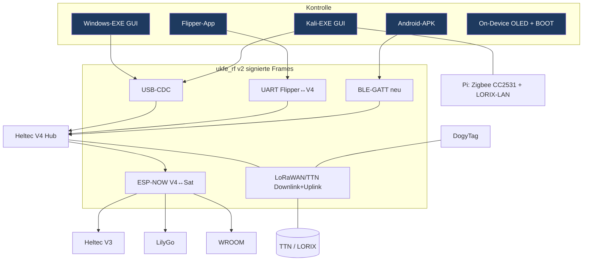

# G4MEOVER — Ökosystem-Masterplan v1 (2026-08-26)

> **Ziel:** Ein nahtloses, geräteübergreifendes Security-/RF-Ökosystem, das alles überragt, was
> in dieser Konstellation je gebaut wurde. Einheitliche Steuerung (Windows-EXE, Kali-EXE, Android-APK,
> Flipper-App, On-Device), volle LoRaWAN-Tiefe + LoRa-Sniffing, DogyTag-Integration, Kartenansicht,
> Live-Szenario-Visualisierung. Jedes Ergebnis wird am Ursprungsgerät **und** zentral angezeigt.
>
> **Dieses Dokument ist die Single Source of Truth + Fortschritts-Tracker.** Jede Session liest zuerst
> den Abschnitt „AUTO-FORTSETZUNG" und arbeitet die nächste offene `[ ]`-TODO ab, hakt sie ab (`[x]`)
> und notiert Ergebnis/Datum. Memory-Pointer: `project_ecosystem_masterplan`.

---

## 0. AUTO-FORTSETZUNG (nach Sitzungslimit zuerst lesen)
1. Diese Datei öffnen → Abschnitt **„FORTSCHRITT / NÄCHSTER SCHRITT"** unten.
2. Handoff `Desktop\_G4MEOVER-HANDOFF-2026-08-20.md` + Memory `MEMORY.md` querlesen (Live-Zustand).
3. Nächste offene TODO nehmen, umsetzen, **verifizieren**, `[x]` setzen + Ergebnis/Datum notieren.
4. Regeln: keine Malware bündeln; Commits nur im User-Namen (kein Co-Autor); B1–B9.sub nie pushen;
   DogyTag-Produktion nur additiv/read-only; Heltec-Native-USB nach esptool-Reset ggf. Replug.
5. Nach jedem abgeschlossenen Meilenstein: Memory + diesen Tracker aktualisieren.

---

## 1. Geräte-Inventar (Stand 2026-08-26, geerdet)
| Gerät | Chip | Wo | Port/ID | Rolle |
|---|---|---|---|---|
| Flipper Zero | STM32WB | PC | COM3 (0483:5740) | Handheld, CC1101/NFC/IR, GPIO-UART→V4, native Apps |
| Heltec **V4**-Hub | ESP32-S3 + SX1262 | **Pi** (SSH) | 303a:1001 (MAC B0:A6:04:C5:73:68) | Hub: UART↔Flipper, ESP-NOW→Sat, LoRaWAN, WiFi/BLE-Executor, OLED |
| Heltec **V3** | ESP32-S3 + SX1262 | PC | COM26 (10C4:EA60, MAC AC:A7:04:06:B1:90) | Satellit: LoRaWAN, WiFi/BLE, HID, RID, OLED |
| ESP32 **WROOM** | ESP32 | PC | COM8 (1A86:55D4) | ESP-NOW-Relay-Koordinator, Multi-Rolle |
| **LilyGo** T-Display | ESP32-S3 | PC | COM13 (303a:1001) | Satellit **mit Display** |
| **DogyTag** | XIAO ESP32-S3 + SX1262 | PC | COM16 (MAC 1C:DB:D4:A7:03:34) | LoRaWAN-Tracker + GPS |
| **CC2531** Zigbee | CC2531 | **Pi** | 0451:16a8 | Zigbee-Sniffer (whsniff/wireshark) |
| Raspberry Pi 4 | — | LAN, lokal notiert | Zugangsdaten lokal, nicht im Repo | Deck/Cockpit-Host, LORIX-LAN, Zigbee, Build/Flash-Host |
| LORIX One GW | SX1301 | LAN, lokal notiert | Zugangsdaten lokal, nicht im Repo | LoRaWAN-Gateway → TTN |
| *später* ESP32-CAM | ESP32 | — | — | Kamera/Streaming |
| *später* RA08 (ASR6601) | ASR6601 | — | — | 433-MHz-LoRa |
| *später* CubeCell HTCC-AB01 | ASR6501 | — | — | 433-MHz-LoRa (LowPower) |

## 2. Ziel-Architektur (Kontroll-Ebenen × Transport-Fabric × Geräte)

**Prinzip:** *Ein* Protokoll (ukfe_rf, signiert) über *fünf* Transporte. Jede Kontroll-Ebene spricht
dasselbe Command-Set. Antworten tragen die **Quell-Geräte-ID** und werden überall angezeigt, wo sie ankommen.

## 3. Kern-Bausteine (was neu gebaut/erweitert wird)
- **A) Unified Control GUI** (Python/PySide6, *ein* Codebase → Win-EXE + Kali-EXE via PyInstaller).
- **B) ukfe_rf v2**: BLE-Transport, erweitertes Command-Set, Ergebnis-Routing mit Quell-ID.
- **C) Flipper-App v3**: alle Funktionen + Raw-Modus; Reverse-Kanal „Kali-Tool ausführen"; WiFi/BLE/SubGHz-Umschalt-Befehle (mit/ohne V4).
- **D) Heltec V3/V4 Firmware**: OLED-Multipage + BOOT-Tasten-Bedienung mit Ergebnis-Anzeige.
- **E) LoRaWAN-Ausbau + LoRa-Sniffing** (SX1262 promiscuous; LORIX-Bezug; Flipper/Pi).
- **F) DogyTag-Tab** (Config/Monitor, additiv/read-only) + **Kartenansicht** (alle GPS-Geräte).
- **G) Szenario-Visualizer** (Live-Datenfluss-Diagramm).
- **H) Android-APK** (BLE, Feature-Parität zur GUI).
- **I) WROOM Multi-Rolle**, **J) Zigbee-Integration** (CC2531→Pi→GUI), **K) 433-MHz-Geräte** (später).

---

## 4. ARBEITSPHASEN mit TODO (Reihenfolge = Abhängigkeiten)

### Phase 0 — Fundament & Tooling
- [x] P0.1 Pi-Flash-Workflow ✅ (2026-08-26): esptool v5.3.1 am Pi (`--break-system-packages`); V4=`/dev/ttyACM1` (per MAC, CC2531 auf ttyACM0 übersprungen). Tool `ecosystem/tools/pi_flash_v4.py` (Build am PC → SFTP → esptool write_flash am Pi) — E2E validiert, Hash verifiziert.
- [~] P0.2 Stabiles Geräte-/Port-/MAC-Mapping als JSON (`ecosystem/devices.json`) — Basis für alle Tools.
  - [x] P0.2a Schema festgelegt + [x] P0.2b `ecosystem/devices.json` mit den 12 aus Abschnitt 1
    bekannten Geräten vorbefüllt ✅ (2026-09-05, Cloud, nur nicht-sensible Felder — keine
    Zugangsdaten/LAN-IPs, siehe CONSTRAINTS.md Regel 3).
  - [ ] P0.2c **Lokal:** pro Gerät Port/MAC frisch verifizieren (`esptool.py --port <x> chip_id`,
    Windows-Gerätemanager bzw. `ls /dev/serial/by-id` am Pi), `verified_at` je Eintrag setzen,
    Abweichungen (v. a. `last_known_port`, kann sich nach Neustart/Replug ändern) korrigieren.
    - Konkrete Prüfschritte je aktivem Gerät aus `ecosystem/devices.json` (planned-Geräte
      esp32-cam/ra08/cubecell entfallen, noch nicht vorhanden):
      - `flipper` (pc, VID:PID `0483:5740`): Gerätemanager-COM-Port gegen `last_known_port`
        (`COM3`) abgleichen (kein `esptool` — STM32, kein ESP32).
      - `heltec-v4-hub` (pi, VID:PID `303a:1001`): `ls -l /dev/serial/by-id/` (persistenter
        Pfad, überlebt Replug/Neustart, besser als `ttyACMx`-Zählung) + `esptool.py --port
        <Pfad> read_mac`, Ergebnis gegen `B0:A6:04:C5:73:68` abgleichen.
      - `heltec-v3` (pc, VID:PID `10C4:EA60`): Gerätemanager-COM-Port + `esptool.py --port
        COMxx read_mac` gegen `AC:A7:04:06:B1:90`.
      - `esp32-wroom` (pc, VID:PID `1A86:55D4`): Gerätemanager-COM-Port + `esptool.py --port
        COMxx chip_id`; `devices.json` hat für dieses Gerät noch keine MAC — beim Verifizieren
        per `read_mac` ergänzen.
      - `lilygo-t-display` (pc, VID:PID `303a:1001` — identisch mit `heltec-v4-hub`, aber
        anderer Host/PC, daher keine reale Verwechslungsgefahr über USB): Gerätemanager-COM-Port
        + `esptool.py --port COMxx read_mac` (MAC bisher nicht hinterlegt — ergänzen).
      - `dogytag` (pc, `usb_id` bisher `null`): Gerätemanager-COM-Port, dabei VID:PID nachtragen,
        + `read_mac` gegen `1C:DB:D4:A7:03:34`.
      - `cc2531-zigbee` (pi, VID:PID `0451:16a8`): `lsusb` + Portpfad via `ls
        /dev/serial/by-id/`/`dmesg` — deckt sich mit dem P0.3a-Praxis-Test, kann in einem
        Rutsch mit erledigt werden.
      - `raspberry-pi-4`, `lorix-one-gw` (beide `lan`): kein Port zu verifizieren, nur
        Erreichbarkeit (SSH bzw. Web-UI/SSH) mit den lokal notierten Zugangsdaten prüfen.
      - Nach jedem Gerät `verified_at` (Datum) im jeweiligen `devices.json`-Eintrag setzen;
        `notes`/`usb_id`-Lücken (s. o.) gleich mitfüllen, aber **keine** Zugangsdaten/LAN-IPs
        eintragen (CONSTRAINTS.md Regel 3).
      - Mechanik für den Eintrag, statt Hand-Editieren der JSON (weniger Risiko für
        kaputtes JSON bei 9 Einträgen nacheinander): `jq` je Gerät gegen die Datei laufen
        lassen und zurückschreiben, z. B. für `heltec-v3` nach erfolgreichem `read_mac`:
        `jq '(.devices[] | select(.id=="heltec-v3")) |= (.verified_at="2026-MM-TT" |
        .last_known_port="COMxx")' ecosystem/devices.json > /tmp/devices.json.tmp &&
        mv /tmp/devices.json.tmp ecosystem/devices.json`. Gleiches Muster für `mac`/`usb_id`
        bei `esp32-wroom`/`lilygo-t-display`/`dogytag` (zusätzliches `.mac="AA:BB:.."` bzw.
        `.usb_id="VVVV:PPPP"` im `|=`-Ausdruck). Nach dem letzten Gerät einmal
        `python -c "import json;json.load(open('ecosystem/devices.json'))"` zur
        Syntax-Gegenprobe (wie beim initialen Anlegen), bevor committet wird.
  - [ ] P0.2d **Lokal:** `pi_flash_v4.py`/`flipper_ctl.py` auf `ecosystem/devices.json` als
    Port-Quelle umstellen statt hartkodierter Werte; Regressionstest: bestehender
    Flash-Workflow (P0.1) läuft unverändert.
    - Vorschlag für den Zugriffs-Contract (spart lokale Entwurfszeit, beide Tools nutzen
      dieselbe Helper-Funktion statt eigener Parsing-Logik): `get_device_port(device_id: str,
      devices_path="ecosystem/devices.json") -> str`. Auflösereihenfolge: 1) exakter Treffer im
      `devices`-Array über `id`, 2) daraus `usb_id` gegen aktuell angeschlossene Geräte matchen
      (`esptool.py` liest VID:PID ohnehin beim Verbindungsaufbau), 3) nur falls kein Live-Match
      möglich (Gerät nicht über USB erkennbar, z. B. V4 rein über SSH/ttyACM) Fallback auf
      `last_known_port`. Kein Live-Match und kein `last_known_port` → klarer Fehler mit
      Geräte-`id` in der Meldung, kein stiller Fallback auf einen geratenen Port.
      `verified_at`/`last_known_port` **nicht** von den Tools automatisch aktualisiert (bleibt
      manueller Schritt aus P0.2c) — vermeidet, dass ein einmaliger Fehl-Match sich in die JSON
      zurückschreibt.
      Konkretes Gerüst (nur Ablaufskizze, kein fertiger Code — Fehlerbehandlung/Imports je nach
      Zielsprache der beiden Tools ergänzen):
      ```
      def get_device_port(device_id, devices_path="ecosystem/devices.json"):
          devices = load_json(devices_path)["devices"]
          entry = find(devices, lambda d: d["id"] == device_id)   # Schritt 1: exakter id-Treffer
          if entry is None:
              raise LookupError(f"unknown device id: {device_id}")
          if entry["usb_id"]:
              live = match_connected_usb_devices(entry["usb_id"])  # Schritt 2: esptool/pyserial-Scan
              if live:
                  return live.port
          if entry["last_known_port"]:
              return entry["last_known_port"]                      # Schritt 3: Fallback
          raise LookupError(f"no live match and no last_known_port for {device_id}")
      ```
      `match_connected_usb_devices()` kapselt den ohnehin vorhandenen esptool-/pyserial-
      Enumerationscode aus `pi_flash_v4.py`/`flipper_ctl.py` — beim Übernehmen prüfen, welches
      der beiden Tools das bereits sauberer kapselt, und von dort in eine gemeinsame Helper-Datei
      (z. B. `ecosystem/tools/device_ports.py`) auslagern statt zu duplizieren.
  - Verifikation: `python -c "import json;json.load(open('ecosystem/devices.json'))"` ✅ (Cloud,
    Syntax geprüft) + Soll/Ist-Abgleich gegen Abschnitt-1-Tabelle (lokal, nach Replug, noch offen).
- [ ] P0.3 CC2531-Zigbee-Pipeline am Pi: Sniffer-FW-Status prüfen, `whsniff`/`tshark`-Capture → pcap.
  - [ ] P0.3a **Lokal (Pi-SSH):** `lsusb` gegen erwartete ID `0451:16a8` prüfen, aktuellen
    Firmware-Stand des CC2531 feststellen (Sniffer- vs. Z-Stack-Coordinator-Image).
    - Vor dem eigentlichen Test klären, ob `whsniff` am Pi überhaupt installiert ist
      (`which whsniff || dpkg -l | grep -i whsniff`) — fehlt es ganz, ist das ein eigener,
      vom Firmware-Stand unabhängiger Blocker (Paket/Build nachziehen), kein Grund, direkt auf
      P0.3b (Firmware-Flash) zu schließen.
    - Praxis-Test statt Firmware-Introspektion (erst wenn `whsniff` vorhanden ist):
      `timeout 10 whsniff -c 11 | tshark -i - -c 5` (kurz, unkritisch, `timeout` verhindert ein
      Hängenbleiben der Pipe) versuchen. Drei mögliche Ausgänge: (1) `tshark` zeigt innerhalb
      weniger Sekunden Zeilen mit Protokoll `IEEE 802.15.4` (nicht nur "Malformed Packet"/leer)
      → Sniffer-Image bereits drauf, P0.3b entfällt, direkt zu P0.3c; (2) der Befehl liefert bis
      zum `timeout` gar keine Zeilen oder nur "Malformed Packet" → vermutlich Coordinator-/
      Router-Image drauf → P0.3b; (3) `whsniff` selbst bricht sofort mit einem USB-/
      Berechtigungsfehler ab (z. B. `libusb` "Access denied") → eigener Blocker (udev-Regel/
      Gruppenrechte für den CC2531), ebenfalls unabhängig vom Firmware-Stand, vor P0.3b zu klären.
  - [ ] P0.3b **Lokal:** falls kein Sniffer-Image drauf: mit am Pi verfügbarem Tool (z. B.
    `cc-tool`/SmartRF Flash Programmer) whsniff-kompatibles Firmware-Image flashen.
    - Vorab prüfen, ob am Pi bereits ein CC-Debugger oder ein anderer unterstützter Flash-Weg für
      den CC2531 vorhanden ist (`cc-tool` braucht i. d. R. einen Debugger/Programmer, nicht nur
      die USB-Dongle-Verbindung selbst) — falls nicht vorhanden, ist das der eigentliche Blocker
      dieses Unterschritts, nicht das Firmware-Image selbst.
  - [ ] P0.3c **Lokal:** Testaufnahme `whsniff -c <Kanal> | tshark -i - -w capture.pcap` für
    30–60 s, Kanal aus eigener Zigbee-Umgebung wählen.
    - Kanal-Findung: falls eigener Koordinator/Router bekannt (z. B. Zigbee2MQTT/ZHA-Konfig,
      Router-Admin-UI), dessen konfigurierten Kanal direkt nehmen. Sonst Kurz-Scan vor der
      eigentlichen Aufnahme: die vier überlappungsarmen Kanäle 11/15/20/25 je 5 s antesten
      (`timeout 5 whsniff -c <n> | tshark -i - -c 20 -q -z io,phs`), den mit sichtbaren
      `zbee_nwk`/`ieee802154`-Frames für die 30–60-s-Aufnahme nehmen.
    - `timeout` statt Handabbruch verwenden, damit die Pipe sicher terminiert, z. B.
      `timeout 45 whsniff -c 15 | tshark -i - -w /home/kali/zigbee_test_c15.pcap` (Zieldatei
      **außerhalb** des Repo-Arbeitsverzeichnisses, damit sie nicht versehentlich mitgestaged wird).
  - [ ] P0.3d **Lokal:** pcap in Wireshark/tshark sichten — nur Meta-Ergebnis (Kanal, Paketzahl,
    erkannte Gerätetypen) dokumentieren, **keine** pcap mit echten Fremd-Zigbee-Nutzdaten pushen
    (analog CONSTRAINTS.md Regel 2/3).
    - Rein statistische Sichtung ohne Nutzdaten-Export: `tshark -r capture.pcap -q -z io,phs`
      (Protokoll-Hierarchie/Paketzahlen je Layer) und `tshark -r capture.pcap -Y ieee802154 -T
      fields -e wpan.src16 -e wpan.dst16 -e wpan.frame_type | sort -u` (eindeutige
      Kurzadressen/Frame-Typen als Metadaten — keine Nutzlast). Nur diese Kennzahlen (Kanal,
      Gesamtpaketzahl, Anzahl unterschiedlicher Kurzadressen, gesehene Frame-Typen) landen im
      Arbeits-Log; die `.pcap`-Datei selbst bleibt lokal, wird nicht committet.
  - Verifikation: pcap lokal vorhanden, Wireshark zeigt gültige 802.15.4/Zigbee-Frame-Header.
  - Kein Cloud-Anteil möglich außer dieser Verfeinerung — Pi-SSH und USB-Dongle sind aus der
    Cloud nicht erreichbar.
- [~] P0.4 ukfe_rf-v2-Spec entwerfen (Doku): BLE-Transport-Frame, Ergebnis-Envelope mit Quell-ID, neue Cmds.
  - [x] P0.4a–d Entwurf geliefert ✅ (2026-09-05, Cloud, rein dokumentarisch): siehe
    [`UKFE-RF-V2-SPEC.md`](UKFE-RF-V2-SPEC.md) — v2-Frame mit Source-ID, Ergebnis-Envelope mit
    Origin-ID, BLE-GATT-/MTU-Mapping, neue Commands (`0x60`–`0x70`) gegen `FLEET-COMMANDS.md`
    kollisionsgeprüft.
  - [ ] P0.4e **Lokal:** Entwurf mit Firmware-Owner-Hut gegenlesen — SRC_ID/ORIGIN_ID-Enum final
    festlegen, BLE-GATT-UUIDs final vergeben, Rückwärtskompatibilitäts-Strategie entscheiden
    (siehe Spec Abschnitt 7).
  - [ ] P0.4f **Lokal:** nach Freigabe erster Firmware-Patch (vermutlich `heltec-v4-hub` zuerst)
    gegen Spec umsetzen, kompilieren, flashen, Funktest.
  - Verifikation (Cloud-Teil): Diff gegen `FLEET-COMMANDS.md` zeigt nur Erweiterungen, keine
    Command-Code-Kollision ✅ geprüft.

### Phase 1 — Unified Control GUI (Win + Kali) [Kern]
- [x] P1.1 Projekt-Skelett ✅ (2026-08-26): `ecosystem/g4meover-control/g4meover_control.py` (Tkinter ttk.Notebook — läuft
  Pi+Windows ohne Extra-Deps; Worker-Thread für Serial/CLI). Tabs: Flipper (aktiv) + Heltec/LoRaWAN/DogyTag/Karte/Zigbee/Visualizer (Stubs).
  Desktop-Verknüpfungen: Windows `.lnk` (pythonw) + Kali `.desktop` (beide gesetzt). Deploy Pi `/home/kali/g4meover-control/`.
- [ ] P1.2 Transport-Abstraktion: serielle ukfe_rf-Verbindung (Auto-Port aus Cockpit übernehmen) + Frame-Dekoder.
  - [ ] P1.2a **Lokal:** Transport-Interface definieren (`open()`/`close()`/`send_frame(bytes)`/
    `receive_frame() -> bytes|None`/`is_connected`), erste Implementierung `SerialTransport`
    (pyserial) im bestehenden Kali-Cockpit-Prototyp (`g4meover_control.py`, Tkinter, P1.1).
    Portauflösung **nicht** neu erfinden: denselben `get_device_port()`-Contract aus P0.2d nutzen,
    sobald der dort vorgeschlagene Helper lokal existiert — sonst driften zwei Port-Logiken
    (Cockpit vs. Flash-Tools) auseinander.
  - [ ] P1.2b **Lokal, nicht aus der Cloud lieferbar:** Frame-Encode/-Decode (v1-Header aus
    Abschnitt „Alle Transporte tragen denselben signierten Frame" in `FLEET-COMMANDS.md`) als
    eigenständiges Modul, getrennt von der Transport-Schicht. Grund für „nur lokal": `CRC16`-Polynom
    und der **keyed-MAC**-Algorithmus (`MAC4`) sind nur in der echten Firmware verifizierbar
    (`heltec-v4-hub`, `lora-ukfe`, `heltec-ukfe-rx`, …) — diese Repos liegen außerhalb des
    GitHub-Zugriffs-Scopes dieser Cloud-Sitzung (nur `g4meover-ecosystem`). Ein hier geschriebener
    Codec wäre reine Vermutung statt gegen die reale Quelle verifizierter Bytes — genau das Risiko,
    das die firmware-mining-Routine mit ihren Host-Repros bewusst vermeidet (dort immer gegen
    echten Firmware-Quellcode geprüft). Lokal denselben Ansatz übertragen: Host-Repro (reines
    Python/C, ohne Hardware) gegen die tatsächliche Firmware-Implementierung schreiben, danach erst
    ins Cockpit integrieren.
  - [ ] P1.2c **Lokal:** Auto-Port-Übernahme aus dem bestehenden Kali-Cockpit-Prototyp (WAN-Tab,
    P1.1 bereits ✅) in die neue Transport-Abstraktion überführen statt neu zu entwerfen.
- [ ] P1.3 Tab **Geräte**: Live-Liste (aus devices.json + Probe), Status/Batt/RSSI je Gerät.
  - [ ] P1.3.0 **Lokal, zuerst:** klären, ob `ecosystem/g4meover-control/g4meover_control.py` (P1.1,
    hier als ✅ mit diesem Pfad vermerkt) tatsächlich nur lokal existiert (siehe neuer Blocker
    „Referenzierte Tool-Dateien fehlen im Repo" unten) — falls ja, aktuellen Stand ins Repo
    committen, **bevor** P1.3 draufgesetzt wird, sonst baut dieser Unterschritt auf einer von hier
    aus unsichtbaren Dateistruktur auf. Falls die Datei bewusst lokal-only bleiben soll: das explizit
    hier vermerken (Grund) statt es weiter stillschweigend als Repo-Artefakt zu führen.
  - [ ] P1.3a Datenquelle: `ecosystem/devices.json` laden (Schema aus P0.2a/b bereits vorhanden) +
    Live-Probe je Gerät über denselben `get_device_port()`-Contract aus P0.2d/P1.2a — kein zweiter,
    paralleler Probe-Pfad im GUI-Code.
  - [ ] P1.3b Anzeige: da P1.1 laut Log auf Tkinter/`ttk.Notebook` aufsetzt (kein Qt), passt
    `ttk.Treeview` als Tabelle (Spalten `id`/`host`/`status`/`last_known_port`/`verified_at`);
    Refresh über den in P1.1 bereits vorhandenen Worker-Thread, nicht im UI-Thread pollen.
  - [ ] P1.3c Batt/RSSI **zurückgestellt**: `0x01 Status` steht in `FLEET-COMMANDS.md` weiterhin auf
    📋 (geplant, kein Handler) — ohne Firmware-Response gibt es keine echten Werte zu zeigen. Bis
    P0.4f/Status-Response umgesetzt ist, nur `devices.json`-Felder + ein simples
    erreichbar/nicht-erreichbar aus der Live-Probe anzeigen, keine Platzhalter-Zahlen erfinden.
- [ ] P1.4 Tab **Flipper**: alle Flipper-Funktionen (CLI + App-Katalog) inkl. **Raw-Command**-Feld.
  - [ ] P1.4.0 **Lokal, zuerst:** dieselbe Existenz-/Commit-Frage wie P1.3.0, hier für
    `ecosystem/flipper-ctl/flipper_ctl.py` (P2.0, ebenfalls ✅ mit Pfad vermerkt, ebenfalls nicht im
    Repo auffindbar).
  - [ ] P1.4a Sobald verfügbar: `flipper_ctl.py`s CLI-Funktionen (SubGHz/NFC/RFID/IR/GPIO/
    Storage/Loader/Apps laut P2.0-Beschreibung) als Aufrufe aus dem GUI-Tab verdrahten (Subprocess
    oder Modul-Import — je nachdem, wie `flipper_ctl.py` tatsächlich strukturiert ist, erst nach
    P1.4.0 entscheidbar).
  - [ ] P1.4b Raw-Command-Textfeld: freier String direkt an die Flipper-CLI-Schicht durchreichen,
    Antwort unverändert im Log-Panel (P1.6) anzeigen — kein Parsing/Validierung nötig, ist bewusst
    der Fallback für alles, was der katalogisierte Teil noch nicht abdeckt.
  - [ ] P1.4c App-Katalog als Liste/Menü im Tab, gespeist aus derselben Quelle wie die CLI-Funktionen
    (kein zweiter, separat gepflegter Katalog).
- [ ] P1.5 Tab **Heltec/V4**: voller Command-Katalog + Raw-Frame-Sender; Ergebnis mit Quell-ID.
  - [ ] P1.5a Command-Katalog-Tabelle direkt aus der Befehls-Matrix in `FLEET-COMMANDS.md` ableiten
    (Code/Befehl/Args/Status-Spalte übernehmen) statt einer zweiten, separat gepflegten Liste im
    GUI-Code.
  - [ ] P1.5b Raw-Frame-Sender ist **blockiert auf P1.2b** (Frame-Encode/-Decode, als lokal markiert
    — CRC16/keyed-MAC nur gegen echte Firmware verifizierbar): ohne fertigen Codec kein sicherer
    Raw-Frame-Versand, nicht vorher als Freitext-Bytes ohne CRC/MAC durchreichen (würde von der
    Firmware ohnehin verworfen).
  - [ ] P1.5c Ergebnis-Anzeige mit Quell-ID setzt v2-`SRC_ID`/`ORIGIN_ID` (P0.4f) voraus; bis dahin
    Fallback: Ergebnis ohne Quell-ID anzeigen (wie v1 es implizit über den Transport-Pfad macht),
    Feld erst nachrüsten sobald P0.4f live ist — kein Platzhalter-Wert erfinden.
- [ ] P1.6 Ergebnis-/Log-Panel: jede Antwort zeigt **Herkunftsgerät**, Zeit, dekodierter Inhalt.
  - [ ] P1.6a Ein gemeinsames Log-Widget (nicht pro Tab dupliziert) im bestehenden `g4meover_control.py`
    (P1.1, Tkinter): `ttk.Treeview` mit Spalten `Zeit`/`Quelle`/`Inhalt`, Einträge kommen aus dem in
    P1.1 bereits vorhandenen Worker-Thread über eine Queue (`queue.Queue` + `after()`-Poll im
    UI-Thread) statt direktem Cross-Thread-Widget-Zugriff.
  - [ ] P1.6b **Herkunftsgerät** ohne v2-`SRC_ID` (das kommt erst mit P0.4f): bis dahin denselben
    Fallback wie P1.5c nutzen — die aktive Tab-/Transport-Verbindung (welcher Port/welches Gerät laut
    `devices.json`-`id` gerade verbunden ist) als Quelle eintragen, nicht auf ein Protokollfeld warten.
    Sobald P0.4f live ist, zusätzlich das echte `SRC_ID`/`ORIGIN_ID` aus dem Frame anzeigen (Feld
    ergänzen, Fallback bleibt für v1-Only-Geräte bestehen).
  - [ ] P1.6c **Dekodierter Inhalt** hat zwei Fälle, die unterschiedlich weit sind: Flipper-CLI-Antworten
    (P1.4, reiner Text über die Flipper-CLI-Schicht) können unverändert als Rohtext geloggt werden —
    kein Decoder nötig, das ist schon heute möglich, sobald P1.1/P1.4 committet sind. `ukfe_rf`-Binär-
    frames (Heltec/V4, P1.5) brauchen dagegen den Codec aus P1.2b — bis der lokal gegen die echte
    Firmware verifiziert ist, hier nur die Rohbytes (Hex) loggen statt eine ungeprüfte Dekodierung zu
    zeigen.
- [ ] P1.7 Packaging: PyInstaller → `G4MEOVER-Control.exe` (Win) + Kali-Binary/AppImage; Icons/Branding.
  - [ ] P1.7a **Bewusst zurückgestellt, bis P1.3/P1.4 (Geräte-/Flipper-Tab) tatsächlich funktionieren**
    (nicht nur Stubs wie laut P1.1-Log) — Packaging eines noch bewegten Ziels erzeugt nur wiederholte
    Rebuild-Arbeit ohne Mehrwert; kein Cloud-Anteil, da PyInstaller-Builds nur lokal gegen die echten
    Win-/Kali-Umgebungen sinnvoll sind.
  - [ ] P1.7b PyInstaller-Grundgerüst: `pyinstaller --onefile --windowed g4meover_control.py` sollte für
    reines Tkinter + `pyserial` ohne Sonder-Deps auskommen; bekannter Stolperstein vorab einplanen —
    `pyserial`s Backend-Module (`serial.tools.list_ports_windows`/`_linux`) werden von PyInstaller nicht
    immer automatisch erkannt, ggf. `--hidden-import` je Zielplattform nötig (Windows-Build separat vom
    Kali-Build testen, nicht nur eine Plattform).
  - [ ] P1.7c **Blocker, neu hier vermerkt:** kein Icon-/Branding-Asset existiert bisher im Repo (nur
    die beiden Ökosystem-Karten-Screenshots unter `docs/img/`, kein Logo/`.ico`/`.png`-Icon) —
    `--icon`-Flag von PyInstaller braucht eins. Muss vor P1.7c erst erstellt/beigesteuert werden
    (eigenständiger kleiner Schritt, keine Abhängigkeit von Hardware oder Firmware).

### Phase 2 — Flipper ↔ Ökosystem-Tiefe
- [~] P2.0 **Pi/PC steuert Flipper DIREKT** ✅ Engine (2026-08-26): `ecosystem/flipper-ctl/flipper_ctl.py`
  (VID:PID-Auto-Erkennung, volle CLI SubGHz/NFC/RFID/IR/GPIO/Storage/Loader/Apps) — läuft Pi+Windows,
  am Pi deployt `/home/kali/g4meover-flipper-ctl/`. TODO: GUI-Tab + BLE-Transport (P2.4).
- [ ] P2.1 Flipper-App: Reverse-Kanal „Kali-Tool ausführen" (Flipper→USB/GUI→Pi→Tool→Ergebnis zurück auf Flipper-Display).
  - [ ] P2.1a **Lokal, zuerst:** prüfen ob `g4meover-companion` (laut README „flipperbridge &
    Deck-Tools", eigenes Repo außerhalb des GitHub-Zugriffs-Scopes dieser Cloud-Sitzung — nur
    `g4meover-ecosystem`) bereits einen Reverse-Kanal-Mechanismus enthält, bevor hier neu entworfen
    wird — dasselbe Blocker-Muster wie bei P1.3.0/P1.4.0 (referenzierte Tool-Dateien erst prüfen,
    dann aufbauen).
  - [ ] P2.1b **Lokal:** Transport-Entscheidung — zwei Optionen, keine davon hier vorentscheidbar ohne
    echten Blick in `G4MEOVER-FW` (ebenfalls außerhalb Scope): (a) die bereits von `flipper_ctl.py`
    genutzte CLI-/RPC-Verbindung um einen eigenen, App-seitig ausgelösten Request erweitern (kein
    neuer Transport, nur neue Richtung auf demselben Kanal), oder (b) ein eigener UART-Pin
    (`furi_hal_serial`, LPUART) getrennt von der USB-CLI. (a) ist der risikoärmere Standardpfad
    (kein zusätzliches Kabel/Pin nötig, nutzt den ohnehin vorhandenen Kanal aus P2.0) — als Vorschlag
    hier vermerkt, endgültige Wahl aber lokal gegen die echte RPC-Implementierung von `G4MEOVER-FW`
    zu prüfen.
  - [ ] P2.1c Protokoll-Skizze (unabhängig von P2.1b, gilt für beide Optionen): Flipper-App sendet
    `{tool, args}` → Pi-seitiger Listener (Erweiterung des P2.0-Engines, sobald `flipper_ctl.py`
    committet ist, siehe Blocker unten) führt das Tool aus → Ergebnis als kurzer Text (Displaybreite
    Flipper-OLED, ca. 30 Zeichen/Zeile) zurück über denselben Kanal, längere Ausgaben auf mehrere
    Frames aufteilen statt abschneiden.
  - Verifikation: nur lokal (`fbt`-Build der Flipper-App, Gegenprobe an echter Hardware); über die
    Blocker-Prüfung (P2.1a) und die Transport-Empfehlung (P2.1b) hinaus kein Cloud-Anteil möglich.
- [ ] P2.2 Flipper-App: WiFi/BLE/SubGHz-Umschalt-Befehle — via V4 **und** V4-los (Flipper-nativ, wo möglich).
  - [ ] P2.2a Ist-Stand gegen `FLEET-COMMANDS.md` geprüft: es gibt noch **keinen** expliziten
    Moduswechsel-Befehl, nur je Angriff eigene Commands (`0x20`–`0x2A` WiFi, `0x30`–`0x33` BLE,
    `0x10`–`0x16` LoRa/SubGHz), die den Funkmodus implizit mit auswählen. Offene Entscheidung für die
    lokale Sitzung: ob P2.2 einen zusätzlichen expliziten „Modus X aktivieren"-Befehl braucht (z. B.
    für eine Status-Anzeige am OLED, siehe P3.1) oder ob das implizite Umschalten je Attack-Command
    bereits ausreicht — **nicht** hier vorentscheiden, da es dieselbe Funk-Koexistenz-Frage wie P8.2
    (BLE/WiFi gleichzeitig auf dem V4) berührt.
  - [ ] P2.2b Falls ein expliziter Befehl gebraucht wird: Code-Bereich `0x60`+ aus
    `UKFE-RF-V2-SPEC.md` nutzen (dort bereits für v2-Erweiterungen reserviert), nicht in die laufende
    v1-Matrix (`0x01`–`0x51`) einschieben — vermeidet die in P0.4 bereits geprüfte
    Command-Code-Kollision.
  - [ ] P2.2c „Flipper-nativ, wo möglich" konkretisiert: für Funktionen, die der Flipper ohne V4 selbst
    kann (SubGHz über eigenes CC1101, siehe `FLEET-COMMANDS.md`-Transporttabelle „868-FSK"), den
    nativen Pfad als Default nehmen und den V4-Pfad nur für WiFi/BLE (Flipper hat kein eigenes
    WiFi/BLE-Radio) — kein Doppelpfad für Funktionen pflegen, die der Flipper allein abdeckt.
- [ ] P2.3 Ergebnis-Anzeige am Flipper vereinheitlichen (Quell-ID, scrollbar).
  - [ ] P2.3a Dasselbe Fallback-Muster wie P1.5c/P1.6b in der Unified-GUI übernehmen statt separat zu
    entwerfen: Quell-ID erst echt, sobald `SRC_ID`/`ORIGIN_ID` (P0.4f) live ist; bis dahin nur die
    aktive Verbindung (welches Gerät gerade laut `devices.json` verbunden ist) anzeigen.
  - [ ] P2.3b Scrollbar-Anzeige ist reine Flipper-App-UI-Arbeit (`ViewPort`/Canvas, scrollendes
    Textfeld) — baut auf P2.1c auf (dieselbe Displaybreiten-Aufteilung für lange Ergebnisse), kein
    eigenständiges Layout zweimal entwerfen.
  - Verifikation: nur lokal (Flipper-Display-Ausgabe visuell prüfbar).
- [ ] P2.4 **BLE-Transport zum Flipper**: Pi (BlueZ Central) + Windows steuern den Flipper auch über dessen
  Serial-over-BLE/RPC (radio_mode=Stack ist aktiv) — kabellose Flipper-Steuerung.

### Phase 2b — KONNEKTIVITÄTS-MATRIX (neu, 2026-08-26): alles spricht mit allem
Ziel: jede Kontroll-Ebene erreicht jedes relevante Gerät **direkt**, nicht nur über den V4.
- [ ] K1 **Pi ↔ Flipper**: USB ✅(Engine) + BLE (P2.4).
- [ ] K2 **Pi ↔ BLE allgemein**: Pi als BLE-Central (bluepy/bleak) — scannt/verbindet BLE-Geräte (V4, Flipper, DogyTag).
- [ ] K3 **Flipper ↔ BLE**: Flipper-BLE (RPC/Serial-over-BLE) als Ziel für Pi-Central **und** Android.
- [ ] K4 **APK ↔ Flipper direkt** (BLE, wie offizielle Flipper-App) — Steuerung + Ergebnis am Handy.
- [ ] K5 **APK ↔ Pi direkt**: BLE-GATT **und** WiFi/TCP (Pi-Dienst) — APK erreicht den Pi kabellos.
- [ ] K6 **APK ↔ V4** (BLE, P8.1). ⇒ Ergebnis: Win/Kali/APK/Flipper/On-Device × USB/UART/ESP-NOW/BLE/WiFi/LoRaWAN vollvermascht.

### Phase 3 — Heltec V3/V4: OLED-Multipage + BOOT-Bedienung
- [ ] P3.1 OLED-Seiten-Framework (Blättern): Status · LoRaWAN · ESP-NOW-Peers · Letztes-Cmd/Resultat · GPS · Szenario.
- [ ] P3.2 BOOT-Taste: kurz=Seite blättern, lang=Aktion des aktuellen Kontexts ausführen, doppelt=Menü.
- [ ] P3.3 Ergebnis-Anzeige direkt am Gerät (Resultat der on-device-getriggerten Aktion).
- [ ] P3.4 V4 nach jeder FW-Änderung **per SSH am Pi flashen** (P0.1-Workflow).

### Phase 4 — LoRaWAN massiv + LoRa-Sniffing
- [ ] P4.1 LoRaWAN-Tab (Win/Kali): Join/Uplink/Downlink-Queue/Session-Status/Live-Events (TTN-API), Duty-Cycle-Anzeige.
- [ ] P4.2 Downlink-Kommandokanal ausbauen (Fleet-Broadcast schon da; Klassen/Ports/Confirmed-Uplink).
- [ ] P4.3 LoRa-Sniffer-Modus (SX1262 promiscuous RX) auf V3/V4 → Roh-Frames an GUI; Flipper-Trigger.
- [ ] P4.4 LORIX-Bezug: Gateway-Status/Traffic aus LORIX/TTN, optional Raw-Packet-Forwarder-Log am Pi.
- [ ] P4.5 (Prüfen) LoRa-Sniffing am Flipper (nur mit SX126x-Modul) / am Pi (SX1262-HAT o. LORIX-UDP).

### Phase 5 — DogyTag-Integration
- [ ] P5.1 DogyTag-Tab: Live-Position/Batt/State via TTN-Uplinks (App dogytag-v1) — read-only.
- [ ] P5.2 Konfig-Downlinks (Intervall/Modus) — additiv, Produktion nicht umkonfigurieren.
- [ ] P5.3 MQTT-Bezug (mosquitto 192.168.0.80) additiv auf `dogytag/#`.

### Phase 6 — Kartenansicht
- [ ] P6.1 Karten-Tab (Leaflet in QWebEngine, offline-Tiles optional): alle GPS-Geräte live (Dogy, Wardrive-GPS, …).
- [ ] P6.2 Marker mit Geräte-ID, Track-Historie, Klick→Detail/Command.

### Phase 7 — Szenario-Visualizer
- [ ] P7.1 Live-Datenfluss-Diagramm: Geräte=Knoten, Cmd/Data/Resp=animierte Kanten, pro Szenario einfärbbar.
- [ ] P7.2 Szenario-Presets (z. B. „Flipper→V4→ESP-NOW→V3→TTN"), Highlight des aktiven Pfads bei jedem Command.

### Phase 8 — Android-APK (BLE)
- [ ] P8.1 Firmware: BLE-GATT-Transport für ukfe_rf am V4 (NimBLE) — Frames über Characteristic.
- [ ] P8.2 BLE/WiFi-Koexistenz-Strategie (ESP32 kann nicht immer gleichzeitig) → Umschalt-Befehl.
- [ ] P8.3 APK (Flutter o. Kotlin): Feature-Parität zur GUI über BLE; Ergebnis-Anzeige mit Quell-ID.

### Phase 9 — WROOM Multi-Rolle
- [ ] P9.1 WROOM-Rollen je Szenario: ESP-NOW-Relay · WiFi-Attack · BLE · Standalone — umschaltbar per Command.
- [ ] P9.2 In GUI/Flipper als eigenes Ziel mit Rollen-Auswahl.

### Phase 10 — Zigbee-Integration
- [ ] P10.1 CC2531 am Pi: Sniffer-Betrieb (whsniff→wireshark/tshark) → pcap; Live-Feed an GUI-Tab.
- [ ] P10.2 Zigbee-Tab: Kanäle, Geräte, Pakete; optional Z-Stack-Koordinator-Modus (Trennung Sniff/Coord).

### Phase 11 — 433-MHz-Erweiterung (wenn HW da)
- [ ] P11.1 RA08 (ASR6601) + CubeCell HTCC-AB01 als 433-LoRa-Knoten integrieren (eigene FW + ESP-NOW/UART-Brücke).
- [ ] P11.2 ESP32-CAM als Streaming-Knoten (Bild an GUI).

### Phase 12 — Politur, Packaging, Doku
- [ ] P12.1 Einheitliches Branding/Icons über alle Tools.
- [ ] P12.2 Installer: Win-EXE, Kali-.deb/AppImage, APK-Release; Auto-Update optional.
- [ ] P12.3 Benutzer-Doku + Szenario-Handbuch.

---

## 5. FORTSCHRITT / NÄCHSTER SCHRITT
**Aktueller Fokus:** Phase 1 → **Heltec/ukfe_rf-Tab** in die Unified GUI überführen (Cockpit einbetten).
**RESUME (nach PC-Neustart / Timeout):** `python ecosystem/tools/g4meover_resume.py` → Briefing + Gerätezustand +
`SESSION-STATE.json`. Desktop-Verknüpfung „G4MEOVER Resume" (Win+Kali). Auto-Fortsetzung: Cloud-Routine (cloud-scoped,
nur Code/Repo/Plan, kein lokaler HW-Zugriff — Pi/COM nicht aus der Cloud erreichbar; HW-Schritte bleiben der lokalen Session).
**Log:**
- 2026-08-26: Masterplan v1 erstellt. Inventar geerdet (V4+CC2531 am Pi; V3/LilyGo/WROOM/Flipper/Dogy am PC).
  Basis vorhanden aus dieser Session: SF9-LoRaWAN-Join (V3+V4) ✅, WAN-Downlink-Kanal + RespAck ✅, WAN→Flotte ✅,
  Kali-Cockpit (Tkinter, ukfe_rf, Auto-Port, WAN-Tab) ✅, Flipper-Katalog voll ausgebaut ✅.
  → Diese werden in die Unified GUI (Phase 1) überführt/erweitert.
- 2026-09-05 (Cloud-Heartbeat): P0.2/P0.3/P0.4 in Abschnitt 4 in konkrete Unterschritte zerlegt.
  P0.2 (Teil): `ecosystem/devices.json` (Schema + 12 Geräte aus Abschnitt 1, nur nicht-sensible
  Felder) neu angelegt und Syntax geprüft. P0.4 (Teil): vollständiger Protokoll-Entwurf
  `UKFE-RF-V2-SPEC.md` geliefert (Frame v2, Ergebnis-Envelope, BLE-Mapping, neue Commands,
  gegen `FLEET-COMMANDS.md` kollisionsgeprüft). P0.3 bleibt reine Lokal-Arbeit (Pi-SSH/USB
  aus der Cloud nicht erreichbar), nur die TODO-Verfeinerung erledigt. Neuer Abschnitt „PREP
  für nächste lokale Session" unten ergänzt. Kein Hardware-Zugriff versucht, nichts geflasht.
- 2026-09-07 (Cloud-Heartbeat): die drei nächsten offenen TODOs (P0.2d, P0.3a/b, P0.4e/f) einen
  Schritt konkreter gemacht, damit die lokale Session direkt entscheiden/umsetzen kann statt
  erst zu entwerfen: P0.2d bekam einen fertigen Zugriffs-Contract-Vorschlag
  (`get_device_port()`-Auflösereihenfolge usb_id-Live-Match → `last_known_port`-Fallback →
  Fehler, kein stiller Fallback) für `pi_flash_v4.py`/`flipper_ctl.py`. P0.3a/b bekam einen
  Praxis-Test (`whsniff`-Kurzversuch statt Firmware-Introspektion) und den Hinweis, dass ein
  fehlender CC-Debugger/Programmer der eigentliche Blocker für P0.3b sein könnte, nicht das
  Firmware-Image selbst. P0.4e/f (`UKFE-RF-V2-SPEC.md`): BLE-Service-/Characteristic-UUIDs als
  konkreter Vorschlag ergänzt (Abschnitt 5), inkl. Hinweis, sie vor dem ersten Firmware-Patch zu
  fixieren, sowie eine empfohlene Patch-Reihenfolge (erst nur `SRC_ID`/Versionsbyte auf
  `heltec-v4-hub`, BLE-Transport separat erst zu P8.1) — beides jetzt Bestätigen-statt-Entwerfen
  für die lokale Session. Kein Hardware-Zugriff versucht, nichts geflasht. Wiederkehrender Fund
  aus den letzten ~30 Firmware-Mining-Reports gegengelesen (siehe PREP unten): Pi-SSH-/
  LORIX-Zugangsdaten weiterhin im Klartext in der Repo-Historie, seit 2026-08-27 unrotiert.
- 2026-09-08 (Cloud-Heartbeat): P0.2c (bisher nur generisch "pro Gerät prüfen") um eine
  konkrete Prüfschritt-Liste je der 9 aktiven Geräte aus `ecosystem/devices.json` ergänzt
  (genauer Befehl/VID:PID/MAC-Soll-Wert pro Eintrag, inkl. Hinweis auf die noch fehlenden
  `usb_id`/MAC-Werte bei `esp32-wroom`/`lilygo-t-display`/`dogytag`). Beim Gegenlesen des
  Zugangsdaten-Fund-Zitats den bisher überall zitierten Commit **korrigiert**: `df0cf3b` (Aug 26,
  README+Screenshots) enthält keine Zugangsdaten — der tatsächliche Fund ist der ursprüngliche
  Masterplan-Commit `7e39b5b` (fügt `192.168.0.18`/`kali@…/kali` sowie `192.168.0.130`/
  `admin/Core2Quad` im Klartext ein) und dessen Redaktions-Commit `57560bd`, dessen Diff die
  entfernten Werte weiterhin als `-`-Zeile im Objekt trägt — beide direkt per `git show`
  gegengeprüft. Damit bestätigt sich der wiederholte Fund als real, nur die Commit-Angabe in den
  letzten ~30 Reports war falsch (vermutlich einmal falsch zitiert und seither unverändert
  weitergereicht). Repo-Sichtbarkeit geprüft: `G4MEOVER18/g4meover-ecosystem` ist **privat**
  (senkt die Dringlichkeit gegenüber "öffentlich exponiert", macht Rotation/Historie-Bereinigung
  aber nicht überflüssig). Kein Hardware-Zugriff versucht, nichts geflasht, kein Firmware-/
  GUI-Code geschrieben.
- 2026-09-09 (Cloud-Heartbeat): P0.3c/d konkretisiert — Kanal-Findung per Kurz-Scan (11/15/20/25,
  je 5 s) falls kein Koordinator-Kanal bekannt, fertiger `timeout`-Befehl für die 30–60-s-Aufnahme
  (P0.3c), sowie zwei `tshark`-Kommandos für P0.3d, die nur Metadaten (Protokoll-Hierarchie,
  eindeutige Kurzadressen/Frame-Typen) liefern statt Nutzdaten — die pcap bleibt lokal, nur die
  Kennzahlen gehören ins Arbeits-Log. Repo-Sichtbarkeit erneut per GitHub-API geprüft: weiterhin
  `private`. Kein Hardware-Zugriff versucht, nichts geflasht, kein Firmware-/GUI-Code geschrieben.
- 2026-09-10 (Cloud-Heartbeat): die drei vordersten offenen TODOs je einen Schritt konkreter
  gemacht. P0.2c: Update-Mechanik für `devices.json` ergänzt (`jq`-Einzeiler pro Gerät statt
  Hand-Editieren, Syntax-Gegenprobe nach dem letzten Gerät). P0.2d: den bisher nur in Prosa
  beschriebenen `get_device_port()`-Contract als Ablaufskizze (Pseudocode) ausformuliert, inkl.
  Hinweis, den ohnehin vorhandenen esptool-/pyserial-Scan aus `pi_flash_v4.py`/`flipper_ctl.py`
  in eine gemeinsame Helper-Datei auszulagern statt zu duplizieren. P0.3a: den Praxis-Test um
  eine dritte, bisher übergangene Fehlerquelle ergänzt (`whsniff` fehlt ganz vs. USB-/
  Berechtigungsfehler vs. tatsächlich falsches Firmware-Image) — jede der drei braucht einen
  anderen nächsten Schritt, nur der letzte Fall führt zu P0.3b. Repo-Sichtbarkeit erneut per
  GitHub-API geprüft: weiterhin `private`. Zugangsdaten-Rotation (siehe Risiken) weiterhin
  unbestätigt, jetzt seit zwei Wochen unverändert offen. Kein Hardware-Zugriff versucht, nichts
  geflasht, kein Firmware-/GUI-Code geschrieben.
- 2026-09-11 (Cloud-Heartbeat): die drei vordersten offenen TODOs (P0.2c/d, P0.3a-d, P0.4e/f) sind
  nach fünf aufeinanderfolgenden Verfeinerungs-Runden jetzt so detailliert (Befehl, Soll-Werte,
  Fehlerbaum, Schreib-Mechanik, Vorschläge für jede offene Entscheidung), dass eine weitere
  Cloud-Verfeinerung nur noch Text wiederholen würde statt echten Mehrwert zu liefern — bewusst
  keine weitere Textmenge ergänzt, um genau das zu vermeiden. Stattdessen den seit fünf Sitzungen
  wiederholten, aber nie umgesetzten Punkt bearbeitet: die Zugangsdaten-Rotation (Pi-SSH,
  LORIX-Admin) — bisher nur als "muss rotiert werden" notiert, jetzt als fertiges Drei-Schritt-
  Runbook unter Risiken (Rotation zuerst, danach erst `git filter-repo --replace-text` statt
  Pfad-Entfernung, `--force-with-lease` statt `--force`, Hinweis auf nötiges Neuklonen aller
  Checkouts) — lokal nur noch auszuführen, nicht mehr zu entwerfen. Fund bleibt unverändert seit
  2026-08-27 offen, jetzt 15 statt 14 Tage; per Push-Notification an den User eskaliert, da fünf
  Cloud-Sitzungen ihn bereits erfolglos im Log vermerkt haben. Repo-Sichtbarkeit erneut per
  GitHub-API geprüft: weiterhin `private`. Kein Hardware-Zugriff versucht, nichts geflasht, kein
  Firmware-/GUI-Code geschrieben.
- 2026-09-12 (Cloud-Heartbeat): P0.2c/d, P0.3a-d und P0.4e/f sind nach sechs aufeinanderfolgenden
  Verfeinerungsrunden bewusst unverändert gelassen (weitere Textmenge dort wäre Wiederholung, siehe
  Log 2026-09-11) — stattdessen den nächsten, noch unverfeinerten Tier aufgegriffen: **Phase 1
  (aktueller Fokus laut FORTSCHRITT)**, P1.2 „Transport-Abstraktion" in drei Unterschritte zerlegt
  (P1.2a Transport-Interface + Wiederverwendung von P0.2d's `get_device_port()`; P1.2b
  Frame-Encode/-Decode — explizit als „lokal, nicht aus der Cloud lieferbar" markiert, da CRC16/
  keyed-MAC nur gegen die echte Firmware verifizierbar sind, deren Repos (`heltec-v4-hub`,
  `lora-ukfe`, …) außerhalb des GitHub-Zugriffs-Scopes dieser Cloud-Sitzung liegen — ein hier
  geschriebener Codec wäre unverifizierte Vermutung, kein prüfbares Artefakt; P1.2c Auto-Port aus
  dem bestehenden Cockpit-Prototyp übernehmen statt neu entwerfen). Doku-Konsistenzlücke geschlossen:
  `FLEET-COMMANDS.md` verwies bisher nicht auf `UKFE-RF-V2-SPEC.md` (nur umgekehrt) — Vorausschau-
  Hinweis ergänzt, v1-Matrix selbst unverändert (weiterhin live). Repo-Sichtbarkeit erneut per
  GitHub-API geprüft: weiterhin `private`. Zugangsdaten-Rotation weiterhin unverändert offen (siehe
  Risiken, jetzt seit 2026-08-27), keine erneute Eskalation ohne neuen Sachstand. Kein
  Hardware-Zugriff versucht, nichts geflasht, kein Firmware-/GUI-Code geschrieben (auch keine
  „nur Python, keine Hardware nötig"-Ausnahme für P1.2b — siehe Begründung oben: der Grund ist hier
  fehlender Quell-Zugriff, nicht nur fehlende Hardware).
- 2026-09-13 (Cloud-Heartbeat): Phase-1-TODO-Kette nach P1.2 (09-12 bereits zerlegt) fortgesetzt:
  P1.3 (Tab Geräte), P1.4 (Tab Flipper), P1.5 (Tab Heltec/V4) in Abschnitt 4 in Unterschritte
  zerlegt. Dabei einen realen Doku-Konsistenzfund gemacht: die als ✅ mit Repo-Pfad geführten Tools
  `ecosystem/tools/pi_flash_v4.py` (P0.1), `ecosystem/g4meover-control/g4meover_control.py` (P1.1),
  `ecosystem/flipper-ctl/flipper_ctl.py` (P2.0) sowie `ecosystem/tools/g4meover_resume.py` (Abschnitt
  FORTSCHRITT/RESUME) sind weder im aktuellen Checkout noch in der vollen Git-Historie dieses Repos
  auffindbar (`git log --all --diff-filter=A` auf alle vier Dateinamen: keine Treffer) — nur
  `ecosystem/devices.json` ist tatsächlich committet. Als neuer Blocker in Risiken/Blocker und PREP
  „Nur lokal möglich" aufgenommen, P1.3/P1.4/P1.5 verweisen jetzt explizit auf diese Klärung als
  ersten Schritt statt blind auf eine von hier aus unsichtbare Dateistruktur aufzusetzen. Repo-
  Sichtbarkeit erneut per GitHub-API geprüft: weiterhin `private`. Zugangsdaten-Rotation weiterhin
  unverändert offen (seit 2026-08-27, jetzt 17 Tage) — keine erneute Push-Notification ohne neuen
  Sachstand (zuletzt am 2026-09-11 eskaliert). Kein Hardware-Zugriff versucht, nichts geflasht, kein
  Firmware-/GUI-Code geschrieben (die fehlenden Tool-Dateien wurden hier bewusst nicht neu erstellt,
  da ihr tatsächlicher lokaler Stand unbekannt ist — ein hier neu geschriebener Ersatz würde einen
  eventuell bereits funktionierenden lokalen Stand überschreiben/verwirren, siehe CONSTRAINTS Regel 6).
- 2026-09-14 (Cloud-Heartbeat): P0.2c/d, P0.3a-d, P0.4e/f weiterhin bewusst unverändert (siehe Log
  2026-09-11/12, weitere Textmenge wäre Wiederholung); Phase-1-TODO-Kette letzten Schritt fortgesetzt:
  P1.6 (Log-Panel) und P1.7 (Packaging) in Abschnitt 4 in Unterschritte zerlegt — beide bauen auf dem
  am 2026-09-13 dokumentierten Fallback-Muster von P1.5c auf (Herkunftsgerät ohne v2-`SRC_ID` über die
  aktive Transport-Verbindung statt Protokollfeld) statt eine dritte, separate Lösung zu entwerfen.
  Dabei einen konkreten neuen Blocker gefunden: P1.7c (Icons/Branding) braucht ein Icon-Asset für
  PyInstallers `--icon`-Flag, das im Repo bisher komplett fehlt (`docs/img/` enthält nur die zwei
  Ökosystem-Karten-Screenshots, kein Logo/`.ico`) — als eigenständiger, hardwareunabhängiger
  Kleinschritt vermerkt, nicht blockiert auf Phase 1 selbst. P1.7 zusätzlich explizit auf „erst wenn
  P1.3/P1.4 wirklich funktionieren, nicht nur Stubs" zurückgestellt, um kein bewegliches Ziel zu
  verpacken. Den seit 2026-09-13 offenen Blocker „referenzierte Tool-Dateien fehlen im Repo"
  (`pi_flash_v4.py`/`g4meover_control.py`/`flipper_ctl.py`/`g4meover_resume.py`) erneut gegen
  `git log --all --diff-filter=A` geprüft: unverändert kein Treffer, Blocker bleibt bestehen. Repo-
  Sichtbarkeit erneut per GitHub-API geprüft (`visibility`-Feld direkt, nicht nur `private`-Flag):
  weiterhin `private`. Zugangsdaten-Rotation weiterhin unverändert offen (seit 2026-08-27, jetzt 18
  Tage) — keine erneute Push-Notification ohne neuen Sachstand (zuletzt am 2026-09-11 eskaliert; reine
  Tageszählung ohne neue Information ist kein neuer Sachstand). Kein Hardware-Zugriff versucht, nichts
  geflasht, kein Firmware-/GUI-Code geschrieben.
- 2026-09-15 (Cloud-Heartbeat): P0.2c/d, P0.3a-d, P0.4e/f sowie die komplette Phase-1-Kette (P1.2-P1.7)
  bewusst unverändert gelassen (weitere Textmenge dort wäre Wiederholung, siehe Log 2026-09-11ff.) —
  stattdessen den nächsten unverfeinerten Tier aufgegriffen: Phase 2, P2.1-P2.3 in Abschnitt 4 in
  Unterschritte zerlegt. P2.1 (Reverse-Kanal) bekam eine Transport-Empfehlung (CLI-/RPC-Kanal aus P2.0
  erweitern statt neuer UART-Pin) mit explizitem Hinweis, dass die endgültige Wahl nur lokal gegen den
  echten `G4MEOVER-FW`-Quellcode zu treffen ist (Repo außerhalb des Cloud-Zugriffs-Scopes, analog der
  P1.2b-Begründung) — hier bewusst nicht vorentschieden. P2.2 bekam einen echten Doku-Abgleich gegen
  `FLEET-COMMANDS.md`: es gibt noch keinen expliziten Moduswechsel-Befehl, nur implizite Umschaltung
  je Attack-Command; ob ein expliziter Befehl nötig wird, als offene lokale Entscheidung markiert
  (verknüpft mit der P8.2-Koexistenzfrage, nicht hier separat beantwortet). P2.3 verweist jetzt auf
  dasselbe Quell-ID-Fallback-Muster wie P1.5c/P1.6b statt einer dritten Variante.
  Vor der Textarbeit einen echten Repo-Zustand geprüft und korrigiert: der lokale `main`-Branch dieses
  Checkouts zeigte auf einen 29 Commits alten Stand (`68cf176`), während `origin/main` bereits weiter
  war (`1d06c82`, reine Firmware-Mining-Reports/Repros, keine Divergenz) — lokal per Fast-Forward
  nachgezogen; `git push` bestätigte „Everything up-to-date", also kein tatsächlicher Datenverlust,
  nur ein veralteter lokaler Branch-Zeiger in diesem Checkout. Keine `.sub`/DogyTag-Berührung in diesem
  Bereich geprüft. Repo-Sichtbarkeit erneut per GitHub-API geprüft: weiterhin `private`. Blocker
  „referenzierte Tool-Dateien fehlen im Repo" (`pi_flash_v4.py`/`g4meover_control.py`/
  `flipper_ctl.py`/`g4meover_resume.py`) erneut gegen `git log --all --diff-filter=A` geprüft:
  unverändert kein Treffer. Zugangsdaten-Rotation weiterhin unverändert offen (seit 2026-08-27, jetzt
  19 Tage) — keine erneute Push-Notification ohne neuen Sachstand (zuletzt am 2026-09-11 eskaliert).
  Kein Hardware-Zugriff versucht, nichts geflasht, kein Firmware-/GUI-Code geschrieben.

## PREP für nächste lokale Session

**Nächster konkreter Schritt:**
1. `ecosystem/devices.json` gegen echte Ports/MACs verifizieren (P0.2c) — die Prüfschritt-Liste
   unter P0.2c oben (Abschnitt 4) ist pro Gerät fertig (Befehl + Soll-MAC/VID:PID), inkl. der
   `jq`-Einzeiler zum Zurückschreiben von `verified_at`/`mac`/`usb_id` statt Hand-Editieren; nur
   noch abzuarbeiten. Replug-Check nach Neustart nicht vergessen. Danach `pi_flash_v4.py`/
   `flipper_ctl.py` auf den in P0.2d vorgeschlagenen `get_device_port()`-Contract umstellen — die
   Ablaufskizze (Pseudocode, s. o.) steht, nur noch in die Zielsprache der beiden Tools zu
   übertragen und den vorhandenen esptool-/pyserial-Scan in eine gemeinsame Helper-Datei
   auszulagern.
2. CC2531 am Pi: erst `which whsniff` prüfen (fehlt es, ist das der Blocker, nicht die Firmware),
   dann den Praxis-Test aus P0.3a (`timeout 10 whsniff -c 11 | tshark -i - -c 5`) versuchen — drei
   mögliche Ausgänge (gültige `IEEE 802.15.4`-Frames / nichts bzw. Malformed / USB-Berechtigungs-
   fehler), siehe P0.3a oben für die jeweils passende Folgeaktion. Liefert er Frames, direkt zu
   P0.3c/d (fertiger Kanal-Scan + `timeout`-Aufnahmebefehl und den beiden Meta-Auswertungs-
   `tshark`-Kommandos, siehe P0.3c/d oben); sonst Flash-Weg klären (P0.3b, siehe Blocker-Hinweis
   unten) und danach dieselbe Testaufnahme + Sichtung.
3. `UKFE-RF-V2-SPEC.md` Abschnitt 5/7 gegenlesen: SRC_ID/ORIGIN_ID-Enum und BLE-GATT-UUIDs sind
   jetzt fertige Vorschläge (nur noch bestätigen oder gezielt abändern, nicht neu entwerfen),
   Rückwärtskompatibilitäts-Strategie weiterhin offen zu entscheiden. Danach ersten, bewusst
   kleinen Firmware-Patch auf `heltec-v4-hub` umsetzen (P0.4e/f) — nur `SRC_ID`/Versionsbyte,
   BLE-Transport separat später.
4. Sobald Zeit für Phase 1 (aktueller Fokus) ist: P1.2a/b/c oben (Abschnitt 4) sind jetzt
   Unterschritte statt einer einzelnen Zeile. P1.2b (Frame-Codec) **zuerst gegen die echte
   Firmware-Quelle verifizieren** (`heltec-v4-hub`/`lora-ukfe`/`heltec-ukfe-rx`), erst danach
   Host-Repro schreiben und ins Cockpit integrieren — nicht aus der v1-Doku allein raten.
   **Davor** aber den neuen Blocker unten klären: `g4meover_control.py`/`flipper_ctl.py` existieren
   nicht im Repo — erst prüfen/committen, dann P1.3/P1.4/P1.5 (jetzt ebenfalls in Unterschritte
   zerlegt, siehe Abschnitt 4) darauf aufsetzen. P1.6 (Log-Panel) und P1.7 (Packaging) sind jetzt
   ebenfalls in Unterschritte zerlegt: P1.6 kann teilweise schon vor P1.2b/P0.4f entstehen (Rohtext-
   Logging der Flipper-CLI-Antworten, P1.6c), P1.7 bewusst erst nach funktionierendem P1.3/P1.4
   angehen (kein Packaging eines beweglichen Ziels). Für P1.7c fehlt noch ein Icon-/Branding-Asset
   (siehe Blocker unten) — unabhängig vom Rest von Phase 1 besorgbar.
4b. Nach Phase 1: P2.1-P2.3 (Abschnitt 4) sind jetzt ebenfalls in Unterschritte zerlegt. P2.1b
   (Transport-Entscheidung Reverse-Kanal) und P2.2a (expliziter Moduswechsel-Befehl ja/nein) sind
   als offene Entscheidungen markiert, die nur lokal gegen `G4MEOVER-FW` (außerhalb Cloud-Scope) bzw.
   im Zusammenspiel mit P8.2 zu treffen sind — vorher `g4meover-companion` auf einen bereits
   vorhandenen Reverse-Kanal-Mechanismus prüfen (P2.1a), um keine Doppelarbeit zu entwerfen.
5. **Sicherheitsrelevant, siehe Risiken unten — jetzt 19 Tage überfällig:** Pi-SSH-Passwort und
   LORIX-Admin-Passwort rotieren, dann entscheiden, ob zusätzlich die Git-Historie bereinigt wird.
   Fertiges Drei-Schritt-Runbook (Rotation zuerst, Historie-Bereinigung erst danach, mit
   `git filter-repo --replace-text` statt Pfad-Entfernung, `--force-with-lease` statt `--force`,
   Neuklonen aller bestehenden Checkouts) steht jetzt unter Risiken unten — nur noch auszuführen.

**Offene Entscheidungen:**
- GUI-Framework: PySide6 vs. Web (Electron/Tauri) — siehe Abschnitt 6, weiterhin offen.
- APK-Framework: Flutter vs. Kotlin-nativ — siehe Abschnitt 6, weiterhin offen.
- ukfe_rf-v2: gestaffelter Firmware-Rollout (Vorschlag V4→V3→LilyGo→WROOM) vs. harter Cutover —
  siehe `UKFE-RF-V2-SPEC.md` Abschnitt 7.
- SRC_ID/ORIGIN_ID-Werte und BLE-GATT-Service-/Characteristic-UUIDs stehen jetzt als konkrete
  Vorschläge im Spec (Abschnitt 3/5) — lokal nur noch zu bestätigen oder gezielt zu ändern, bevor
  der erste Firmware-Patch sie fixiert.
- Ob Pi-SSH-Passwort/LORIX-Admin-Passwort rotiert **und zusätzlich** die Git-Historie bereinigt
  wird, oder ob (da Repo privat, siehe Risiken) Rotation allein als ausreichend gilt — Force-Push
  über bereits gepushte, öffentlich zitierte Commit-SHAs ist eine bewusste Entscheidung, keine
  Routine-Aktion.

**Risiken/Blocker:**
- CC2531-Sniffer-Firmware-Status unbekannt — evtl. muss ein Flash-Tool (SmartRF Flash Programmer
  o. ä.) am Pi erst besorgt/eingerichtet werden. Konkretisiert diese Sitzung: der wahrscheinlichere
  Blocker ist ein fehlender CC-Debugger/Programmer für `cc-tool`, nicht das Firmware-Image selbst
  — das zuerst klären, bevor nach einem Sniffer-Image gesucht wird.
- **Sicherheitsrelevant, seit 2026-08-27 unverändert eskaliert, diese Sitzung gegen die
  Repo-Historie direkt verifiziert (nicht nur aus `reports/` übernommen) — dabei die bisherige
  Commit-Angabe korrigiert:** Pi-SSH-Login (`kali@…`, Passwort `kali`) und LORIX-Gateway-Admin
  (`admin`/`Core2Quad`) stehen im Klartext in Commit `7e39b5b` (fügt sie ein) und sind über den
  Diff von `57560bd` (entfernt sie aus der aktuellen Datei, der Diff selbst zeigt die Werte aber
  weiterhin als `-`-Zeile) weiterhin abrufbar — **nicht** `df0cf3b`, wie in allen vorherigen
  Reports/Log-Einträgen zitiert (dieser Commit enthält nur README-Text + zwei PNG-Screenshots,
  beide ohne sichtbare Zugangsdaten, per Bildsichtung geprüft). Repo-Sichtbarkeit geprüft: `private`
  — reduziert die Dringlichkeit gegenüber einer öffentlichen Exposition, macht Rotation aber nicht
  überflüssig (jeder Collaborator/App mit Repo-Zugriff sieht es; ein versehentliches Public-Setzen
  würde es sofort breit exponieren). Weder Rotation noch eine Entscheidung über
  Historie-Bereinigung sind bislang bestätigt — beides nur lokal mit ausdrücklicher Freigabe
  möglich (Force-Push, Zugangsdaten-Rotation). Bis dahin: Repo als kompromittiert für diese beiden
  Zugangsdaten behandeln.
  - **Rotations-Runbook (fertig, nur lokal auszuführen — jetzt 19 Tage überfällig):**
    1. **Pi-SSH-Passwort:** lokal einloggen (Zugangsdaten wie bisher nur lokal notiert), `passwd`
       neues starkes Passwort setzen. Besser strukturell statt nur einmalig: Key-Auth einrichten
       (`ssh-copy-id`), danach `PasswordAuthentication no` in `/etc/ssh/sshd_config` setzen und
       `sshd` neu laden — schließt den Passwort-Angriffsweg dauerhaft. Neues Passwort nur lokal
       (Passwort-Manager), nicht ins Repo.
    2. **LORIX-Admin-Passwort:** Web-UI → Administration/System → Passwort ändern (Menüpfad je
       Firmware-Version leicht abweichend, sonst LORIX-Handbuch); falls CLI/SSH-Zugriff aufs
       LORIX besteht, alternativ dortiges Passwort-Kommando nutzen. Neues Passwort nur lokal notieren.
    3. **Git-Historie erst NACH 1+2 bereinigen** (sonst bleiben die noch gültigen Alt-Credentials im
       force-gepushten Objekt-Store erreichbar): `git filter-repo --replace-text` mit einer lokalen
       Ersetzungsdatei (Alt-Werte → `[REDACTED]`, Datei selbst nicht committen) über die volle
       Historie laufen lassen — **nicht** `--path …--invert-paths`, da die betroffene Datei aktuell
       gebraucht wird und nur der Text ersetzt werden soll. Danach `git push --force-with-lease
       origin main` (nicht `--force`, falls zwischenzeitlich woanders gepusht wurde). Jeder
       bestehende Klon (PC, Pi) muss danach **neu geklont** werden, nicht nur gepullt (History-IDs
       ändern sich).
- Heltec-V4-Native-USB kann nach esptool-Reset kurz verschwinden → ggf. Replug nötig (bekannt,
  siehe AUTO-FORTSETZUNG Regel 4).
- **Neu (2026-09-13), Doku-Konsistenz:** Die als ✅ abgehakten Tools `ecosystem/tools/pi_flash_v4.py`
  (P0.1), `ecosystem/g4meover-control/g4meover_control.py` (P1.1), `ecosystem/flipper-ctl/flipper_ctl.py`
  (P2.0) sowie `ecosystem/tools/g4meover_resume.py` (Abschnitt „FORTSCHRITT/RESUME") werden im
  Tracker mit konkretem Repo-Pfad geführt, existieren aber **nirgends in diesem Repo** — weder im
  aktuellen Checkout noch in der vollen Git-Historie (`git log --all --diff-filter=A` auf alle vier
  Dateinamen: keine Treffer). Nur `ecosystem/devices.json` ist tatsächlich committet. Entweder wurden
  die Tools lokal gebaut und nie gepusht (dann fehlt hier ein Commit-Schritt aus den jeweiligen
  Sitzungen), oder sie sollen bewusst lokal-only bleiben (dann sollte der Tracker das nicht als
  Repo-Pfad, sondern als lokalen Stand kennzeichnen). Blockiert die sinnvolle Vertiefung von P1.3/
  P1.4/P1.5, P0.2d und der `get_device_port()`-Integration aus der Cloud, da der tatsächliche
  Code-Stand von hier aus nicht einsehbar ist.

**Nur lokal möglich (Hardware: flashen/serial/BLE/Pi-SSH):**
- P0.2c/d: echte Port-/MAC-Verifikation (Prüfschritt-Liste steht), Tool-Umstellung gegen den
  vorgeschlagenen Contract testen.
- P0.3 komplett: CC2531 physisch am Pi (Firmware-Check/Flash, Capture, Wireshark-Sichtung).
- P0.4e/f: Firmware-Owner-Review der jetzt vorliegenden Spec-Vorschläge, jede Firmware-Umsetzung
  (Compile/Flash/Funktest auf V3/V4/LilyGo/WROOM).
- Phase 1 GUI-Arbeit, sofern gegen echte Serial-/USB-Geräte getestet wird. P1.2b (Frame-Codec)
  zusätzlich deshalb nur lokal möglich, weil die zur Verifikation nötige Firmware-Quelle
  (`heltec-v4-hub`/`lora-ukfe`/`heltec-ukfe-rx`) außerhalb des GitHub-Zugriffs-Scopes dieser
  Cloud-Sitzung liegt — unabhängig von der Hardware-Frage.
- P2.1a/b (Reverse-Kanal-Prüfung gegen `g4meover-companion`, Transport-Entscheidung gegen
  `G4MEOVER-FW`): dieselbe Begründung wie bei P1.2b — beide Repos liegen außerhalb des
  GitHub-Zugriffs-Scopes dieser Cloud-Sitzung, eine hier getroffene Entscheidung wäre Vermutung statt
  gegen den echten Quellcode geprüft. P2.1/P2.3 App-seitige Umsetzung zusätzlich Hardware-gebunden
  (`fbt`-Build, Flipper-Display-Gegenprobe).
- Zugangsdaten-Rotation + ggf. Git-Historie-Bereinigung (Force-Push) für den Punkt oben — reine
  Cloud-Sitzungen können das nicht anstoßen, nur wiederholt aufzeigen (jetzt mit korrekter
  Commit-Angabe).
- **Korrigiert (2026-09-14):** der bisher hier vermerkte Satz „die ausführende Cloud-Umgebung hängt
  den `Co-Authored-By`/`Claude-Session`-Trailer automatisch an, eine einzelne Sitzung kann das nicht
  unterbinden" stimmt nicht mehr (evtl. nie so allgemeingültig, siehe unten) — diese Sitzung hat
  `git log` über alle 50 Commits gegen den Trailer geprüft: die letzten 15 Commits **mit** Trailer
  enden am 2026-09-10 (`29aa985`); jeder Commit **ab** 2026-09-11 (Beginn: lokale `git config
  user.name/user.email`-Setzung laut `reports/2026-09-11-0632.md`) trägt **keinen** Trailer mehr —
  0 von inzwischen 35 Commits. Betroffen bleiben nur die 15 historischen Commits bis 2026-09-10;
  das ist weiterhin nur über die bereits dokumentierte Historie-Bereinigung (`git filter-repo`,
  Force-Push, nur lokal mit ausdrücklicher Freigabe) zu beheben, aber kein laufendes/aktives Problem
  mehr — muss nicht mehr bei jeder neuen Cloud-Sitzung neu geprüft werden.
- **Neu (2026-09-13):** prüfen, ob `ecosystem/tools/pi_flash_v4.py`, `ecosystem/g4meover-control/
  g4meover_control.py`, `ecosystem/flipper-ctl/flipper_ctl.py`, `ecosystem/tools/g4meover_resume.py`
  lokal existieren (laut Tracker ✅ mit diesen Pfaden) — falls ja, in dieses Repo committen; falls
  bewusst lokal-only, den Tracker entsprechend umformulieren. Nur lokal feststellbar, da diese
  Dateien aus der Cloud-Sitzung heraus nicht sichtbar sind.
- **Neu (2026-09-14):** für P1.7c (Packaging-Icon) fehlt ein Icon-/Branding-Asset (`.ico`/`.png`,
  Windows-Taskleiste + Kali-Desktop-Eintrag) — im Repo bisher nirgends vorhanden. Kein Hardware-Bezug,
  aber eine bewusste Design-/Marken-Entscheidung (Motiv, Farben), die hier aus der Cloud nicht
  eigenmächtig getroffen werden sollte; lokal erstellen oder beisteuern, dann unter `docs/img/` oder
  einem neuen `ecosystem/branding/` ablegen.

**Cloud hat in dieser Sitzung erledigt (2026-09-15):** komplette Phase-1-TODO-Kette (P1.2-P1.7)
bewusst unverändert gelassen (weitere Textmenge wäre Wiederholung); stattdessen Phase 2, P2.1-P2.3
in Abschnitt 4 in Unterschritte zerlegt (Transport-Entscheidung Reverse-Kanal P2.1b, Moduswechsel-
Frage P2.2a gegen `FLEET-COMMANDS.md` geprüft, P2.3 auf bestehendes SRC_ID-Fallback-Muster verwiesen —
Details siehe FORTSCHRITT-Log oben). Dabei einen echten Repo-Zustand korrigiert: lokaler `main`-Branch
dieses Checkouts war 29 Commits hinter `origin/main` (rein lokaler Branch-Zeiger-Stand, `git push`
bestätigte „Everything up-to-date" — kein tatsächlicher Datenverlust). Blocker „referenzierte
Tool-Dateien fehlen im Repo" erneut geprüft: unverändert kein Treffer. Repo-Sichtbarkeit erneut per
GitHub-API geprüft: weiterhin `private`. Zugangsdaten-Rotation weiterhin offen, jetzt 19 Tage — keine
erneute Push-Notification ohne neuen Sachstand (zuletzt am 2026-09-11 eskaliert). Kein Hardware-Zugriff
versucht, nichts geflasht, kein Firmware-/GUI-Code geschrieben.

**Vorherige Cloud-Sitzung (2026-09-14):** Phase-1-TODO-Kette letzten Schritt fortgesetzt: P1.6
(Log-Panel) und P1.7 (Packaging) in Unterschritte zerlegt. Zwei reale Funde: (1) P1.7c braucht ein
bisher komplett fehlendes Icon-/Branding-Asset; (2) der Blocker „Cloud-Umgebung hängt Co-Authored-By-
Trailer automatisch an" ist veraltet (0 von 35 Commits seit der Git-Identitäts-Setzung am 2026-09-11
tragen noch einen Trailer, betrifft nur die 15 historischen Commits bis 2026-09-10). Repo-Sichtbarkeit
weiterhin `private`. Zugangsdaten-Rotation weiterhin offen, damals 18 Tage. Kein Hardware-Zugriff
versucht, nichts geflasht, kein Firmware-/GUI-Code geschrieben.

---

## 6. Architektur-Entscheidungen (offen — beim Erreichen entscheiden)
- GUI-Framework: **PySide6** (Qt, QWebEngine für Karte/Visualizer) vs. Web (Electron/Tauri). *Vorschlag: PySide6.*
- APK: **Flutter** (BLE-Plugin, cross) vs. Kotlin-nativ. *Vorschlag: Flutter.*
- Ein-Codebase Win/Kali: ja (PyInstaller je Ziel).
- Szenario-Visualizer: QGraphicsScene (nativ) vs. Web/D3 in QWebEngine. *Vorschlag: Web/D3 (auch für Artefakt wiederverwendbar).*
