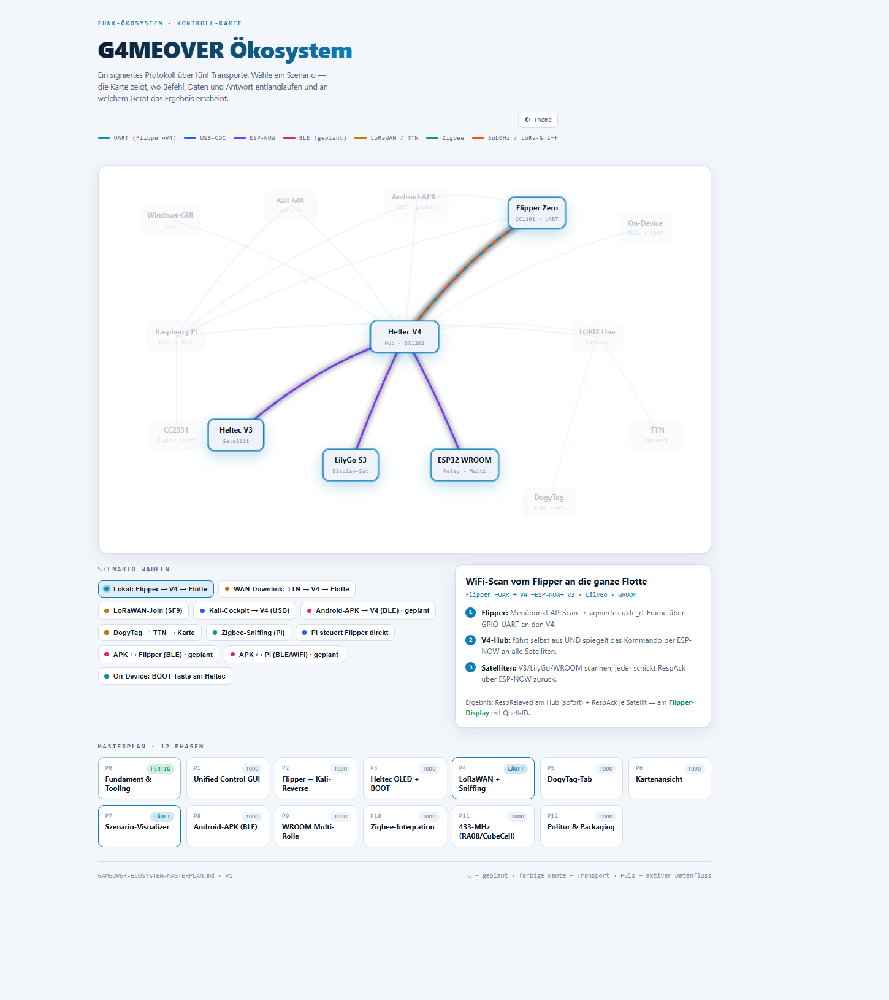
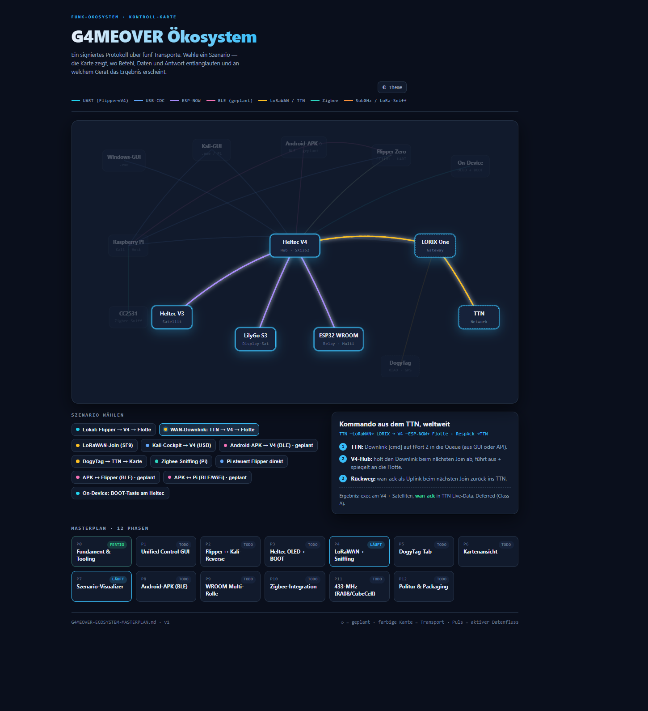

# G4MEOVER Ecosystem

Sammelstelle für die kontinuierliche Weiterentwicklung des **G4MEOVER Flipper-Zero-Pentest-Ökosystems** (Firmware, Apps, Tools).

Die eigentliche Firmware (G4MEOVER-FW v2, Momentum-mntm-012-Fork) und die Hardware-Arbeit bleiben lokal — hier landen **Recherche, Feature-Port-Vorschläge, Ideen und reine Code-Verbesserungen**, die lokal gebaut/geflasht/getestet werden.

## 🛰️ Ökosystem-Visualisierung

Interaktive Kontroll-Karte: alle Geräte, **farbcodierte Transporte** (UART · USB · ESP-NOW · BLE · LoRaWAN · Zigbee · SubGHz) und anklickbare **Szenario-Datenflüsse** — zeigt genau, wo Befehl, Daten und Antwort entlanglaufen und an welchem Gerät das Ergebnis erscheint. Vollständiger Ausbauplan (12 Phasen, TODO, Auto-Fortsetzung): **[`G4MEOVER-ECOSYSTEM-MASTERPLAN.md`](G4MEOVER-ECOSYSTEM-MASTERPLAN.md)**.

| Szenario „Lokal" — Flipper → V4 → Flotte | Szenario „WAN-Downlink" — TTN → V4 → Flotte |
|:---:|:---:|
|  |  |

---

## Struktur
- **[`FLEET-COMMANDS.md`](FLEET-COMMANDS.md)** — Befehls- & Fähigkeits-Matrix: jeder `ukfe_rf`-Befehl × Gerät × Status.
- **[`UKFE-RF-V2-SPEC.md`](UKFE-RF-V2-SPEC.md)** — `ukfe_rf`-v2-Entwurf (BLE-Transport, Ergebnis-Envelope mit Quell-ID, neue Commands).
- **[`UKFE-RF-CODEC-CROSSCHECK.md`](UKFE-RF-CODEC-CROSSCHECK.md)** — Host-Repro: `ukfe_rf`-v1-Codec (CRC16/keyed-MAC) gegen die reale Firmware verifiziert.
- **[`TEST-PLAN.md`](TEST-PLAN.md)** — Flash-Test-Aufträge für die offenen Firmware-PRs.
- `WORKFLOW.md` — Arbeitsweise & Kontext (vor jeder Sitzung lesen).
- `CONSTRAINTS.md` — **verbindliche** Regeln (Sicherheit, Nichts-Pushen-Listen, Commit-Stil).
- `BACKLOG.md` — offene Aufgaben, priorisiert.
- `firmware-mining/` — Diffs anderer Firmwares vs. mntm-012 + Port-Vorschläge.
- `ideas/` — recherchierte App-/Tool-/File-Ideen, kuratiert.
- `app-improvements/` — Code-Verbesserungen für eigene Apps (als Patches/PRs).
- `reports/` — Arbeits-Logs (was geprüft, was geliefert, was offen).

---

## Ökosystem-Karte — alle Repos, gruppiert (Index)
*Dach-Übersicht des konvergierten G4MEOVER-Ökosystems. Einzel-Repos bleiben eigenständig; hier ist die Karte.*

### 🎛️ Flipper Zero — Master-Controller
- [`lora-ukfe`](https://github.com/G4MEOVER18/lora-ukfe) — USB Army Penetrator App: hierarchisches Katalog-Menü, steuert den Heltec-Hub über GPIO-UART
- [`G4MEOVER-FW`](https://github.com/G4MEOVER18/G4MEOVER-FW) — Flipper-Firmware (Momentum-mntm-012-Fork)
- [`RollForge`](https://github.com/G4MEOVER18/RollForge) · [`RollJam`](https://github.com/G4MEOVER18/RollJam) · [`RollLab`](https://github.com/G4MEOVER18/RollLab) · [`ProtoPirate`](https://github.com/G4MEOVER18/ProtoPirate) · [`FlipperJammer`](https://github.com/G4MEOVER18/FlipperJammer) — SubGHz-Power-Apps
- [`usb-army-penetrator`](https://github.com/G4MEOVER18/usb-army-penetrator) — USB Army Knife Fork

### 📡 ESP32 — Hub & Satelliten
- [`heltec-v4-hub`](https://github.com/G4MEOVER18/heltec-v4-hub) — **Heltec V4 Flipper-Hub** (UART→ESP-NOW, LoRa-Terminal, GPS, interaktives Menü) — das „Masterpiece"
- [`heltec-ukfe-rx`](https://github.com/G4MEOVER18/heltec-ukfe-rx) — Heltec V3 (868-FSK + ESP-NOW)
- [`lilygo-ukfe-rx`](https://github.com/G4MEOVER18/lilygo-ukfe-rx) — LilyGo T-Dongle S3 (ESP-NOW + USB-HID + TFT)
- [`g4meover-wifi-relay`](https://github.com/G4MEOVER18/g4meover-wifi-relay) — ESP32-WROOM ESP-NOW-Koordinator

### 🧠 Deck & Koordination
- [`g4meover-deck`](https://github.com/G4MEOVER18/g4meover-deck) — Raspberry-Pi-4-Ökosystem-OS (Gehirn) + **[ROADMAP.md](https://github.com/G4MEOVER18/g4meover-deck/blob/main/ROADMAP.md)** (Master-Handoff)
- [`g4meover-companion`](https://github.com/G4MEOVER18/g4meover-companion) — flipperbridge & Deck-Tools
- [`g4meover-payloads`](https://github.com/G4MEOVER18/g4meover-payloads) — Payloads
- `g4meover-ecosystem` — **dieses Repo** (Planung/Koordination/Index)

### 🛡️ Pentest-Tools
[`g4meover-pentest-cockpit`](https://github.com/G4MEOVER18/g4meover-pentest-cockpit) · [`g4meover-security-suite`](https://github.com/G4MEOVER18/g4meover-security-suite) · hashpwn · netmap · xss-hunter · sqli-hunter · jwt-pwn · cors-scanner · http-header-auditor · subdomain-takeover-scanner · web-recon-toolkit

**Ein Vokabular:** Alle Geräte sprechen dasselbe signierte `ukfe_rf`-Protokoll über 868-FSK / ESP-NOW / UART.
Filterbar über GitHub-Topics: `g4meover-ecosystem`, `flipper-zero`, `esp32`, `lora`, `pentesting`.
